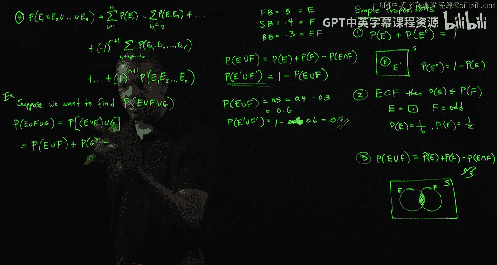

#  015：简单命题分析 📊

在本节课中，我们将学习概率论中的四个基本命题。这些命题是理解更复杂概率概念的基础，我们将通过直观的解释和具体的例子来掌握它们。

---

## 命题一：事件与其补事件的概率之和为1

上一节我们介绍了概率的基本概念，本节中我们来看看第一个简单命题。该命题指出，任何一个事件发生的概率与其不发生的概率之和总是等于1。

用公式表示如下：
**P(E) + P(E') = 1**

其中，`E'` 表示事件 `E` 的补事件（即 `E` 不发生）。由此可以推导出：
**P(E') = 1 - P(E)**

这个结论非常直观。例如，抛一枚硬币，正面朝上的概率是0.5，那么正面不朝上（即反面朝上）的概率就是 `1 - 0.5 = 0.5`。

---

## 命题二：子事件的概率

理解了事件与其补事件的关系后，我们来看第二个命题。该命题涉及事件的包含关系。

如果事件 `E` 是事件 `F` 的子集（即 `E` 发生必然导致 `F` 发生），那么事件 `E` 的概率小于或等于事件 `F` 的概率。

用公式表示如下：
**如果 E ⊆ F，则 P(E) ≤ P(F)**

例如，掷一个骰子：
*   令事件 `E` 为“点数为1”。
*   令事件 `F` 为“点数为奇数”。
显然，`E` 是 `F` 的子集。`P(E) = 1/6`，而 `P(F) = 1/2`，满足 `1/6 ≤ 1/2`。

---

## 命题三：两个事件的并集概率（容斥原理）

上一节我们讨论了事件的包含关系，本节中我们来看看如何处理两个事件至少有一个发生的情况。这是概率论中一个极其重要的公式，称为**容斥原理**。

对于任意两个事件 `E` 和 `F`，它们至少有一个发生的概率（即并集的概率）等于各自概率之和减去它们同时发生的概率（即交集的概率）。

用公式表示如下：
**P(E ∪ F) = P(E) + P(F) - P(E ∩ F)**

这个公式的核心在于减去重叠部分 `P(E ∩ F)`。如果 `E` 和 `F` 互斥（不可能同时发生），则 `P(E ∩ F) = 0`，公式简化为 `P(E) + P(F)`。

### 应用示例

以下是应用该命题解决实际问题的一个例子：

> 杰伊在假期带了两本书。她喜欢第一本书的概率是0.5，喜欢第二本书的概率是0.4，同时喜欢两本书的概率是0.3。请问她**不喜欢任何一本书**的概率是多少？

**解题步骤：**
1.  定义事件：设 `E` 为“喜欢第一本书”，`F` 为“喜欢第二本书”。已知 `P(E)=0.5`, `P(F)=0.4`, `P(E ∩ F)=0.3`。
2.  计算她喜欢至少一本书的概率：`P(E ∪ F) = 0.5 + 0.4 - 0.3 = 0.6`。
3.  “不喜欢任何一本书”是“喜欢至少一本书”的补事件。根据命题一：
    `P(不喜欢任何书) = P((E ∪ F)') = 1 - P(E ∪ F) = 1 - 0.6 = 0.4`。

因此，杰伊不喜欢任何一本书的概率是 **0.4**。

---

## 命题四：多个事件的并集概率（广义容斥原理）

最后，我们将命题三推广到多个事件的情况。这是容斥原理的一般形式。

对于 `n` 个事件 `E₁, E₂, ..., Eₙ`，它们至少有一个发生的概率由以下公式给出：

**P(E₁ ∪ E₂ ∪ ... ∪ Eₙ) = Σ P(Eᵢ) - Σ P(Eᵢ ∩ Eⱼ) + Σ P(Eᵢ ∩ Eⱼ ∩ Eₖ) - ... + (-1)^(n+1) P(E₁ ∩ E₂ ∩ ... ∩ Eₙ)**

其中，第一个求和是对所有单个事件，第二个求和是对所有两两组合，第三个求和是对所有三三组合，依此类推，符号正负交替。

### 三个事件的情况

为了理解这个一般公式，我们来看 `n=3` 的特例，即三个事件 `E, F, G` 的并集概率：

**P(E ∪ F ∪ G) = P(E) + P(F) + P(G) - P(E∩F) - P(E∩G) - P(F∩G) + P(E∩F∩G)**

这个公式可以通过反复应用命题三（两个事件的容斥原理）推导出来。它先加所有单个事件的概率，再减去所有两两相交的概率，最后加上三个事件同时发生的概率，以修正之前被重复减去的部分。

---

## 总结 📝

本节课中我们一起学习了概率论的四个基础命题：
1.  **互补性**：`P(E) + P(E') = 1`。
2.  **单调性**：如果 `E ⊆ F`，则 `P(E) ≤ P(F)`。
3.  **两个事件的容斥原理**：`P(E ∪ F) = P(E) + P(F) - P(E ∩ F)`。这是计算事件并集概率的核心工具。
4.  **多个事件的广义容斥原理**：提供了计算任意多个事件并集概率的通用公式，是命题三的推广。

掌握这些命题是进行更复杂概率分析和推理的基石。