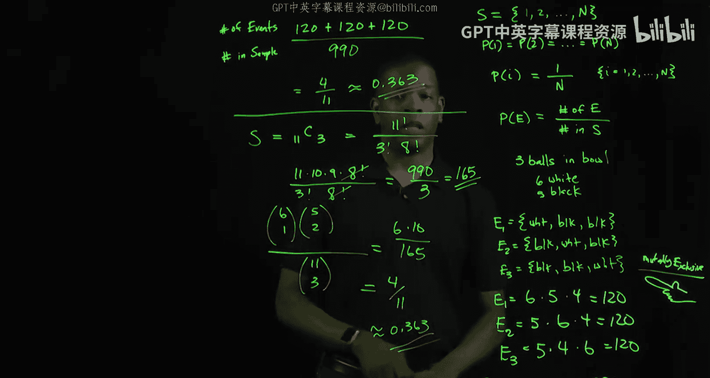
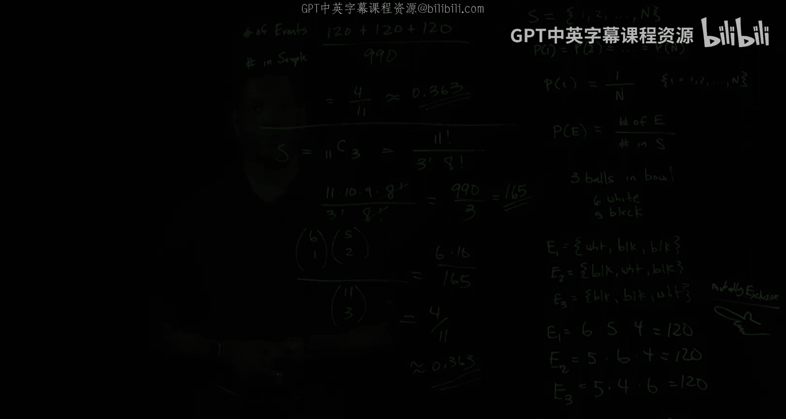

#  016：等可能结果场景 🎲

在本节课中，我们将学习当样本空间中所有结果出现的可能性都相等时，如何计算事件的概率。这是本模块的最后一讲，我们将综合运用之前学到的知识。

## 概述

当样本空间 **S** 是一个有限集，并且其中每个结果发生的可能性都相等时，概率的计算会变得非常直接。本节将介绍其核心公式，并通过具体例子展示其应用。

## 等可能结果的定义

首先，我们定义等可能结果场景。设样本空间 **S** 是一个有限集：

**S = {1, 2, 3, ..., n}**

如果其中每个结果发生的概率都相等，那么对于任意结果 **i**，其概率为：

**P({i}) = 1 / n**

其中，**i = 1, 2, ..., n**。

基于此，对于任意事件 **E**（即 **S** 的一个子集），其概率可以计算为事件 **E** 包含的结果数量与样本空间 **S** 总结果数量之比：

**P(E) = |E| / |S|**

这里，**|E|** 表示事件 **E** 包含的结果数，**|S|** 表示样本空间 **S** 的总结果数。

## 实例分析：从碗中取球

为了深入理解这个概念，我们来看一个具体的例子。

假设一个碗中有 **6个白球** 和 **5个黑球**，总共11个球。我们随机从中抽取3个球。我们想知道事件 **E** 的概率：抽到的3个球中，恰好有 **1个白球** 和 **2个黑球**。

我们将用两种方法来计算这个概率：第一种考虑抽取的顺序，第二种不考虑顺序。你会发现，在等可能结果的假设下，两种方法会得到相同的答案。

### 方法一：考虑顺序（排列）

在这种方法中，我们认为抽取 `白，黑，黑` 和抽取 `黑，白，黑` 是不同的结果。

首先，我们需要计算样本空间 **S** 的大小。从11个球中依次抽取3个球，考虑顺序，总共有多少种可能？

第一次抽取有11种选择，第二次有10种，第三次有9种。因此：

**|S| = 11 × 10 × 9 = 990**

接下来，我们计算事件 **E**（恰好1白2黑）包含的结果数。事件 **E** 可以通过以下三种互斥的排列模式发生：
1.  第一个是白球，后两个是黑球。
2.  第二个是白球，第一个和第三个是黑球。
3.  第三个是白球，前两个是黑球。

由于这些模式是互斥的，事件 **E** 的总结果数是这三种模式结果数的和。

以下是每种模式的结果数计算：
*   **模式1 (白, 黑, 黑)**： 6 × 5 × 4 = 120
*   **模式2 (黑, 白, 黑)**： 5 × 6 × 4 = 120
*   **模式3 (黑, 黑, 白)**： 5 × 4 × 6 = 120

因此，事件 **E** 的总结果数为：

**|E| = 120 + 120 + 120 = 360**

现在，我们可以计算概率：

**P(E) = |E| / |S| = 360 / 990 = 4 / 11 ≈ 0.363**

### 方法二：不考虑顺序（组合）

现在，我们假设球的抽取顺序不重要，即我们只关心最终手里是哪三个球，而不关心它们被抽出的先后顺序。

在这种情况下，样本空间 **S** 的大小是从11个球中任意选出3个球的组合数：

**|S| = C(11, 3) = 11! / (3! × 8!) = (11 × 10 × 9) / (3 × 2 × 1) = 165**

对于事件 **E**（恰好1白2黑），我们需要从6个白球中选1个，同时从5个黑球中选2个。其组合数为：

**|E| = C(6, 1) × C(5, 2) = 6 × 10 = 60**

因此，概率为：

**P(E) = |E| / |S| = 60 / 165 = 4 / 11 ≈ 0.363**

## 两种方法的比较与总结

正如计算结果所示，无论我们是否考虑抽取的顺序，最终得到的概率都是 **4/11** 或约 **0.363**。

这个例子说明了等可能结果概率计算的核心要点：**当样本空间中每个基本结果发生的可能性相同时，计算事件概率的关键在于正确地计数**。你可以根据问题的具体情况和便利性，选择使用排列（考虑顺序）或组合（不考虑顺序）的方法来计数，只要应用得当，它们会导向相同的正确答案。

## 本节总结

本节课我们一起学习了等可能结果场景下的概率计算。
*   我们首先定义了等可能结果，并给出了核心公式 **P(E) = |E| / |S|**。
*   然后，我们通过一个从碗中取球的经典例子，演示了如何应用这个公式。
*   我们分别使用考虑顺序的排列方法和不考虑顺序的组合方法进行了计算，并验证了它们结果的一致性。
*   最后我们指出，在等可能前提下，概率计算的本质是计数问题，可以根据问题灵活选择计数工具。

掌握这一基础而强大的方法，是理解更复杂概率模型的重要一步。