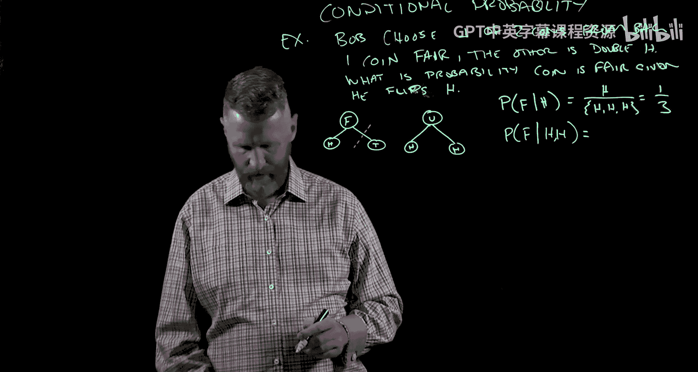
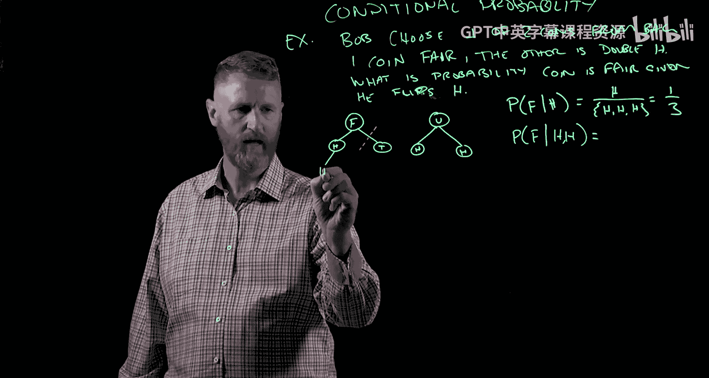
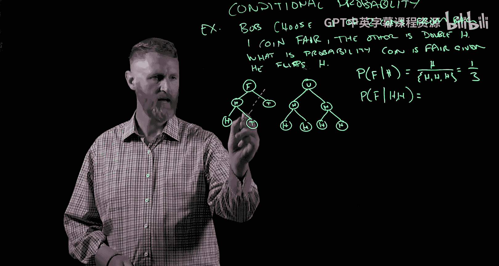
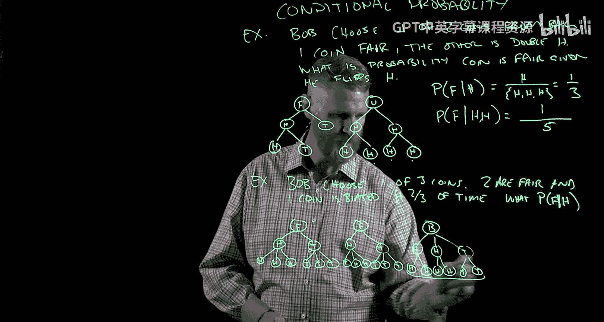
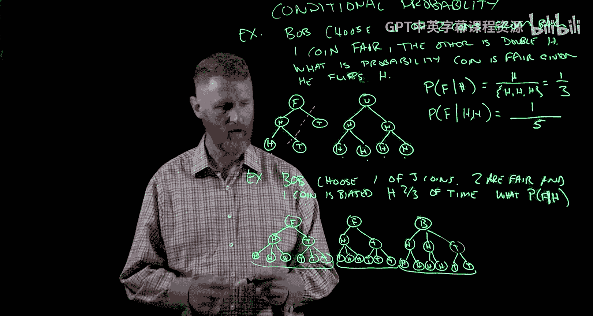
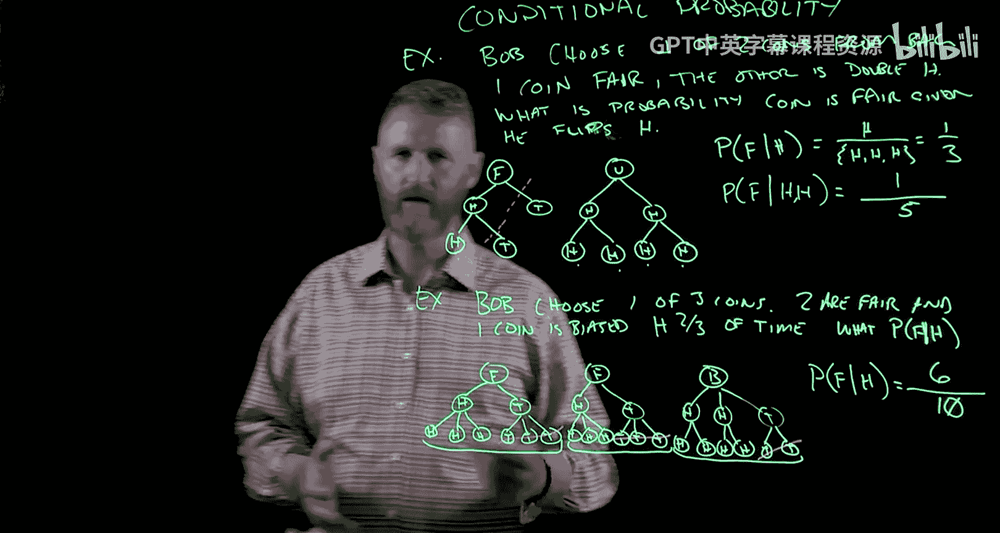

#  019：条件概率理论 🎲

在本节课中，我们将要学习**条件概率**。条件概率是概率论中的一个核心概念，它描述了在已知某个事件发生的情况下，另一个事件发生的概率。我们将通过几个抛硬币的例子，直观地理解如何计算条件概率。

---

## 示例一：两枚硬币的选择

假设鲍勃从一个袋子中选择一枚硬币。袋子里有两枚硬币：一枚是**公平硬币**，另一枚是**两面都是正面的硬币**。

公平硬币意味着出现正面或反面的概率各为50%。两面都是正面的硬币则意味着抛掷结果永远是正面。

我们的问题是：**在鲍勃抛掷一次硬币并观察到正面的条件下，他选到公平硬币的概率是多少？**

为了解答这个问题，我们使用一种强大的工具——**概率树**来分析所有可能的结果。

以下是构建概率树的步骤：
1.  首先，鲍勃有两种选择：公平硬币或两面都是正面的硬币。
2.  如果选择公平硬币，抛掷结果可能是正面或反面。
3.  如果选择两面都是正面的硬币，抛掷结果只能是正面。

现在，我们已知观察到的结果是正面。因此，所有导致反面的分支（即公平硬币抛掷出反面的情况）都不在我们的考虑范围内。

在剩余的样本空间中，总共有三种可能得到正面：
1.  选择公平硬币并抛出正面。
2.  选择两面都是正面的硬币并抛出正面（第一种情况）。
3.  选择两面都是正面的硬币并抛出正面（第二种情况，虽然结果相同，但在计数上视为不同的可能性路径）。

在这三种可能中，只有第一种情况（选择公平硬币并抛出正面）符合“选到公平硬币”的条件。

因此，概率计算如下：
`P(公平硬币 | 观察到正面) = 1 / 3`

---

## 示例延伸：观察到两次正面

上一节我们介绍了在观察到一次正面的情况下计算条件概率。本节中我们来看看，如果鲍勃抛掷**两次**硬币并都观察到正面，那么他选到公平硬币的概率是多少。

我们继续扩展概率树：
1.  如果第一次抛掷公平硬币得到正面，第二次抛掷可能是正面或反面。
2.  如果第一次抛掷两面都是正面的硬币得到正面，第二次抛掷仍然是正面。

现在，我们已知观察到的结果是**两次正面**。因此，所有包含反面的分支（例如，公平硬币在第二次抛掷出现反面）都不在考虑范围内。

在剩余的样本空间中，总共有五种可能得到两次正面：
1.  选择公平硬币，第一次正面，第二次正面。
2.  选择两面都是正面的硬币，第一次正面，第二次正面（情况A）。
3.  选择两面都是正面的硬币，第一次正面，第二次正面（情况B）。
4.  选择两面都是正面的硬币，第一次正面，第二次正面（情况C）。
5.  选择两面都是正面的硬币，第一次正面，第二次正面（情况D）。

在这五种可能中，只有第一种情况符合“选到公平硬币”的条件。

因此，概率计算如下：
`P(公平硬币 | 观察到两次正面) = 1 / 5`

---

## 示例二：三枚硬币与有偏硬币

现在让我们看一个更复杂的例子。假设鲍勃从三枚硬币中选择一枚：其中两枚是**公平硬币**，一枚是**有偏硬币**。

这枚有偏硬币被设计为抛出正面的概率是 `2/3`，抛出反面的概率是 `1/3`。

我们的问题是：**在鲍勃抛掷一次硬币并观察到正面的条件下，他选到公平硬币的概率是多少？**

我们再次使用概率树。但这里有一个关键点：公平硬币的结果（正/反）概率相等，而有偏硬币的结果概率不相等。为了在同一个样本空间中公平地比较和计数，我们需要找到一个**共同的分母**。

公平硬币有两种等可能结果，有偏硬币有三种可能结果（但概率权重不同）。为了平衡，我们将每个结果“拆分”以确保每条路径的权重一致。最小公倍数是6。
*   对于公平硬币：我们将“正面”拆分为3条等价的路径，将“反面”也拆分为3条等价的路径。
*   对于有偏硬币：根据其 `2/3` 对 `1/3` 的概率，我们将“正面”拆分为2条路径，将“反面”拆分为1条路径。

经过这样的调整，每枚硬币在树状图中都对应6条等可能的基本结果路径。

现在，我们已知观察到的结果是正面。因此，所有导致反面的分支都不在考虑范围内。

在剩余的样本空间中，总共有10条可能得到正面的路径：
*   来自第一枚公平硬币：3条路径。
*   来自第二枚公平硬币：3条路径。
*   来自有偏硬币：2条路径。

在这10条路径中，有6条（来自两枚公平硬币）符合“选到公平硬币”的条件。

因此，概率计算如下：
`P(公平硬币 | 观察到正面) = 6 / 10 = 3 / 5`

---

## 总结

本节课中我们一起学习了**条件概率**的计算方法。我们通过构建**概率树**来枚举所有可能的结果，并在已知某个事件（条件）发生的情况下，通过**计数**满足条件的结果总数以及其中符合目标事件的结果数，来求得条件概率。

核心步骤可以总结为：
1.  列出所有可能的结果（样本空间）。
2.  根据已知条件，排除不满足条件的结果。
3.  在剩余的结果中，计数满足目标事件的结果数量。
4.  计算概率：`P(目标事件 | 已知条件) = (满足条件且满足目标的结果数) / (满足条件的结果总数)`。

这种方法直观且强大，是理解更复杂概率问题的基础。