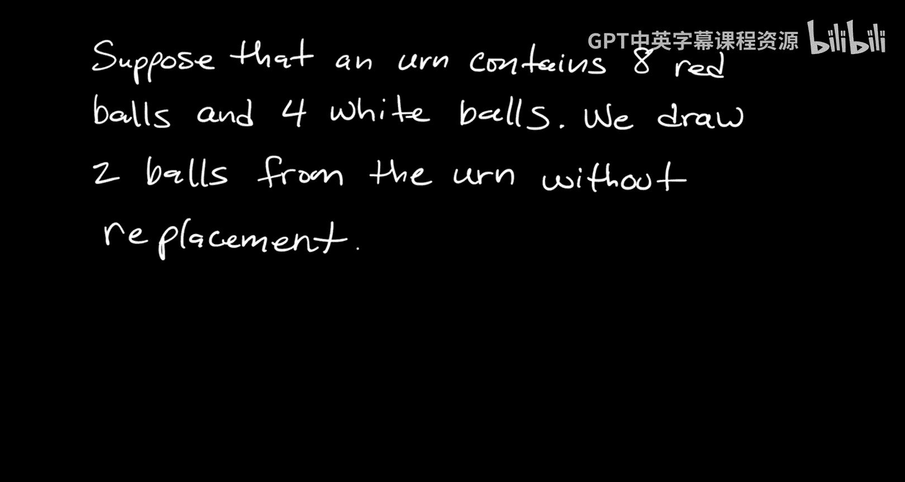
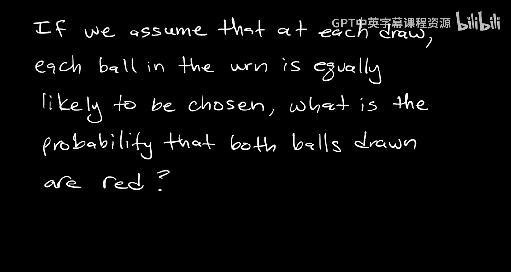
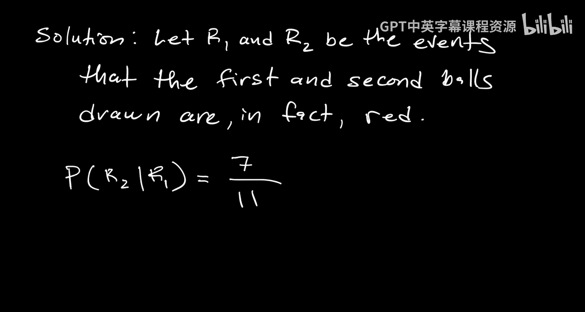
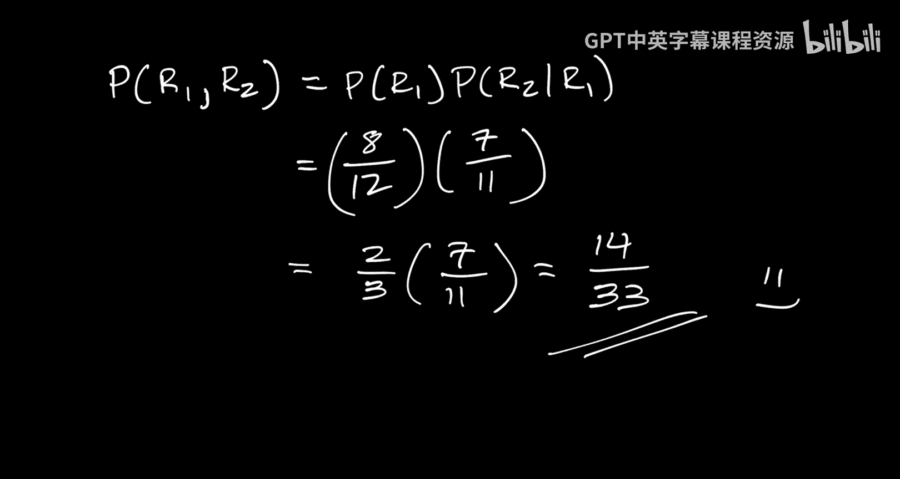

#  021：瓮中红球抽取实验 🎱

在本节课中，我们将通过一个具体的例子来学习**条件概率**的计算。这个例子涉及从一个瓮中不放回地抽取两个球，并计算两个球都是红色的概率。

---

## 实验设定

首先，我们来明确实验的设定。假设我们有一个瓮，里面装有8个红球和4个白球。实验内容是：**不放回地**从瓮中连续抽取两个球。这意味着，我们抽出一个球后，不会将其放回瓮中，然后再抽取第二个球。

我们假设在每次抽取时，瓮中**每个球被选中的可能性是相等的**。我们的目标是计算：**连续抽出的两个球都是红球的概率**。

---

## 定义事件

为了清晰地分析问题，我们首先定义两个事件：
*   设事件 **R₁** 为“第一次抽出的球是红球”。
*   设事件 **R₂** 为“第二次抽出的球是红球”。

因此，我们要求解的概率是 **P(R₁ ∩ R₂)**，即事件 R₁ 和 R₂ 同时发生的概率。

---

## 计算条件概率

上一节我们定义了事件，本节中我们来看看如何计算关键的条件概率。根据乘法法则，我们有：
**P(R₁ ∩ R₂) = P(R₁) × P(R₂ | R₁)**

其中，**P(R₂ | R₁)** 表示在“第一次抽到红球”的条件下，“第二次也抽到红球”的概率。这是我们需要计算的核心条件概率。

以下是计算 **P(R₂ | R₁)** 的推理过程：
1.  在第一次抽球前，瓮中共有 12 个球（8红 + 4白）。
2.  如果第一次抽到了红球（事件 R₁ 发生），那么抽完后，瓮中还剩下 11 个球。
3.  由于第一次抽走了一个红球，剩下的 11 个球中，红球数量变为 7 个，白球仍为 4 个。
4.  在第二次抽取时，每个球被抽中的可能性依然相等。因此，在 R₁ 发生的条件下，第二次抽到红球的概率就是剩余红球数除以总球数。

所以，条件概率的计算公式为：
**P(R₂ | R₁) = 7 / 11**

---

## 求解最终概率

现在我们已经得到了条件概率，可以将其代入乘法公式来求解最终答案。

我们知道：
*   **P(R₁)**：第一次抽到红球的概率。初始时，12个球中有8个红球，所以 **P(R₁) = 8 / 12 = 2 / 3**。
*   **P(R₂ | R₁)**：在第一次抽到红球的条件下，第二次抽到红球的概率，我们已计算出为 **7 / 11**。

将这两个概率相乘，即可得到两个球都是红球的概率：
**P(R₁ ∩ R₂) = P(R₁) × P(R₂ | R₁) = (2/3) × (7/11) = 14/33**

因此，**连续两次不放回地抽到红球的概率是 14/33**。

---

## 总结

本节课中，我们一起学习了如何应用条件概率和乘法法则解决一个经典的不放回抽样问题。我们首先定义了事件，然后计算了在第一次抽球结果已知的条件下，第二次抽球的概率，最后通过乘法得到了联合概率。这个例子清晰地展示了条件概率在序贯实验中的重要作用。