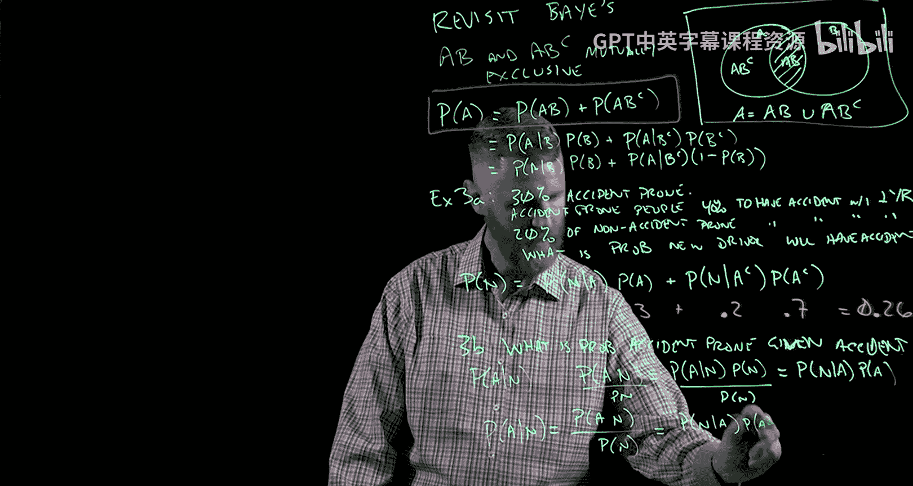
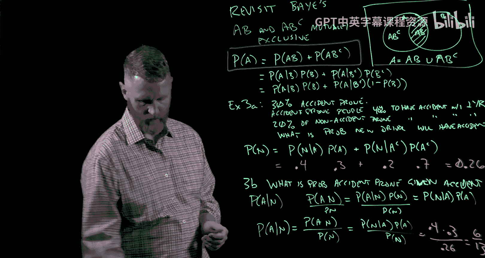

#  022：贝叶斯定理再探讨 🔄

在本节课中，我们将重新审视贝叶斯定理。我们将通过一个具体的例子，深入理解如何运用贝叶斯定理解决涉及条件概率的问题，并推导出计算事件总概率的通用公式。

## 样本空间与事件分解

为了更直观地理解，我们首先考虑一个样本空间。假设我们有两个事件：事件 **A** 和事件 **B**。

如上图所示，整个矩形代表样本空间。圆圈 **A** 和 **B** 分别代表两个事件。它们的交集区域记为 **A ∩ B**。事件 **A** 可以分解为两个互斥的部分：
*   在 **B** 内的部分：**A ∩ B**
*   不在 **B** 内的部分：**A ∩ Bᶜ** （其中 **Bᶜ** 是 **B** 的补集）

由于 **A ∩ B** 和 **A ∩ Bᶜ** 没有重叠，它们是互斥的。因此，事件 **A** 的概率可以表示为这两个互斥部分概率之和：

**P(A) = P(A ∩ B) + P(A ∩ Bᶜ)**

## 应用贝叶斯定理展开

上一节我们将事件 **A** 分解成了两个部分。现在，我们可以利用贝叶斯定理（条件概率公式）对每一部分进行展开。

根据贝叶斯定理，我们有：
*   **P(A ∩ B) = P(A | B) * P(B)**
*   **P(A ∩ Bᶜ) = P(A | Bᶜ) * P(Bᶜ)**

将这两个等式代入 **P(A)** 的公式中，我们得到一个非常重要的全概率公式：

**P(A) = P(A | B) * P(B) + P(A | Bᶜ) * P(Bᶜ)**

由于 **P(Bᶜ) = 1 - P(B)**，这个公式也可以写成：

**P(A) = P(A | B) * P(B) + P(A | Bᶜ) * (1 - P(B))**

这个公式是解决许多概率问题的核心工具，它允许我们通过考虑不同条件（这里是 **B** 和 **Bᶜ**）下的概率来求一个事件的总概率。

## 实例解析：事故概率计算

让我们通过一个具体问题来应用上述公式。以下是问题描述：
*   30% 的人是易出事故的。
*   易出事故的人，在一年内发生事故的概率是 40%。
*   不易出事故的人，在一年内发生事故的概率是 20%。

**问题（3a）：一个新司机在一年内发生事故的概率是多少？**

我们定义事件：
*   **A**：司机在一年内发生事故。
*   **P**：司机是易出事故的。

根据全概率公式，新司机发生事故的概率为：

**P(A) = P(A | P) * P(P) + P(A | Pᶜ) * P(Pᶜ)**

现在，我们将题目给出的数值代入公式：
*   **P(A | P)** = 0.40 （已知易出事故者的事故概率）
*   **P(P)** = 0.30 （易出事故者的比例）
*   **P(A | Pᶜ)** = 0.20 （不易出事故者的事故概率）
*   **P(Pᶜ)** = 1 - 0.30 = 0.70 （不易出事故者的比例）

计算过程如下：
**P(A) = (0.40 * 0.30) + (0.20 * 0.70) = 0.12 + 0.14 = 0.26**

因此，一个新司机在一年内发生事故的概率是 **0.26** 或 **26%**。

## 逆向推理：应用贝叶斯公式

在解决了直接概率问题后，我们来看一个逆向问题。这需要直接使用贝叶斯定理的标准形式。

**问题（3b）：如果一个新司机在一年内发生了事故，那么他是易出事故的人的概率是多少？**

现在我们要求的是条件概率 **P(P | A)**，即在已知发生事故（A）的条件下，司机是易出事故者（P）的概率。

根据贝叶斯定理：

**P(P | A) = P(A | P) * P(P) / P(A)**

我们已经从题目和上一问的计算中知道了所有需要的值：
*   **P(A | P)** = 0.40
*   **P(P)** = 0.30
*   **P(A)** = 0.26 （从3a得出）

代入公式计算：
**P(P | A) = (0.40 * 0.30) / 0.26 = 0.12 / 0.26 ≈ 0.4615**

所以，如果一个新司机发生了事故，那么他属于易出事故人群的概率大约是 **46.15%**。

## 总结

本节课我们一起深入探讨了贝叶斯定理的应用。
1.  我们首先通过文氏图理解了事件如何被分解为互斥的部分。
2.  接着，我们推导并掌握了计算事件总概率的关键公式：**P(A) = P(A|B)P(B) + P(A|Bᶜ)P(Bᶜ)**。
3.  然后，我们运用这个公式解决了一个实际问题，计算了新司机的事故概率。
4.  最后，我们使用贝叶斯定理的标准形式 **P(B|A) = P(A|B)P(B)/P(A)** 解决了一个逆向概率问题，即在已知结果的情况下推断原因的可能性。

通过这两个例子，我们可以看到贝叶斯定理如何将复杂的条件概率问题分解为已知或更易计算的组成部分，是统计学中一个极其强大的推理工具。