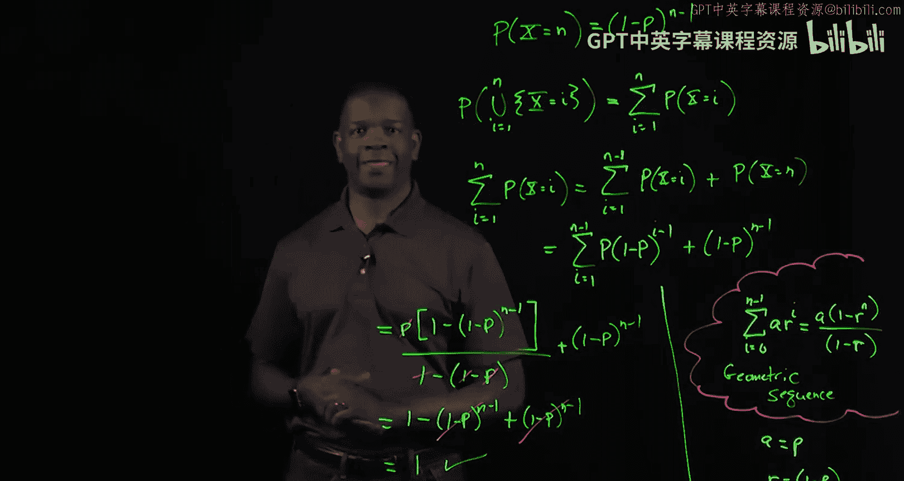

#  029：硬币抛掷证明过程 🪙

在本节课中，我们将学习如何验证一个离散随机变量的概率质量函数是否正确。我们将通过一个具体的例子——抛掷硬币直到出现正面——来演示如何证明所有可能结果的概率之和等于1，这是概率函数必须满足的基本条件。

上一节我们介绍了抛掷硬币直到出现正面这个实验，并推导了随机变量 **X**（表示首次出现正面所需的抛掷次数）的概率公式。本节中我们来看看如何验证这个公式的正确性。

我们之前计算得出，随机变量 **X** 等于 **n** 的概率为：
**P(X = n) = p * (1-p)^{n-1}**

其中，**p** 是单次抛掷出现正面的概率，**n** 是抛掷次数。

验证这个公式是否正确的唯一方法是，证明所有可能结果（即 **n** 从1到无穷大）的概率之和等于1。如果总和不为1，那么这个公式就是不正确的。

为了进行验证，我们首先需要理解一个关键概念：所有可能事件的并集的概率。对于我们的随机变量 **X**，所有可能事件的并集就是 **X** 取遍所有可能值的事件。

以下是计算概率之和的步骤：

1.  首先，我们写出所有可能事件的并集及其概率。事件“**X** 取某个值”是互斥的（即不可能同时发生），因此并集的概率等于各个事件概率之和。
    **P(⋃_{i=1}^{n} {X = i}) = Σ_{i=1}^{n} P(X = i)**

2.  接下来，我们将之前推导的概率公式代入求和式中。为了便于计算，我们将求和上限设为 **n-1**，然后单独加上第 **n** 项。
    **Σ_{i=1}^{n} P(X = i) = Σ_{i=1}^{n-1} [p * (1-p)^{i-1}] + (1-p)^{n-1}**

3.  现在，我们需要计算这个求和式。我们注意到求和部分 **Σ_{i=1}^{n-1} [p * (1-p)^{i-1}]** 是一个几何级数（等比数列）。回忆几何级数的求和公式：
    **Σ_{i=0}^{m-1} a * r^{i} = a * (1 - r^{m}) / (1 - r)**

4.  为了应用这个公式，我们需要调整我们的求和式。令 **a = p**， **r = (1-p)**， 并且注意到我们的求和下标是从 **i=1** 开始，而公式是从 **i=0** 开始。我们可以通过变量替换来适配公式。最终，应用几何级数求和公式，我们得到：
    **Σ_{i=1}^{n-1} [p * (1-p)^{i-1}] = p * [1 - (1-p)^{n-1}] / [1 - (1-p)]**

5.  对上式进行化简。分母 **1 - (1-p)** 等于 **p**。分子中的 **p** 与分母的 **p** 相消，得到：
    **1 - (1-p)^{n-1}**

6.  最后，我们将这个结果代回步骤2的总概率公式中：
    **总概率 = [1 - (1-p)^{n-1}] + (1-p)^{n-1} = 1**

通过上述推导，我们证明了对于任意正整数 **n**，所有概率 **P(X = i)** 的和确实等于1。这验证了我们之前推导的概率质量函数 **P(X = n) = p * (1-p)^{n-1}** 是正确的。

本节课中我们一起学习了如何验证离散随机变量概率分布的正确性。我们通过抛掷硬币的实例，应用几何级数求和公式，严谨地证明了所有可能结果的概率之和为1。这个验证过程展示了概率论公理的实际应用，也巩固了我们对随机变量及其概率函数的理解。值得注意的是，在这个具体问题中，概率函数实际上只依赖于出现反面的次数 **(1-p)^{n-1}**，这体现了该分布的特性。