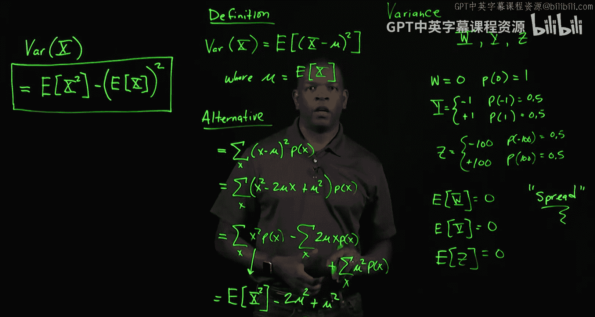

#  032：随机变量的方差 📊

在本节课中，我们将学习随机变量的另一个重要属性——方差。我们将探讨为什么仅靠期望值不足以完全描述一个随机变量，并学习方差的计算方法及其意义。

## 概述

上一节我们介绍了随机变量的期望值，它描述了随机变量的“中心”位置。本节中，我们来看看另一个关键属性——方差，它用于衡量随机变量取值围绕其期望值的“离散”或“扩散”程度。

## 为什么需要方差？

为了理解方差的重要性以及为什么仅靠期望值不够，我们可以看一个简单的例子。

假设有三个随机变量：W、Y 和 Z。它们的概率质量函数如下：

*   **随机变量 W**： 它只能取一个值 0，且概率为 1。即 **P(W=0) = 1**。
*   **随机变量 Y**： 它可以取两个值 -1 和 1，每个值的概率均为 0.5。即 **P(Y=-1) = 0.5**，**P(Y=1) = 0.5**。
*   **随机变量 Z**： 它可以取两个值 -100 和 100，每个值的概率均为 0.5。即 **P(Z=-100) = 0.5**，**P(Z=100) = 0.5**。

现在，计算这三个随机变量的期望值：
*   **E[W] = 0**，因为其取值恒为 0。
*   **E[Y] = (-1)*0.5 + (1)*0.5 = 0**。
*   **E[Z] = (-100)*0.5 + (100)*0.5 = 0**。

可以看到，这三个描述完全不同现象的随机变量，其期望值却都是 0。如果只用期望值来描述它们，我们将无法区分它们之间的差异。显然，我们还需要一个度量来描述这些值围绕中心（期望值）的“扩散”程度。这个度量就是**方差**。

## 方差的定义

方差衡量的是随机变量取值与其期望值之间的平均平方距离。其正式定义如下：

对于一个随机变量 X，其期望值为 **μ = E[X]**，则方差 **Var(X)** 定义为：

**Var(X) = E[ (X - μ)² ]**

这个公式的含义是：计算随机变量 X 的每个可能取值与期望值 μ 的偏差（距离），将其平方（以避免正负抵消），然后对所有可能取值求该平方偏差的加权平均（即期望值）。

## 方差的计算公式（替代形式）

根据期望值的性质，我们可以从上述定义推导出一个更便于计算的替代公式。

我们从定义开始推导：
1.  **Var(X) = E[ (X - μ)² ]**
2.  展开平方项：**= E[ X² - 2μX + μ² ]**
3.  根据期望的线性性质：**= E[X²] - E[2μX] + E[μ²]**
4.  由于 μ 是常数（期望值），可以提到期望符号外：**= E[X²] - 2μE[X] + μ²**
5.  因为 **E[X] = μ**，代入得：**= E[X²] - 2μ² + μ²**
6.  简化后得到最终公式：**Var(X) = E[X²] - (E[X])²**

这个替代公式非常有用：
**方差 = 随机变量平方的期望值 - 期望值的平方**

> **重要提示**：**E[X²]** 和 **(E[X])²** 是两个完全不同的量。前者是先对 X 的每个取值平方，再求平均；后者是先求 X 的平均值，再对这个平均值进行平方。

## 总结

本节课中我们一起学习了随机变量的方差。
*   我们了解到，仅靠期望值（中心位置）无法完全描述随机变量的行为，还需要方差来描述其取值的离散程度（扩散程度）。
*   方差 **Var(X)** 的正式定义是 **E[ (X - μ)² ]**，即随机变量取值与期望值之差的平方的平均值。
*   我们推导出了一个更实用的计算公式：**Var(X) = E[X²] - (E[X])²**。这个公式在解决实际问题时通常更方便。