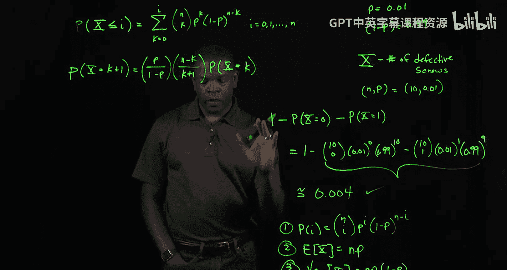

#  033：伯努利随机变量与质量函数 📊


在本节课中，我们将深入学习随机变量，特别是两种在统计学和计算机科学中极为常见的类型：伯努利随机变量和二项随机变量。我们将探讨它们的定义、概率质量函数以及如何在实际问题中应用它们。

---

## 伯努利随机变量

上一节我们介绍了随机变量的基本概念。本节中，我们来看看一种最简单的离散随机变量——伯努利随机变量。

伯努利随机变量描述的是只有两种可能结果的单次试验。通常，我们将这两种结果定义为“成功”和“失败”。

以下是伯努利随机变量的核心定义：
*   **可能取值**：我们将“成功”记为 `1`，“失败”记为 `0`。
*   **概率**：设成功的概率为 `p`，则失败的概率为 `1-p`。
*   **公式**：其概率质量函数可以简洁地表示为：
    ```
    P(X=1) = p
    P(X=0) = 1-p
    ```
    其中，`p` 的取值范围在 `0` 到 `1` 之间。

---

## 二项随机变量

理解了单次试验后，我们自然要扩展到多次独立重复试验的情况，这就引出了二项随机变量。

二项随机变量本质上是一系列独立的伯努利试验的总和。它由两个参数定义：
*   **n**：独立试验的次数。
*   **p**：单次试验中成功的概率。

以下是二项随机变量的核心概念：
*   **概率质量函数**：随机变量 `X`（表示 `n` 次试验中成功的次数）取值为 `i` 的概率由以下公式给出：
    ```
    P(X=i) = C(n, i) * p^i * (1-p)^(n-i)
    ```
    其中，`i = 0, 1, 2, ..., n`，`C(n, i)` 是组合数，表示从 `n` 次试验中选出 `i` 次成功的方式数。
*   **验证**：所有可能取值的概率之和必须为 `1`。利用二项式定理可以证明：
    ```
    Σ P(X=i) = [p + (1-p)]^n = 1^n = 1
    ```
*   **期望与方差**：二项随机变量的期望（均值）和方差有非常简洁的公式：
    ```
    期望 E[X] = n * p
    方差 Var(X) = n * p * (1-p)
    ```

---

## 应用示例：抛硬币

现在，我们通过一个具体例子来看看如何应用二项分布。

**问题**：抛掷一枚均匀硬币5次。设随机变量 `X` 为出现正面的次数，求 `X` 的概率质量函数。

**解答**：
这是一个典型的二项分布问题，参数为 `n=5`，`p=0.5`。
我们需要计算 `X` 从 `0` 到 `5` 每个取值的概率。

以下是具体的计算过程：
1.  **X=0**（全是反面）：
    `P(X=0) = C(5,0) * (0.5)^0 * (0.5)^5 = 1 * 1 * 1/32 = 1/32`
2.  **X=1**（恰好一次正面）：
    `P(X=1) = C(5,1) * (0.5)^1 * (0.5)^4 = 5 * (1/2) * (1/16) = 5/32`
3.  **X=2**：
    `P(X=2) = C(5,2) * (0.5)^2 * (0.5)^3 = 10 * (1/4) * (1/8) = 10/32`
4.  **X=3**：
    `P(X=3) = C(5,3) * (0.5)^3 * (0.5)^2 = 10/32` （由对称性）
5.  **X=4**：
    `P(X=4) = C(5,4) * (0.5)^4 * (0.5)^1 = 5/32`
6.  **X=5**（全是正面）：
    `P(X=5) = C(5,5) * (0.5)^5 * (0.5)^0 = 1/32`

因此，概率质量函数为：`P(X) = [1/32, 5/32, 10/32, 10/32, 5/32, 1/32]`。所有概率之和为 `1`，验证正确。

> **提示**：当 `p=0.5` 时，二项系数 `C(n, i)` 构成了著名的帕斯卡三角形。对于 `n=5`，系数正是 `1, 5, 10, 10, 5, 1`。

---

## 应用示例：产品质量检测

上一个例子中概率是对称的。现在，我们看一个概率不对称的实际情况。

**问题**：某公司生产螺丝，每个螺丝有 `1%` 的概率是次品。每包装有 `10` 个螺丝。公司承诺，若一包中次品数超过 `1` 个则退款。求需要退款的包裹比例。

**解答**：
参数：`n=10`，`p=0.01`。
设随机变量 `X` 为一包中的次品数。我们需要求 `P(X >= 2)`。

更简便的方法是计算其互补事件：
```
P(X >= 2) = 1 - P(X=0) - P(X=1)
```

以下是计算步骤：
1.  **P(X=0)**：
    `P(X=0) = C(10,0) * (0.01)^0 * (0.99)^10 ≈ 0.9044`
2.  **P(X=1)**：
    `P(X=1) = C(10,1) * (0.01)^1 * (0.99)^9 ≈ 0.0914`
3.  **最终结果**：
    `P(X >= 2) = 1 - 0.9044 - 0.0914 ≈ 0.0043`

因此，大约只有 `0.43%` 的包裹需要退款，这是一个很低的比率。

---

## 计算二项概率的递推方法

当 `p ≠ 0.5` 时，我们可以使用递推关系高效地计算一系列二项概率，而无需逐个计算组合数。

已知 `P(X=k)`，可以通过以下公式计算 `P(X=k+1)`：
```
P(X=k+1) = [ p/(1-p) ] * [ (n-k)/(k+1) ] * P(X=k)
```



**示例**：设 `n=6`，`p=0.4`，且已知 `P(X=0) = (0.6)^6 ≈ 0.0467`。
1.  计算 `P(X=1)`：
    `P(X=1) = (0.4/0.6) * (6/1) * P(X=0) = (2/3)*6*0.0467 ≈ 0.1866`
2.  计算 `P(X=2)`：
    `P(X=2) = (0.4/0.6) * (5/2) * P(X=1) = (2/3)*2.5*0.1866 ≈ 0.3110`
    ... 以此类推，直至计算出所有 `P(X=k)`。

这种方法在编写程序或手动计算一系列概率时非常高效。

---

## 总结

本节课中我们一起学习了离散随机变量中两个最重要的类型。
*   我们首先定义了**伯努利随机变量**，它描述单次二元试验。
*   然后我们将其扩展为**二项随机变量**，它描述了 `n` 次独立伯努利试验中成功的总次数。我们学习了它的概率质量函数、期望和方差公式。
*   我们通过“抛硬币”和“产品质量检测”两个例子，实践了如何应用二项分布解决实际问题。
*   最后，我们介绍了一种利用递推关系高效计算二项概率的方法，特别是在 `p` 不等于 `0.5` 的情况下。


掌握二项分布是理解许多统计推断和机器学习算法的基础。接下来，我们将继续学习其他重要的离散分布，如泊松分布。