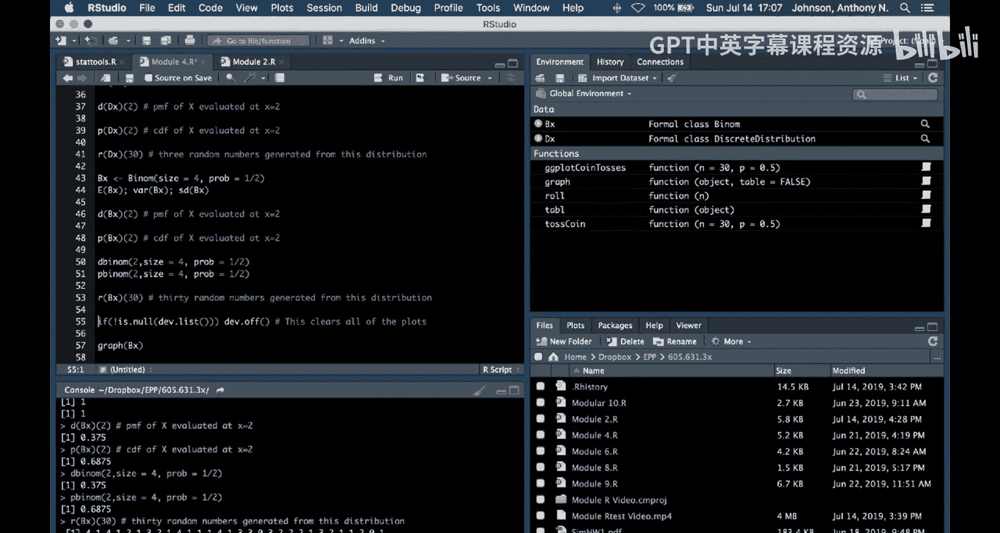
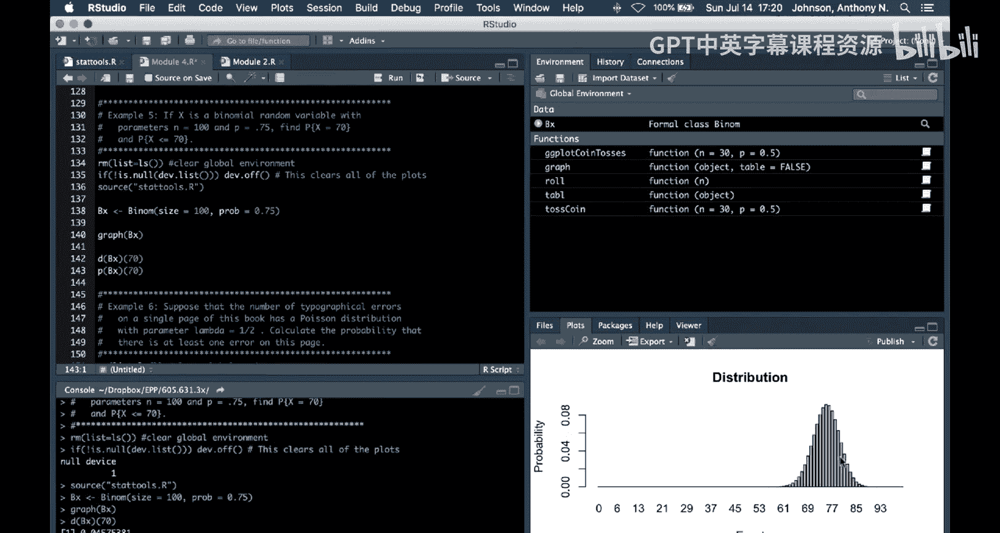
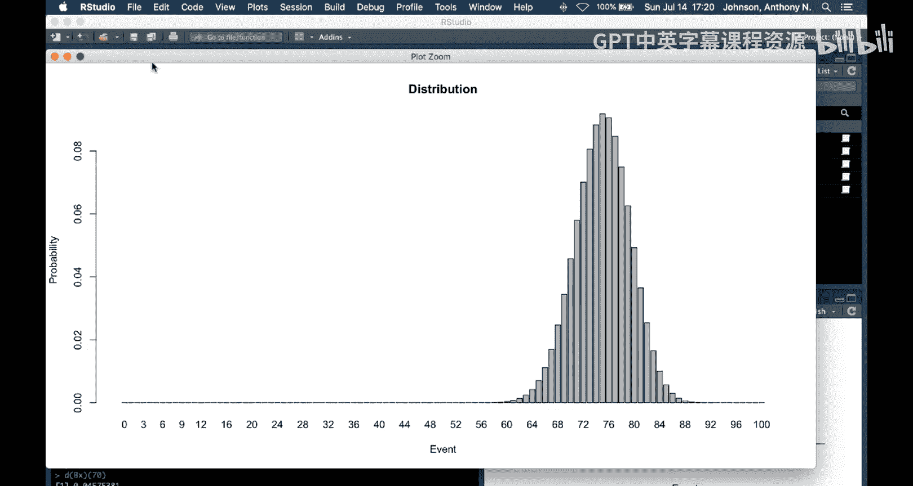
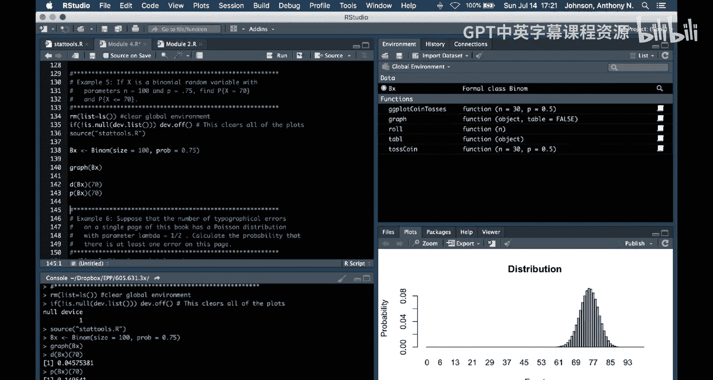
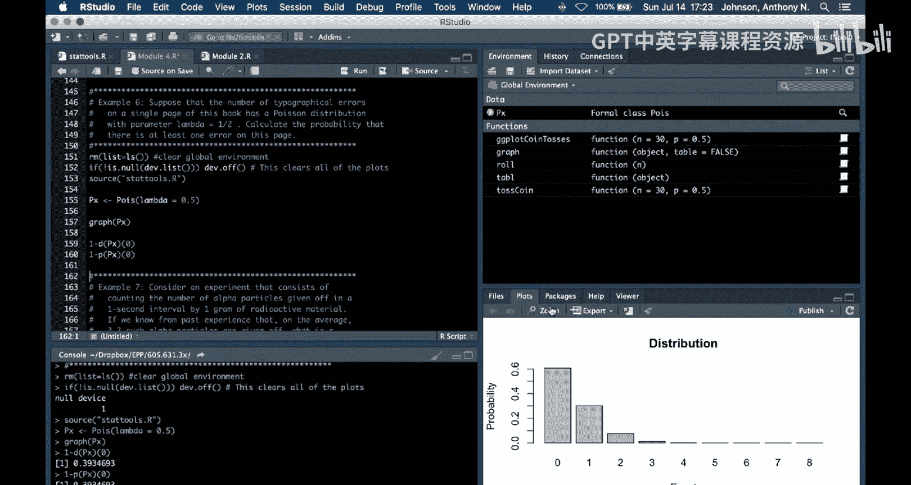
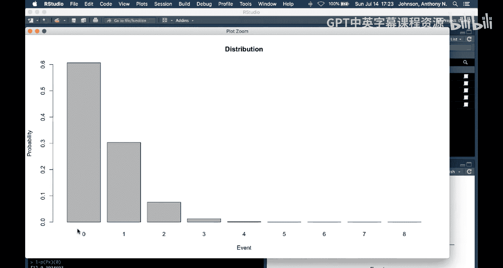
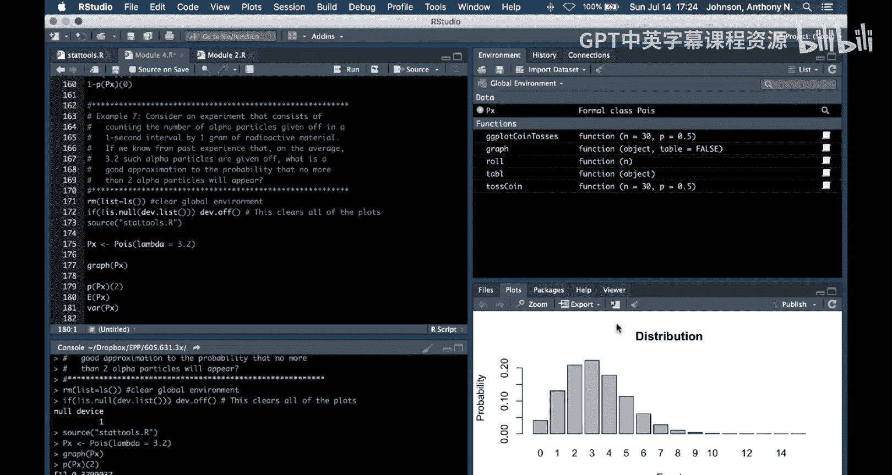
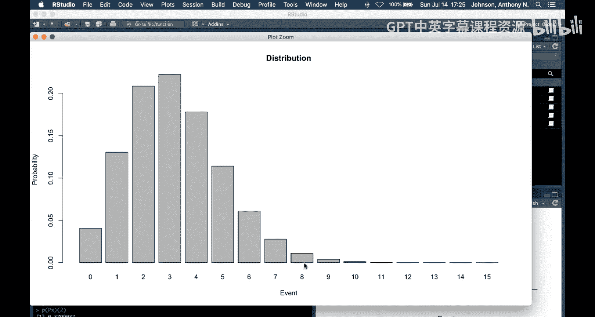
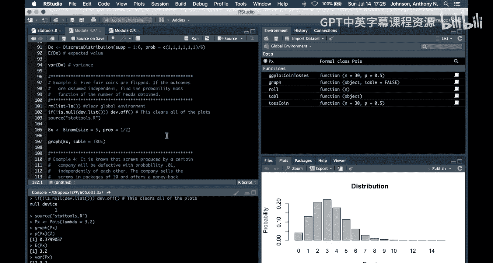

#  035：离散随机变量 📊

在本教程中，我们将学习如何在R语言中处理和分析离散随机变量。我们将从基本概念入手，通过具体示例演示如何计算期望值、方差、概率质量函数和累积分布函数，并介绍如何使用R内置函数和自定义工具包来简化这些计算。

---

## 概述

上一节我们介绍了离散随机变量的理论概念。本节中，我们将使用R语言将这些概念付诸实践。我们将学习如何手动计算期望值和方差，然后利用R函数高效地完成相同任务，并通过一系列示例加深理解。

---

## 基本概念与手动计算

首先，我们从一个简单的例子开始：投掷一枚硬币三次，统计正面朝上的次数。这是一个离散随机变量。

样本空间包含8种等可能的结果。我们定义随机变量X为正面朝上的次数，其取值可以是0、1、2或3。对应的频率（或概率）如下：

*   X = 0 的频率为 1/8
*   X = 1 的频率为 3/8
*   X = 2 的频率为 3/8
*   X = 3 的频率为 1/8

在R中，我们可以这样设置并计算：

```r
# 定义支持集（可能取值）和概率
x <- c(0, 1, 2, 3)
f <- c(1, 3, 3, 1) / 8

# 计算期望值 (均值 mu)
mu <- sum(x * f)
# 输出：1.5

# 计算方差
variance <- sum((x - mu)^2 * f)
# 输出：0.75

# 计算标准差
std_dev <- sqrt(variance)
```

累积分布函数（CDF）是概率的累加和。我们可以使用 `cumsum()` 函数来计算：

```r
# 计算累积分布函数 (CDF)
cdf <- cumsum(f)
# 输出：0.125 0.500 0.875 1.000
```

---

## 使用 `discrete_distribution` 函数

为了更高效地工作，我们可以使用自定义函数 `discrete_distribution`。它需要两个参数：`support`（支持集）和 `prob`（对应概率）。

以下是使用该函数完成相同计算的步骤：

```r
# 定义离散分布
dist <- discrete_distribution(support = c(0, 1, 2, 3), prob = c(1, 3, 3, 1)/8)

# 计算期望值
E(dist)
# 输出：1.5

# 计算方差
V(dist)
# 输出：0.75

# 计算标准差
SD(dist)
```



我们还可以计算概率质量函数（PMF）和累积分布函数（CDF）在特定点的值：

```r
# 计算 PMF 在 x=2 的值
d(dist, 2)
# 输出：0.375

# 计算 CDF 在 x=2 的值 (即 P(X <= 2))
p(dist, 2)
# 输出：0.875
```

此外，我们可以从这个分布中生成随机数：

```r
# 生成10个来自该分布的随机数
r(dist, 10)
```

---

## 二项分布示例

二项分布是一种常见的离散分布。假设进行5次独立的公平硬币投掷，我们想得到正面朝上次数的PMF。

在R中，我们可以使用 `binomial` 类来处理：

```r
# 创建二项分布对象，参数 n=5, p=0.5
bx <- binomial(size = 5, prob = 0.5)

# 计算期望值、方差
E(bx)
V(bx)

# 计算 x=2 时的 PMF 和 CDF
d(bx, 2)
p(bx, 2)

# 生成随机数
r(bx, 30)

# 绘制概率质量函数图
graph(bx)
# 以表格形式查看PMF
graph(bx, table = TRUE)
```

R基础包中也提供了函数 `dbinom` 和 `pbinom` 来实现相同的计算。

---

## 综合应用示例

现在，我们通过几个例子来综合运用以上知识。

### 示例1：抽球问题

一个罐子有20个编号1-20的球。随机无放回地抽取3个球。打赌至少有一个球的号码大于等于17。求赢赌的概率。

**思路**：计算至少一个球号码≥17的互补事件（所有球号码≤16）的概率。

```r
# 定义样本空间：从20个球中无放回抽取3个的所有组合
S <- combn(20, 3) # 这是一个矩阵
# 样本空间大小
nrow(S) # 或使用组合数公式 choose(20,3) = 1140

# 更高效的方法：使用概率空间（假设已加载相关工具函数）
# 这里我们计算互补事件概率：所有球号码 <= 16
# 从16个球（1-16）中抽取3个的组合数
favorable <- choose(16, 3)
total <- choose(20, 3)
prob_no_large <- favorable / total

# 赢赌的概率是互补事件的概率
prob_win <- 1 - prob_no_large
# 输出：约 0.5088
```

### 示例2：掷公平骰子的方差

随机变量X代表掷一个公平六面骰子的结果。计算其方差。

```r
dist_die <- discrete_distribution(support = 1:6, prob = rep(1/6, 6))
V(dist_die)
# 输出：2.916667
```

### 示例3：已知缺陷概率



已知某公司生产的螺丝有0.01的概率是缺陷的，且相互独立。公司以10个一包出售，并保证每包最多有1个缺陷螺丝。求公司需要退货换新的包裹比例。



**思路**：缺陷螺丝数量X服从二项分布 `B(n=10, p=0.01)`。需要替换的情况是X ≥ 2。计算P(X ≥ 2) = 1 - P(X ≤ 1)。




```r
bx_defect <- binomial(size = 10, prob = 0.01)
prob_replace <- 1 - p(bx_defect, 1) # 1 - P(X <= 1)
# 输出：约 0.0043
```

### 示例4：泊松分布

假设书页上的印刷错误数服从参数 λ = 0.5 的泊松分布。求一页上至少有一个错误的概率。

**思路**：至少有一个错误即 P(X ≥ 1) = 1 - P(X = 0)。

```r
px <- poisson(lambda = 0.5)
prob_at_least_one <- 1 - d(px, 0) # 或 1 - p(px, 0)，因为P(X=0)就是CDF在0的值
# 输出：约 0.3935
```





### 示例5：放射性粒子计数

已知1克放射性材料在1秒内放出的α粒子数平均为3.2个，近似服从泊松分布。求不超过2个粒子出现的概率。

```r
px_alpha <- poisson(lambda = 3.2)
prob_no_more_than_two <- p(px_alpha, 2)
# 输出：约 0.3799
```



---



## 总结



在本教程中，我们一起学习了如何在R语言中处理离散随机变量。我们从手动计算期望值和方差开始，逐步引入了 `discrete_distribution` 等便利函数来自动化这些计算。我们重点探讨了二项分布和泊松分布这两种重要的离散分布，并通过多个实际示例练习了如何计算概率质量函数（PMF）、累积分布函数（CDF）以及解决相关的概率问题。掌握这些工具将帮助你更高效地将统计理论应用于计算实践。