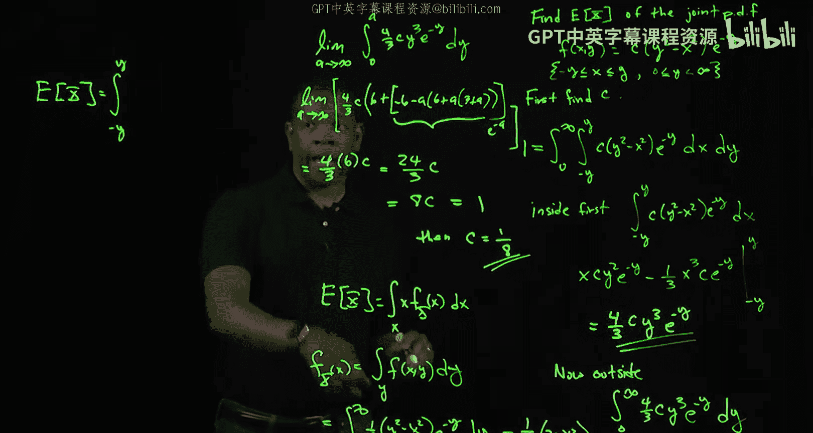

#  051：联合概率密度函数例题解析 📊

在本节课中，我们将通过一个具体的例题，综合运用之前所学的关于联合概率密度函数、期望值以及定义域的所有知识。我们将逐步解析如何根据给定的联合概率密度函数，求解其中的未知常数，并最终计算随机变量X的期望值。

---

## 问题概述

我们被给定一个联合概率密度函数（PDF），其形式为：
**f(x, y) = C * (y² - x²) * e⁻ʸ**

其中，C是一个未知常数。随机变量X和Y的定义域为：
*   **-y ≤ x ≤ y**
*   **0 ≤ y < ∞**

我们的目标是：首先确定常数C的值，然后计算随机变量X的期望值E[X]。

---

## 第一步：求解常数C 🧮

由于f(x, y)是一个联合概率密度函数，它在整个定义域上的积分必须等于1。这是求解未知常数C的关键方程。

以下是求解步骤：

1.  **建立积分方程**：
    根据PDF的性质，我们有：
    **∫∫ f(x, y) dx dy = 1**

2.  **代入函数与定义域**：
    将函数和定义域的上下限代入方程：
    **1 = ∫₀^∞ ∫_{-y}^{y} C * (y² - x²) * e⁻ʸ dx dy**

3.  **先对x进行内层积分**：
    我们将首先计算内层关于x的积分。
    **内层积分：∫_{-y}^{y} C * (y² - x²) * e⁻ʸ dx**
    由于e⁻ʸ在关于x的积分中可视为常数，计算过程如下：
    *   求原函数：**C * e⁻ʸ * [y²x - (x³/3)]**
    *   代入上下限y和-y进行计算：
        *   上限(y)：**C * e⁻ʸ * [y³ - (y³/3)] = C * e⁻ʸ * (2y³/3)**
        *   下限(-y)：**C * e⁻ʸ * [-y³ - (-y³/3)] = C * e⁻ʸ * [-y³ + (y³/3)] = C * e⁻ʸ * (-2y³/3)**
    *   上限值减下限值，得到内层积分结果：
        **C * e⁻ʸ * (2y³/3) - C * e⁻ʸ * (-2y³/3) = (4/3) * C * y³ * e⁻ʸ**

4.  **再对y进行外层积分**：
    现在，我们需要计算外层积分：
    **1 = ∫₀^∞ (4/3) * C * y³ * e⁻ʸ dy**
    这是一个从0到无穷的广义积分。我们通过取极限来计算：
    **1 = lim_{a→∞} ∫₀ᵃ (4/3) * C * y³ * e⁻ʸ dy**

5.  **计算积分并求解C**：
    计算定积分∫ y³ * e⁻ʸ dy（例如使用分部积分法或查表），然后代入极限。最终，当a→∞时，包含e⁻ᵃ的项会趋于0。经过计算，我们得到：
    **1 = 8C**
    因此，常数C的值为：
    **C = 1/8**

---

## 第二步：计算X的期望值E[X] 🎯

上一节我们成功求得了联合PDF中的常数C。本节中，我们来看看如何计算随机变量X的期望值。

期望值E[X]的公式为：
**E[X] = ∫ x * f_X(x) dx**
其中，f_X(x)是X的**边缘概率密度函数**，需要通过联合PDF对Y积分得到。

以下是计算步骤：

1.  **求X的边缘概率密度函数f_X(x)**：
    边缘PDF通过对所有可能的y值积分获得：
    **f_X(x) = ∫ f(x, y) dy = ∫₀^∞ (1/8) * (y² - x²) * e⁻ʸ dy**
    计算这个积分，我们得到：
    **f_X(x) = (1/8) * (2 - x²)**
    *注意：此结果仅在x满足原始定义域（即|x| ≤ y）的相应范围内有效，但幸运的是，在后续计算期望值时，积分区间会自然处理这一点。*

2.  **建立期望值积分式**：
    现在，将f_X(x)代入期望值公式。由于x的定义域依赖于y（-y ≤ x ≤ y），我们直接在原始的x-y联合定义域上积分更为方便：
    **E[X] = ∫∫ x * f(x, y) dx dy = ∫₀^∞ ∫_{-y}^{y} x * (1/8) * (y² - x²) * e⁻ʸ dx dy**

3.  **先对x进行内层积分**：
    我们计算内层积分：
    **内层积分：∫_{-y}^{y} (1/8) * x * (y² - x²) * e⁻ʸ dx**
    *   求原函数：(1/8) * e⁻ʸ * [ (y²x²)/2 - (x⁴)/4 ]
    *   代入上下限y和-y：
        *   代入x = y: (1/8) * e⁻ʸ * [ (y⁴)/2 - (y⁴)/4 ] = (1/8) * e⁻ʸ * (y⁴/4)
        *   代入x = -y: (1/8) * e⁻ʸ * [ (y⁴)/2 - (y⁴)/4 ] = (1/8) * e⁻ʸ * (y⁴/4)
    *   由于上下限的x值（y和-y）代入后函数值相同，相减结果为：
        **(1/8) * e⁻ʸ * (y⁴/4) - (1/8) * e⁻ʸ * (y⁴/4) = 0**

4.  **得出最终结果**：
    内层积分的结果为0，因此无论外层关于y的积分如何，最终结果都是：
    **E[X] = 0**

---

## 总结 📝

本节课中我们一起学习了如何完整处理一个联合概率密度函数的问题。

1.  **求解归一化常数**：我们利用联合PDF在全定义域上积分为1的性质，通过两步积分成功解出了未知常数 **C = 1/8**。
2.  **计算期望值**：我们通过先求边缘PDF再积分，或直接在联合定义域上积分的方法，计算了随机变量X的期望值。由于被积函数**x * f(x, y)**是关于x的奇函数（在对称区间[-y, y]上积分），最终得出 **E[X] = 0**。

这个例题展示了处理联合分布问题的标准流程：确定定义域、利用归一化条件求解常数、最后根据目标（如求期望、方差、边缘分布等）进行相应的积分计算。