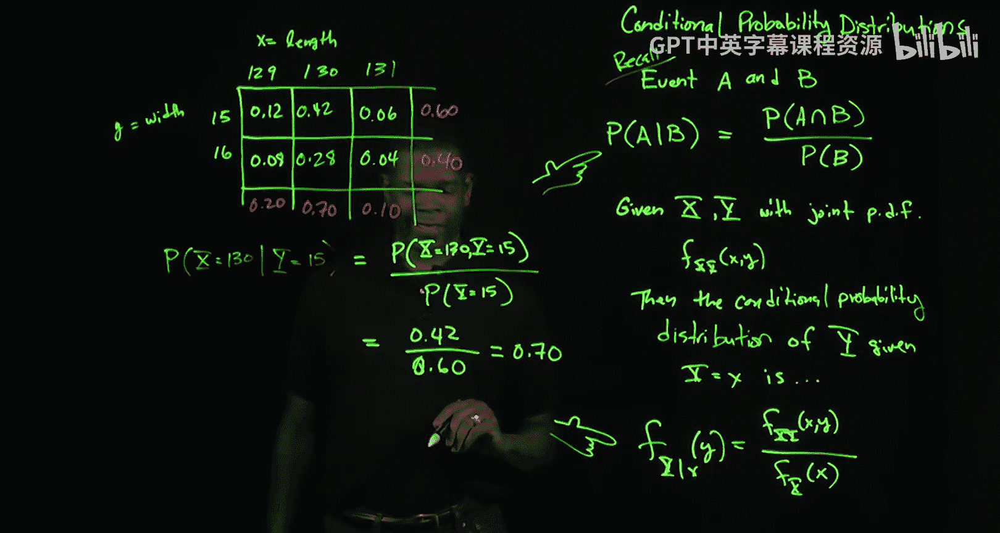

#  052：条件联合概率分布 📊

在本节课中，我们将学习条件概率分布。我们将从回顾事件的条件概率概念开始，然后将其扩展到涉及多个随机变量的情况，特别是联合分布。我们将通过一个具体的例子来演示如何计算条件概率分布，并理解其与边际分布的关系。

---

## 回顾事件的条件概率

上一节我们介绍了联合概率分布。本节中，我们来看看如何将条件概率的概念应用到随机变量上。

首先，回忆一下在单一事件背景下条件概率的定义。如果有事件A和事件B，那么给定B发生的条件下A发生的概率，记作 **P(A|B)**，其计算公式为：

**P(A|B) = P(A ∩ B) / P(B)**

这个公式表示，事件A在事件B已发生条件下的概率，等于事件A与事件B同时发生的概率（即它们的交集概率），除以事件B发生的概率。

---

## 扩展到随机变量的条件概率分布

现在，当我们讨论随机变量及其联合分布时，我们希望将同样的条件化思想应用到两个随机变量上，例如 **X** 和 **Y**。

假设我们有两个随机变量 **X** 和 **Y**，它们具有联合概率密度函数（或概率质量函数） **f_{X,Y}(x, y)**。

那么，给定 **X** 取某个特定值 **x** 的条件下，随机变量 **Y** 的条件概率分布定义为：

**f_{Y|X}(y | x) = f_{X,Y}(x, y) / f_X(x)**

其中：
*   **f_{X,Y}(x, y)** 是 **X** 和 **Y** 的联合概率分布。
*   **f_X(x)** 是 **X** 的边际概率分布（即不考虑Y时，X自身的分布）。

这个公式与事件的条件概率公式在结构上完全对应：**条件概率分布 = 联合分布 / 边际分布**。

---

## 实例解析：矩形容器的尺寸

为了巩固这个概念，我们来看一个具体的例子。考虑一个矩形容器的制造商，我们定义两个随机变量：
*   **X** 表示容器的长度，可能取值为 129, 130, 131。
*   **Y** 表示容器的宽度，可能取值为 15, 16。

假设我们已知 **X** 和 **Y** 的联合概率分布表以及计算出的边际分布如下：

|          | Y=15 | Y=16 | 边际 P(X) |
| :------- | :--- | :--- | :-------- |
| **X=129** | 0.12 | 0.08 | **0.20**   |
| **X=130** | 0.42 | 0.28 | **0.70**   |
| **X=131** | 0.06 | 0.04 | **0.10**   |
| 边际 P(Y) | **0.60** | **0.40** | 1.00       |

### 计算单一条件概率

首先，我们计算一个具体的条件概率：**在宽度 Y=15 的条件下，长度 X=130 的概率是多少？**

根据公式：
P(X=130 | Y=15) = P(X=130, Y=15) / P(Y=15)

从表中可得：
*   联合概率 P(X=130, Y=15) = 0.42
*   边际概率 P(Y=15) = 0.60

因此：
P(X=130 | Y=15) = 0.42 / 0.60 = 0.70

### 计算完整的条件概率分布

然而，我们通常更关心完整的条件分布。现在，我们来求 **给定 Y=15 时，X 的完整条件概率分布**。这意味着我们需要计算 X 所有可能取值（129, 130, 131）在此条件下的概率。

以下是计算过程：

1.  **P(X=129 | Y=15)** = P(X=129, Y=15) / P(Y=15) = 0.12 / 0.60 = 0.20
2.  **P(X=130 | Y=15)** = 0.42 / 0.60 = 0.70 （已计算）
3.  **P(X=131 | Y=15)** = P(X=131, Y=15) / P(Y=15) = 0.06 / 0.60 = 0.10

现在，我们可以写出给定 Y=15 时，X 的条件概率分布：

**f_{X|Y}(x | 15) =**
*   当 x = 129 时，概率为 0.20
*   当 x = 130 时，概率为 0.70
*   当 x = 131 时，概率为 0.10

观察这个结果，你会发现一个有趣的现象：在这个特定的例子中，给定 Y=15 时 X 的条件分布 **f_{X|Y}(x | 15)**，恰好等于 X 的边际分布 **f_X(x)**（即表格最右侧的一列：0.20, 0.70, 0.10）。这表明在这个联合分布中，X 的分布不受 Y 取值的影响，这是一个重要的特性，我们将在后续课程中深入探讨。

---

## 总结

本节课中我们一起学习了条件概率分布的核心概念。我们从事件的条件概率公式出发，将其成功推广到随机变量的场景，得到了关键公式：**f_{Y|X}(y | x) = f_{X,Y}(x, y) / f_X(x)**。通过矩形容器尺寸的实例，我们一步步演示了如何计算单一的条件概率以及完整的条件概率分布。理解条件概率分布是分析随机变量间关系的基础，在机器学习和数据分析中有着广泛的应用。