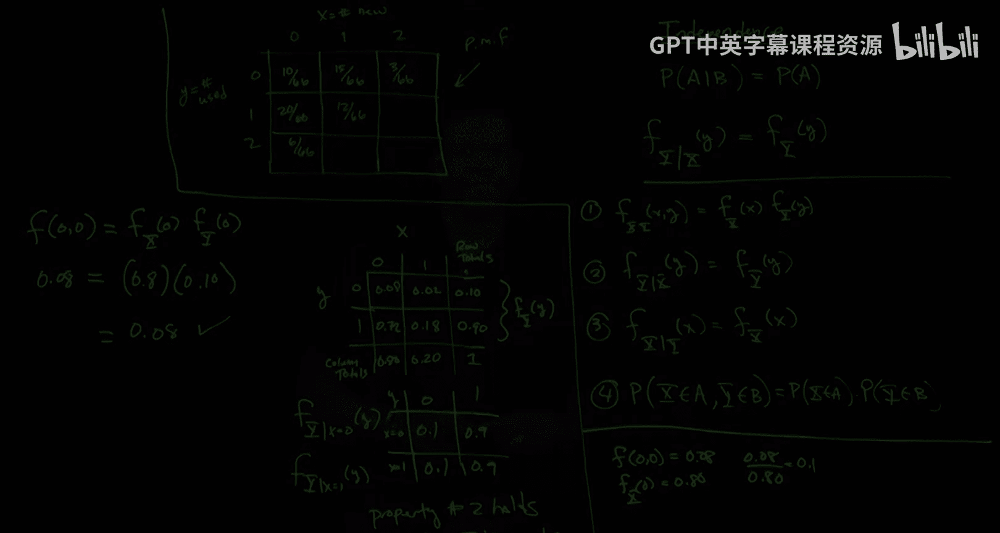

#  053：联合随机变量的独立性 📊

在本节课中，我们将要学习联合随机变量独立性的概念。独立性是概率论中的一个核心思想，它描述了两个随机变量之间是否存在相互影响的关系。我们将探讨如何判断两个随机变量是否独立，并通过具体的例子来加深理解。

## 回顾独立性概念

上一节我们介绍了联合分布和边缘分布。本节中，我们来看看如何将这些概念应用于判断随机变量的独立性。

回想一下在之前关于事件独立性的学习中，如果事件A在事件B发生的条件下的概率等于事件A自身的概率，即 **P(A|B) = P(A)**，那么我们就说事件A和B是独立的。这意味着事件B的发生与否对事件A的概率没有影响。

## 联合随机变量的独立性

对于随机变量X和Y，我们可以将事件独立性的思想推广过来。如果随机变量X和Y是独立的，那么知道其中一个变量的值，不会为我们提供关于另一个变量值的任何额外信息。

具体来说，如果以下**任何**一个性质成立，那么随机变量X和Y就是独立的。实际上，如果其中一个性质成立，那么所有性质都将成立。

以下是判断随机变量X和Y是否独立的四个等价性质：

1.  **联合分布等于边缘分布的乘积**：对于所有x和y，联合概率密度（或质量）函数等于各自边缘分布的乘积。
    *   **公式**：`f_{X,Y}(x, y) = f_X(x) * f_Y(y)`

2.  **给定X时Y的条件分布等于Y的边缘分布**：对于所有x和y，在已知X=x的条件下，Y的条件分布与Y自身的边缘分布相同。
    *   **公式**：`f_{Y|X}(y | x) = f_Y(y)`

3.  **给定Y时X的条件分布等于X的边缘分布**：对于所有x和y，在已知Y=y的条件下，X的条件分布与X自身的边缘分布相同。
    *   **公式**：`f_{X|Y}(x | y) = f_X(x)`

4.  **事件概率可分离**：对于随机变量X和Y取值范围内的任意集合A和B，X属于A且Y属于B的联合概率，等于X属于A的概率乘以Y属于B的概率。
    *   **公式**：`P(X ∈ A, Y ∈ B) = P(X ∈ A) * P(Y ∈ B)`

## 应用示例：电池问题 🔋

让我们通过一个具体的例子来应用这些概念。还记得之前关于电池的例子吗？假设我们从一堆电池中无放回地抽取两个电池。令随机变量X表示新电池的数量，Y表示旧电池的数量。我们得到了如下的联合概率质量函数表：

| X\Y | 0   | 1   | 2   | 边缘 P(X) |
| :-- | :-- | :-- | :-- | :-------- |
| 0   | 0   | 0   | 3/66| 3/66      |
| 1   | 0   | 20/66| 12/66| 32/66     |
| 2   | 10/66| 6/66 | 0   | 16/66     |
| 边缘 P(Y) | 10/66| 26/66| 15/66| 1         |

**问题**：在不进行任何计算的情况下，你能判断X和Y是否独立吗？

**提示**：观察联合分布表。注意，表格中存在多个概率为0的单元格（例如(0,0), (0,1), (1,0), (2,2)）。现在，检查性质1：`f_{X,Y}(x, y) = f_X(x) * f_Y(y)` 是否对所有x和y都成立？例如，看(0,0)这个点：
*   联合概率 `f_{X,Y}(0,0) = 0`
*   X的边缘概率 `f_X(0) = 3/66`
*   Y的边缘概率 `f_Y(0) = 10/66`
*   乘积 `f_X(0) * f_Y(0) = (3/66) * (10/66) = 30/4356`，这显然不等于0。

因此，性质1不成立，所以随机变量X和Y**不是独立的**。这符合直觉，因为是无放回抽样，抽出一个电池（新或旧）会影响剩余电池的构成，从而影响第二次抽样的结果。

## 另一个示例：验证独立性 ✅

为了更清晰地展示独立性成立的情况，我们来看一个更简单的虚构例子。假设有两个随机变量X和Y，它们的联合分布如下：

| X\Y | 0   | 1   | 边缘 P(X) |
| :-- | :-- | :-- | :-------- |
| 0   | 0.08| 0.72| 0.80      |
| 1   | 0.02| 0.18| 0.20      |
| 边缘 P(Y) | 0.10| 0.90| 1         |

**问题**：X和Y是否独立？

我们可以使用性质2来验证：检查条件分布 `f_{Y|X}(y | x)` 是否等于边缘分布 `f_Y(y)`。

以下是验证步骤：
1.  当 `x=0` 时：
    *   `f_{Y|X}(0 | 0) = f(0,0) / f_X(0) = 0.08 / 0.80 = 0.10`，等于 `f_Y(0)=0.10`。
    *   `f_{Y|X}(1 | 0) = f(0,1) / f_X(0) = 0.72 / 0.80 = 0.90`，等于 `f_Y(1)=0.90`。
2.  当 `x=1` 时：
    *   `f_{Y|X}(0 | 1) = f(1,0) / f_X(1) = 0.02 / 0.20 = 0.10`，等于 `f_Y(0)=0.10`。
    *   `f_{Y|X}(1 | 1) = f(1,1) / f_X(1) = 0.18 / 0.20 = 0.90`，等于 `f_Y(1)=0.90`。

由于对于**所有**的x和y，条件分布都等于边缘分布，因此性质2成立。根据等价性，X和Y是独立的。

我们也可以用性质1快速验证：对于表中任意一点，其联合概率都等于对应边缘概率的乘积。例如：
*   `f(0,0)=0.08`， `f_X(0)*f_Y(0)=0.80*0.10=0.08`，成立。
*   `f(1,1)=0.18`， `f_X(1)*f_Y(1)=0.20*0.90=0.18`，成立。

## 总结 📝

本节课中我们一起学习了联合随机变量独立性的核心概念。我们了解到，判断两个随机变量X和Y是否独立，有多个等价的数学标准，其中最常用的是检查它们的联合分布是否等于各自边缘分布的乘积。我们通过电池（非独立）和虚构（独立）两个例子，演示了如何应用这些标准进行判断。理解独立性对于后续学习更复杂的概率模型和统计推断至关重要。