#  056：期望的线性性质 📈

在本节课中，我们将学习期望的线性性质。我们将从一个计算机科学领域的例子开始，探讨延迟分布的特性，然后引出并详细解释期望的线性性质定理及其推论。

## 网络数据包延迟示例 💻

我们从一个计算机科学领域的例子开始。设 **D** 为一个数据包在信道上的延迟时间。

我们令 **f(x)** 表示延迟 **D** 等于某个特定值 **x** 的概率密度函数。其图像大致如下：

在这个分布中，短延迟出现的频率很高，而长延迟则非常罕见。

假设我们进行一个实验，测量100次延迟，并估算平均延迟。第一次实验得到的平均延迟是10毫秒。第二次实验得到的平均延迟是9.8毫秒。

现在，考虑延迟超过某个值 **i** 的概率。假设这个概率为 **1/i**。那么延迟的期望值计算如下：

**公式：E[D] = Σ_{i=1}^{∞} P(D > i) = Σ_{i=1}^{∞} 1/i**

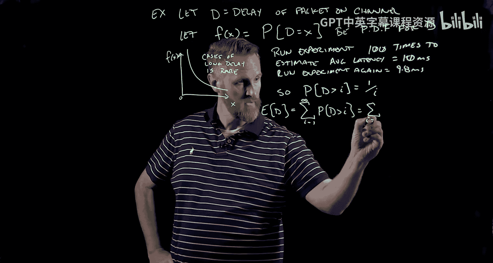

我们知道，这个调和级数求和会发散到无穷大。

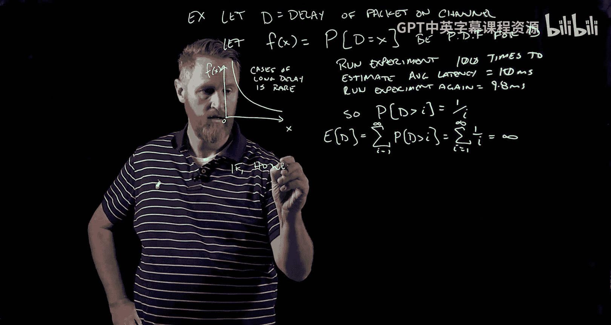

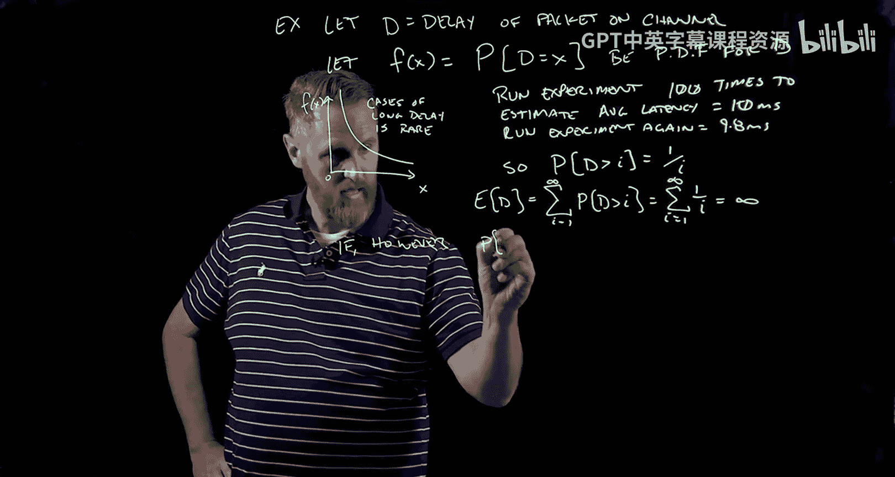

然而，如果延迟超过值 **i** 的概率是 **1/i²**，情况则完全不同：

**公式：E[D] = Σ_{i=1}^{∞} P(D > i) = Σ_{i=1}^{∞} 1/i²**

根据几何级数的知识，这个求和收敛，其值小于或等于2。

这个例子说明了什么？关键在于，当你从分布中采样进行实验时，那些概率极低的罕见事件（即长延迟）很难被观测到。然而，一旦这些罕见事件发生，它们会对总和产生巨大的影响，从而改变整个分布的期望值估计。在处理期望值时，罕见事件可能带来问题。

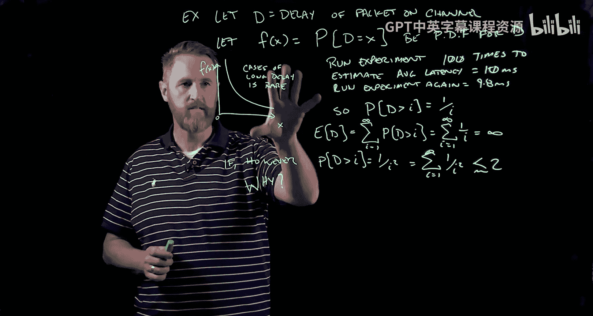

## 期望的线性性质 📐

现在，我们转换话题，来讨论**期望的线性性质**。

存在一个定理：对于定义在同一个概率空间 **S** 上的任意两个随机变量 **R₁** 和 **R₂**，以下等式成立：

**公式：E[R₁ + R₂] = E[R₁] + E[R₂]**

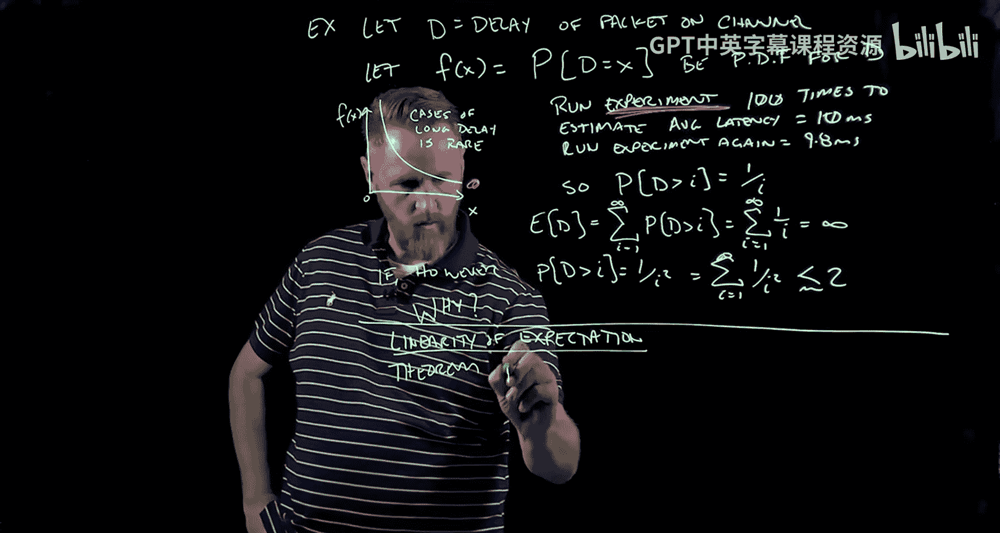

也就是说，两个随机变量之和的期望值，等于它们各自期望值的和。

### 示例：掷两个骰子 🎲

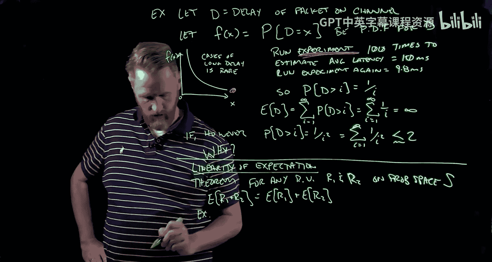

一个简单的例子是掷两个标准的六面骰子。我们知道单个骰子的期望值是3.5。根据线性性质，两个骰子点数之和的期望值为：

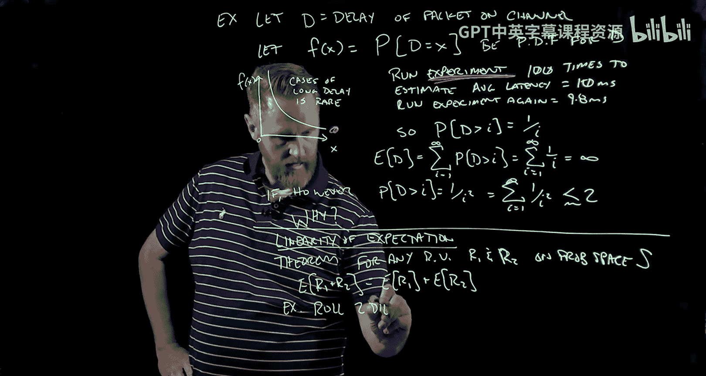

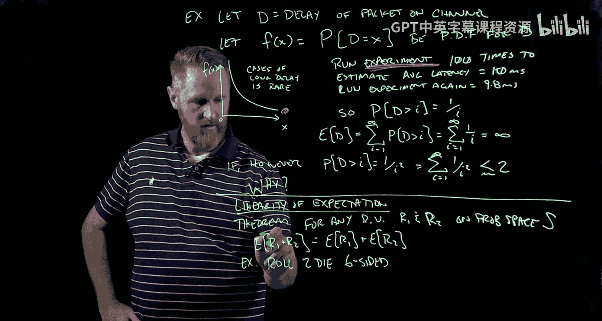

**公式：E[骰子1 + 骰子2] = E[骰子1] + E[骰子2] = 3.5 + 3.5 = 7**

这也解释了为什么在玩“双骰子”游戏时，数字7出现的频率最高——因为它是平均意义上的最可能结果。

### 推论与独立性要求 🔗

上述定理有一个直接的推论：对于样本空间中的任意 **k** 个随机变量 **R₁, R₂, ..., Rₖ**，有：

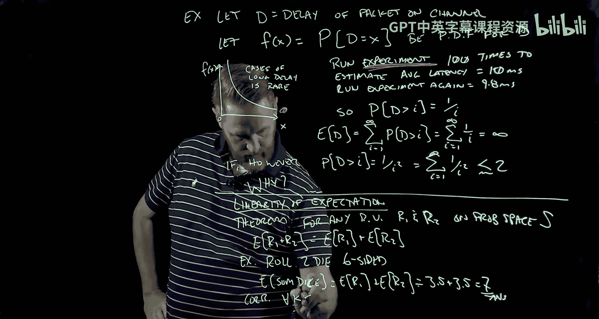

**公式：E[R₁ + R₂ + ... + Rₖ] = E[R₁] + E[R₂] + ... + E[Rₖ]**

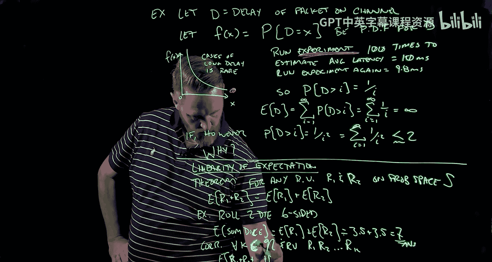

这意味着，要求一组随机变量总和的期望值，只需将它们各自的期望值相加即可。

然而，**必须注意一个关键前提**：期望的线性性质要求随机变量之间满足**独立性假设**。如果 **R₂** 的结果以某种方式依赖于 **R₁** 的结果，那么就不能直接使用线性性质。我们将在后续课程中看到不满足独立性时的例子。

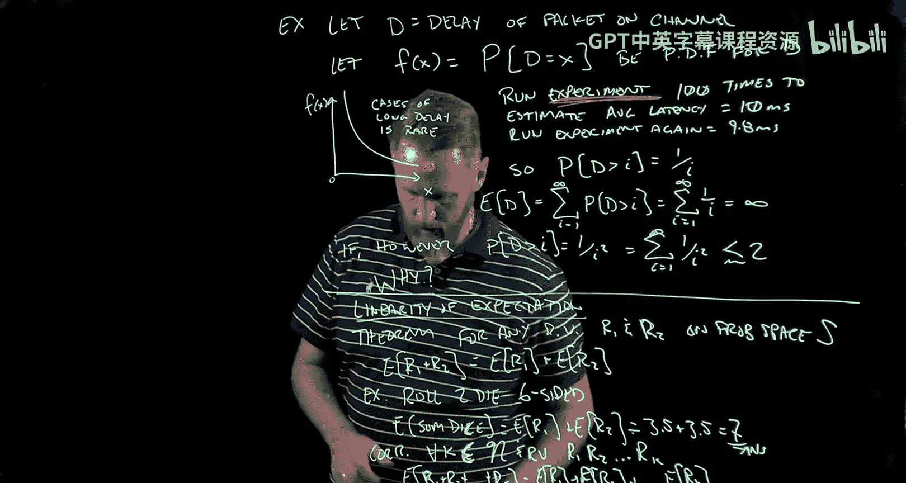

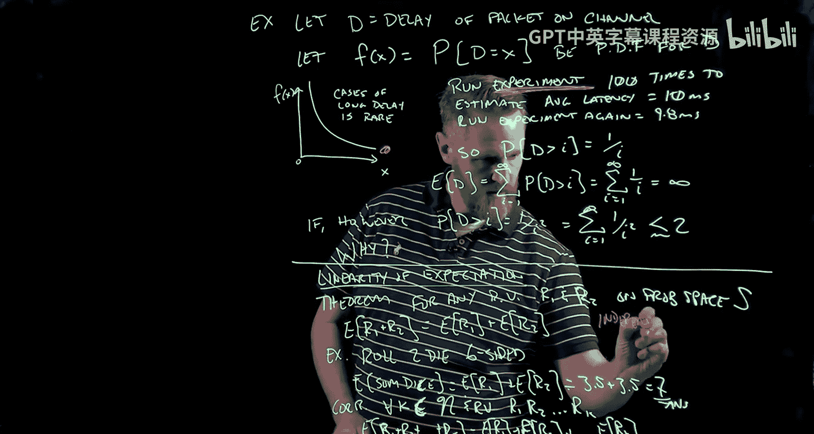

## 总结 📝

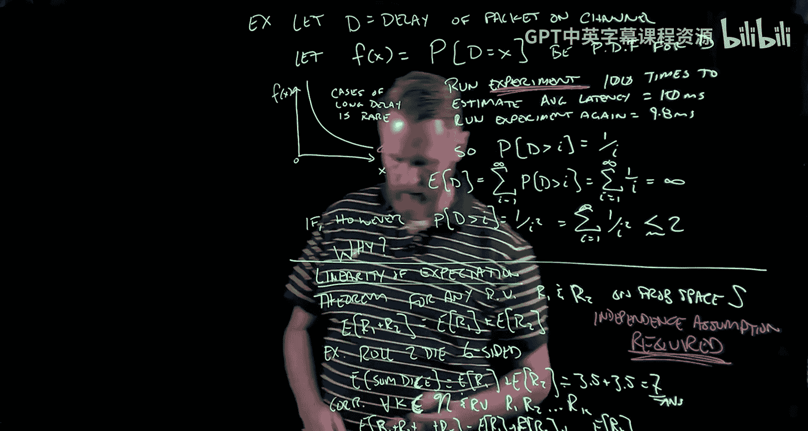

本节课我们一起学习了两个核心内容：
1.  通过数据包延迟的例子，我们看到了概率分布中“长尾”或罕见事件对期望值计算的潜在巨大影响。
2.  我们重点学习了**期望的线性性质**定理及其推论，即独立随机变量之和的期望等于期望之和。同时，我们强调了应用该性质时必须满足的**独立性**前提条件。