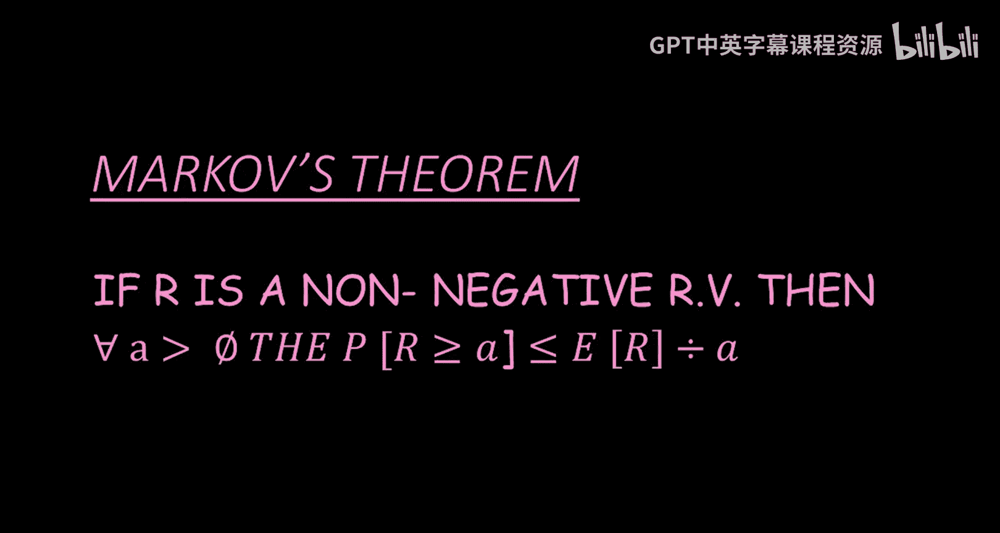
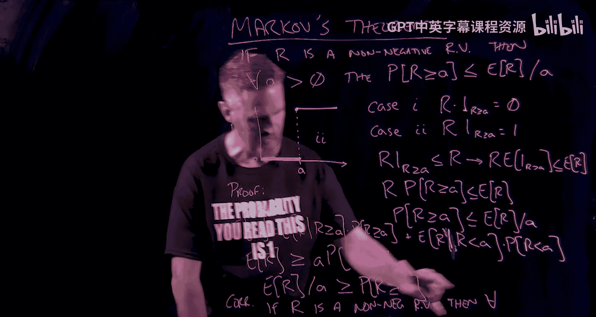
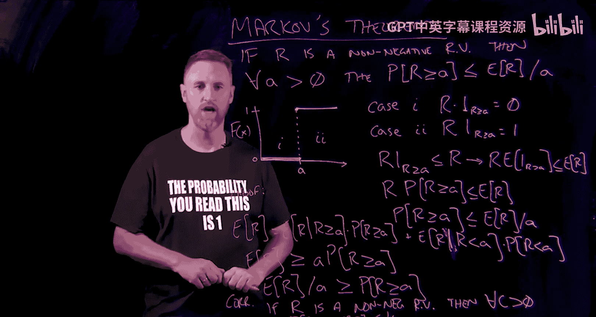

#  061：罕见事件与马尔可夫定理 🎲

在本节课中，我们将要学习统计学中一个重要的概念——罕见事件，并介绍一个用于分析罕见事件概率的强大工具：马尔可夫定理。我们将从定理的定义和证明开始，理解其核心思想，为后续学习切比雪夫不等式和中心极限定理打下基础。

## 马尔可夫定理介绍 📖

上一节我们引入了罕见事件的概念。本节中，我们来看看如何量化地分析一个非负随机变量取极大值的概率。马尔可夫定理为此提供了一个概率上界。

马尔可夫定理的表述如下：
如果 **R** 是一个非负随机变量，那么对于所有 **a > 0**，有：

**P(R ≥ a) ≤ E[R] / a**

这个公式的核心在于，它利用随机变量的期望值 **E[R]**，为“R 超过某个阈值 a”这一事件的概率设定了一个上限。阈值 **a** 越大，这个概率上界就越小。

## 定理的证明与理解 🔍

为了理解这个定理从何而来，我们需要进行一个简单的证明。证明的思路是引入一个指示函数，并通过期望值的性质进行推导。

首先，我们考虑随机变量 **R** 和阈值 **a**。我们可以定义一个指示函数 **I(R ≥ a)**，当 **R ≥ a** 时其值为1，否则为0。

显然，对于所有情况，以下不等式成立：
**a * I(R ≥ a) ≤ R**

这是因为：
*   当 **R < a** 时，左边为0，右边 **R ≥ 0**，不等式成立。
*   当 **R ≥ a** 时，左边为 **a**，右边 **R ≥ a**，不等式同样成立。

接下来，我们对不等式两边取期望值。根据期望的线性性质和非负性，得到：
**a * E[I(R ≥ a)] ≤ E[R]**

由于指示函数的期望值就等于事件发生的概率，即 **E[I(R ≥ a)] = P(R ≥ a)**，代入上式：
**a * P(R ≥ a) ≤ E[R]**

最后，因为 **a > 0**，我们将不等式两边同时除以 **a**，就得到了马尔可夫定理：
**P(R ≥ a) ≤ E[R] / a**

这个证明展示了如何通过一个巧妙的不等式，将概率问题转化为期望值问题。

## 定理的推论

从马尔可夫定理可以直接推导出一个常用的推论：
如果 **R** 是一个非负随机变量，那么对于所有 **c > 0**，有：

**P(R ≥ c * E[R]) ≤ 1 / c**

这个推论是令原定理中的 **a = c * E[R]** 得到的。它意味着，一个随机变量超过其期望值 **c** 倍的概率，最多只有 **1/c**。例如，它超过期望值10倍的概率不会超过10%。

## 总结与过渡 🚀

本节课中我们一起学习了马尔可夫定理。我们了解了它的定义，并通过引入指示函数完成了定理的证明。马尔可夫定理的核心价值在于，它仅利用随机变量的期望值（无需知道其具体分布），就能对罕见事件（取值很大的事件）的概率给出一个保守的估计。

在接下来的课程中，我们将通过具体的例子，看看马尔可夫定理如何应用于实际问题，并进一步探索其更强大的推广形式——切比雪夫不等式。