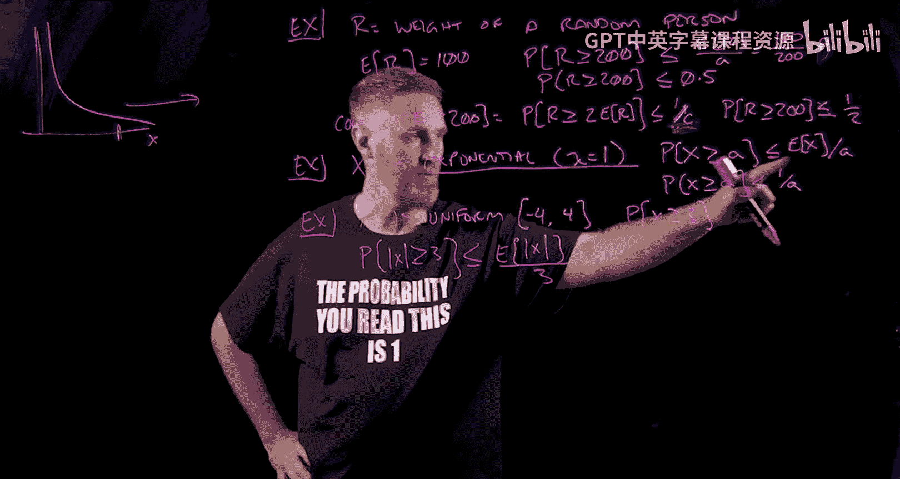
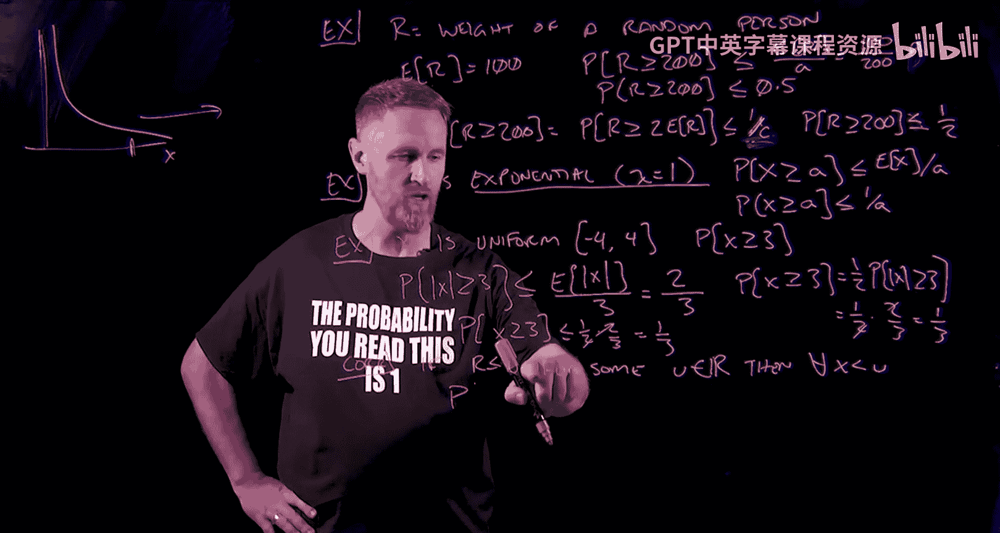
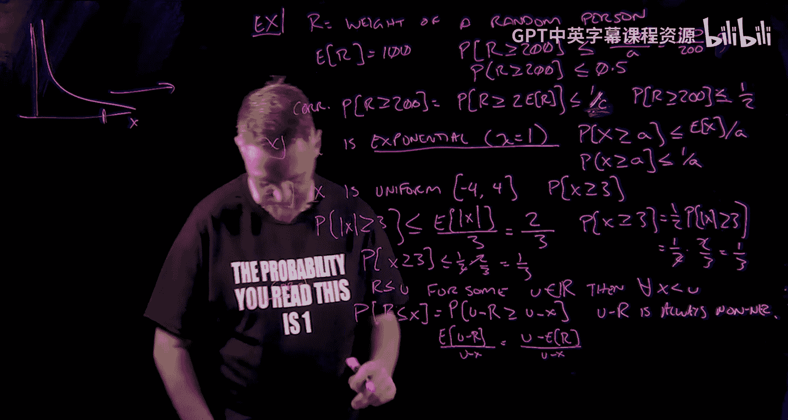
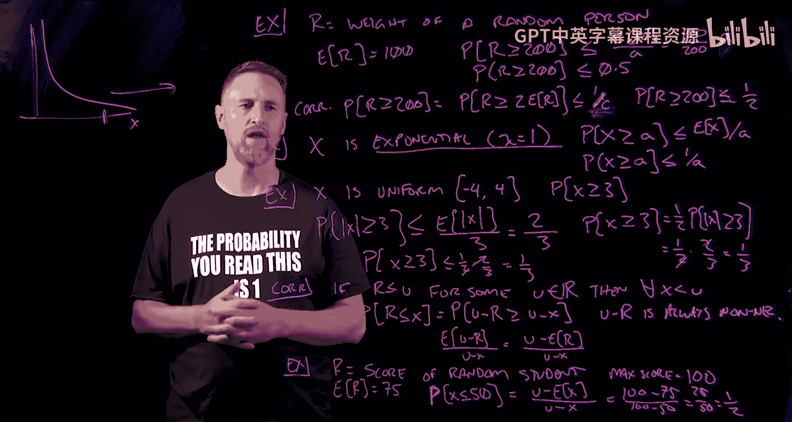

#  062：马尔可夫定理实例分析 📊

在本节课中，我们将通过几个具体的例子来学习如何应用马尔可夫定理。上一节我们介绍了马尔可夫定理的证明，本节中我们来看看如何在实际问题中使用它来估计罕见事件的概率上界。

马尔可夫定理的核心公式是：对于一个非负随机变量 **R** 和任意正数 **a**，有：
**P(R ≥ a) ≤ E[R] / a**

---

## 实例一：随机体重分析 🏋️

假设随机变量 **R** 表示一个人的体重（单位：磅）。已知体重的期望值 **E[R] = 100**。

我们希望估计体重超过或等于 200 磅的概率。

根据马尔可夫定理，我们可以直接计算其上界：
**P(R ≥ 200) ≤ E[R] / 200 = 100 / 200 = 0.5**

这意味着，体重超过200磅的概率**至多**为50%。

我们也可以使用马尔可夫定理的推论来理解这个结果。因为 200 = 2 * E[R]，所以常数 **c = 2**。根据推论 **P(R ≥ c * E[R]) ≤ 1/c**，我们同样得到：
**P(R ≥ 2 * E[R]) ≤ 1/2 = 0.5**

---

## 实例二：指数分布与到达时间 ⏳

在某些场景中，数据服从指数分布，例如银行柜台的顾客到达间隔时间。这类数据通常具有**右偏**特性：大量值集中在较小的区间，但偶尔会出现非常大的值（即罕见的长等待时间）。

假设随机变量 **X** 服从参数 **λ = 1** 的指数分布，即 **X ~ Exp(1)**。对于指数分布，其期望值 **E[X] = 1/λ = 1**。

现在，我们想估计等待时间超过某个阈值 **a** 的概率。根据马尔可夫定理：
**P(X ≥ a) ≤ E[X] / a = 1 / a**

例如，如果我们想知道等待时间超过15分钟的概率，其**上界**就是 **1/15**。这为我们评估“极端长等待”这种罕见事件的风险提供了一个快速的量化工具。

---

## 实例三：均匀分布分析 📏

假设随机变量 **X** 服从区间 **[-4, 4]** 上的均匀分布，即 **X ~ Uniform(-4, 4)**。

我们希望估计 **X ≥ 3** 的概率。注意，此时 **X** 可能取负值，我们需要应用马尔可夫定理的绝对值形式：
**P(|X| ≥ a) ≤ E[|X|] / a**

首先计算 **E[|X|]**。由于分布对称，我们只需计算在 **[0, 4]** 区间上的期望，结果为 **2**。

因此，**P(|X| ≥ 3) ≤ 2 / 3**。

由于事件 **{X ≥ 3}** 是事件 **{|X| ≥ 3}** 的一部分（并且概率为其一半，因为分布对称），我们可以得到：
**P(X ≥ 3) = (1/2) * P(|X| ≥ 3) ≤ (1/2) * (2/3) = 1/3**

所以，**X** 大于等于3的概率**至多**为 **1/3**。

---

## 推论与实例四：学生成绩分析 📝

马尔可夫定理还有一个有用的推论：如果随机变量 **R** 存在一个上界 **u**（即 **R ≤ u**），那么对于任意 **x < u**，有：
**P(R ≤ x) ≤ (u - E[R]) / (u - x)**

这个推论允许我们估计随机变量取值很小的概率。

让我们看一个例子：设 **R** 表示一个随机学生的考试成绩，满分 **u = 100**。已知班级平均分 **E[R] = 75**。

我们想估计一个学生成绩低于或等于50分的概率。根据上述推论：
**P(R ≤ 50) ≤ (100 - 75) / (100 - 50) = 25 / 50 = 0.5**

这意味着，成绩低于50分的概率**至多**为50%。这个上界帮助我们量化了出现“极低分”这种罕见事件的风险。

---

## 总结

本节课中，我们一起学习了如何应用马尔可夫定理及其推论来分析不同场景下的罕见事件概率上界。

以下是本节课的核心要点回顾：
*   **核心公式**：对于非负随机变量 **R**，**P(R ≥ a) ≤ E[R] / a**。
*   **应用场景**：该定理特别适用于处理具有**偏态分布**（如指数分布）的数据，其中存在少数极端大值。
*   **主要作用**：它为估计“随机变量远超其平均值”这类事件的概率提供了一个简单而保守的**上界**，是风险评估和决策分析中的一个有用工具。
*   **灵活变体**：通过取绝对值或利用变量上界，我们可以将定理应用于更广泛的随机变量。

通过体重、等待时间、均匀分布变量和考试成绩这四个例子，我们看到了马尔可夫定理如何将抽象的数学公式转化为解决实际概率估计问题的有力手段。