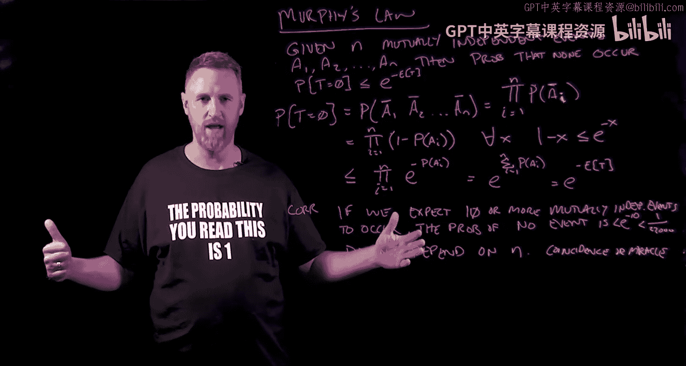
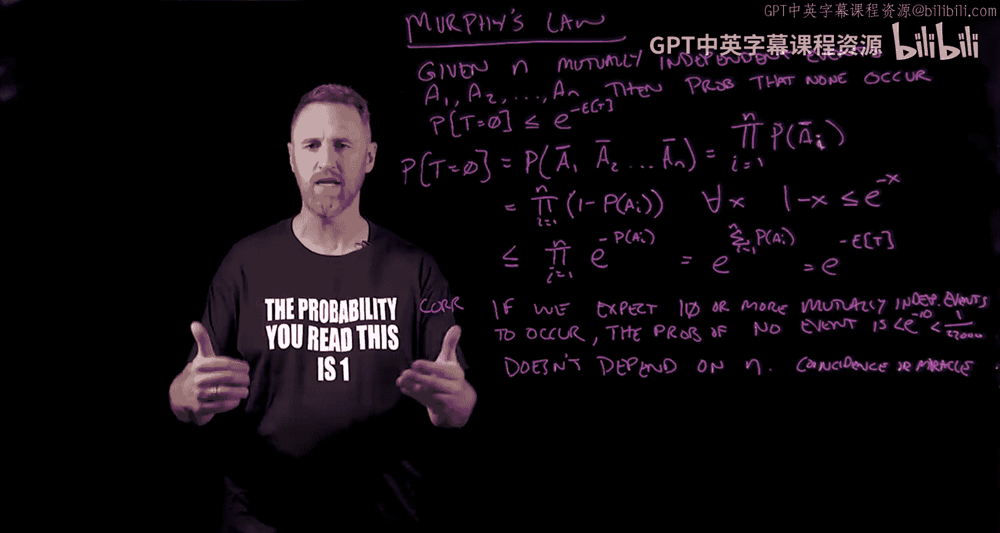

#  063：墨菲定律的统计证明 🧮


在本节课中，我们将学习如何从统计学的角度理解和证明著名的“墨菲定律”。我们将看到，即使单个事件发生的概率很低，当事件数量足够多时，至少发生一件“坏事”的概率会变得非常高。


---


## 墨菲定律的统计表述


墨菲定律通常被表述为：“如果某件坏事有可能发生，那么它就一定会发生。” 在统计学中，我们可以将其形式化。


假设存在一系列相互独立的事件，记为 **A₁, A₂, ..., Aₙ**。令 **T** 表示这些事件中实际发生的事件数量。

那么，**没有任何一个事件发生**的概率满足以下不等式：


**P(T = 0) ≤ e^{-E[T]}**


其中，**E[T]** 是事件发生数量 **T** 的期望值。这个公式的含义是：给定一系列事件，即使每个事件单独发生的可能性很低，但**至少有一个事件发生**的可能性却可能很高。


---


## 证明过程


上一节我们介绍了墨菲定律的统计形式。本节中，我们来一步步证明这个不等式。


证明的核心步骤如下：


1.  **计算无事件发生的概率**：
    没有任何事件发生，意味着事件 A₁ 不发生，且 A₂ 不发生，...，且 Aₙ 不发生。由于事件相互独立，其概率等于各自不发生的概率的乘积。
    ```
    P(T=0) = P(¬A₁ ∧ ¬A₂ ∧ ... ∧ ¬Aₙ) = ∏_{i=1}^{n} P(¬Aᵢ)
    ```


2.  **用发生概率表示**：
    事件不发生的概率等于 1 减去它发生的概率。
    ```
    P(¬Aᵢ) = 1 - P(Aᵢ)
    ```
    因此：
    ```
    P(T=0) = ∏_{i=1}^{n} [1 - P(Aᵢ)]
    ```


3.  **应用不等式 1 - x ≤ e^{-x}**：
    对于任意实数 x，有一个重要的不等式成立：**1 - x ≤ e^{-x}**。我们将此不等式应用于每一项 `1 - P(Aᵢ)`。
    ```
    P(T=0) ≤ ∏_{i=1}^{n} e^{-P(Aᵢ)}
    ```


4.  **合并指数项**：
    指数相乘等于指数相加。
    ```
    ∏_{i=1}^{n} e^{-P(Aᵢ)} = e^{-∑_{i=1}^{n} P(Aᵢ)}
    ```


5.  **关联到期望值**：
    事件发生数量 T 的期望值 **E[T]**，正是每个事件发生概率的总和（因为 T 是各事件发生次数的和，而期望具有可加性）。
    ```
    E[T] = ∑_{i=1}^{n} P(Aᵢ)
    ```
    因此，我们得到：
    ```
    P(T=0) ≤ e^{-E[T]}
    ```
    证明完毕。


---


## 推论与实际意义


我们已经完成了墨菲定律的数学证明。现在，让我们看看它的一个直接推论及其在现实世界中的解释。

**推论**：如果预期会发生的事件数量（即 **E[T]**）大于或等于 10，那么没有任何事件发生的概率将小于 **e^{-10}**，这个值大约等于 **1/22000**。




这个推论揭示了一个关键点：**概率上界 `e^{-E[T]}` 只依赖于预期发生的事件总数 `E[T]`，而与具体的事件个数 `n` 无关**。这解释了为什么“巧合”或“小概率事件”总会发生。


以下是几个例子：


*   **“奇迹”的发生**：一个人被闪电击中的概率极低，这像是一个“奇迹”。但考虑到全球有数十亿人，**没有任何人**被闪电击中的概率同样极低。因此，我们观察到有人被击中并不奇怪。
*   **商业投标策略**：假设一家公司提交了10份投标书，每份中标的概率都很低。根据墨菲定律（或者说它的反面），**所有投标都失败**的概率会非常低。因此，公司可能需要提前雇佣员工，为“至少有一份投标成功”的可能性做好准备。这是一种基于概率的**需求前置**和**风险分散**策略。
*   **风险管理**：对于一系列罕见的风险事件，我们可以利用这个定律和马尔可夫不等式来评估风险。通过计算预期发生的事件数量，我们可以根据自身的风险承受能力，决定在何时需要提前采取措施来应对可能发生的负面事件。


---

## 总结




本节课中，我们一起学习了如何用统计学语言描述和证明墨菲定律。我们证明了对于一系列独立事件，没有任何事件发生的概率以 **e^{-E[T]}** 为上界。这意味着，只要预期会发生的事件数量足够多，那么至少发生一件“坏事”的概率就会非常高。这个原理不仅解释了生活中的巧合，也为商业决策和风险管理提供了重要的数学依据：**不要因为单个事件概率低就忽视其发生的可能性，在大量尝试或面临多种风险时，必须为“有事发生”做好准备**。