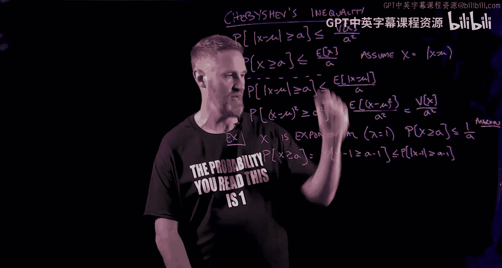
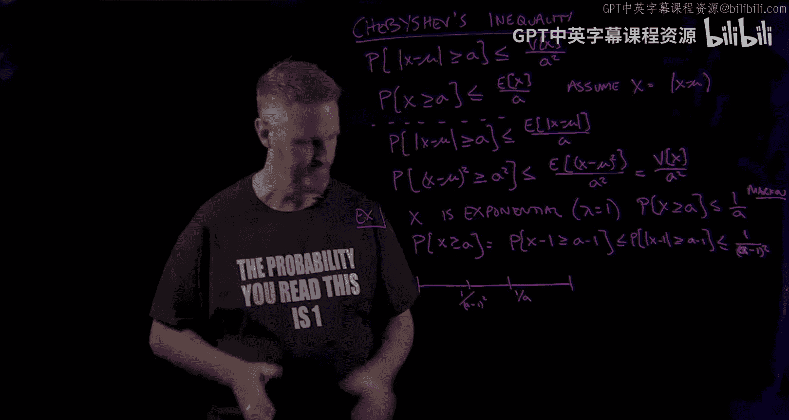

#  064：切比雪夫不等式 📊

在本节课中，我们将学习另一个重要的概率不等式——切比雪夫不等式。我们将了解它的定义、推导过程，并通过一个具体例子来比较它与马尔可夫不等式，看看它如何提供一个更紧的概率上界。

## 概述

切比雪夫不等式描述了随机变量偏离其均值的概率上界。具体来说，它指出随机变量 `X` 与其均值 `μ` 的绝对偏差超过某个阈值 `a` 的概率，不会超过 `X` 的方差除以 `a` 的平方。

其核心公式如下：

**P(|X - μ| ≥ a) ≤ Var(X) / a²**

上一节我们介绍了马尔可夫不等式，它利用期望值来界定概率。本节中，我们将基于马尔可夫不等式来推导切比雪夫不等式，并展示它在某些情况下能提供更精确的估计。

## 从马尔可夫不等式推导

马尔可夫不等式指出，对于一个非负随机变量 `Y`，有：

**P(Y ≥ a) ≤ E[Y] / a**

为了推导切比雪夫不等式，我们令 `Y = (X - μ)²`。显然，`Y` 是一个非负随机变量。

根据马尔可夫不等式，我们可以得到：

**P((X - μ)² ≥ a²) ≤ E[(X - μ)²] / a²**

请注意，事件 `|X - μ| ≥ a` 等价于事件 `(X - μ)² ≥ a²`。因此，上式左边就是 `P(|X - μ| ≥ a)`。

同时，根据方差的定义，`E[(X - μ)²]` 正是随机变量 `X` 的方差 `Var(X)`。

将这两个事实代入上式，我们就得到了切比雪夫不等式：

**P(|X - μ| ≥ a) ≤ Var(X) / a²**

这个推导过程清晰地展示了切比雪夫不等式如何从更基础的马尔可夫不等式演化而来，并引入了方差这一衡量数据离散程度的关键概念。

## 与马尔可夫不等式的比较

为了理解切比雪夫不等式的优势，我们来看一个具体例子。假设随机变量 `X` 服从参数 λ=1 的指数分布。

以下是使用两种不等式对 `P(X ≥ a)` 进行估计的结果：

*   **使用马尔可夫不等式**：对于指数分布 `Exp(1)`，其期望 `E[X] = 1`。根据马尔可夫不等式，有：
    `P(X ≥ a) ≤ E[X] / a = 1 / a`

*   **使用切比雪夫不等式**：首先，我们将事件 `X ≥ a` 进行变换。因为 `μ = 1`，所以 `X ≥ a` 等价于 `X - 1 ≥ a - 1`。一个更强的条件是 `|X - 1| ≥ a - 1`（因为绝对值要求两边都满足）。因此：
    `P(X ≥ a) ≤ P(|X - 1| ≥ a - 1)`
    然后应用切比雪夫不等式。指数分布 `Exp(1)` 的方差 `Var(X) = 1`。令不等式中的 `a` 为 `(a-1)`，得到：
    `P(|X - 1| ≥ a - 1) ≤ Var(X) / (a-1)² = 1 / (a-1)²`

通过比较可以发现，当 `a > 1` 时，分母 `(a-1)²` 的增长速度远快于 `a`。因此，`1/(a-1)²` 这个上界通常比 `1/a` 更小、更紧，这意味着切比雪夫不等式给出了一个更精确的概率上限估计。

## 总结

本节课中我们一起学习了切比雪夫不等式。我们首先回顾了马尔可夫不等式，并以此为基础推导出了切比雪夫不等式的公式 **P(|X - μ| ≥ a) ≤ Var(X) / a²**。该不等式利用随机变量的方差，为其偏离均值的程度设定了一个概率上界。

通过一个指数分布的例子，我们比较了切比雪夫不等式和马尔可夫不等式。结果表明，由于方差包含了比期望更多的分布信息（离散程度），切比雪夫不等式往往能提供一个更严格、更有效的概率上界。这是分析随机变量尾部概率行为的一个强大工具。