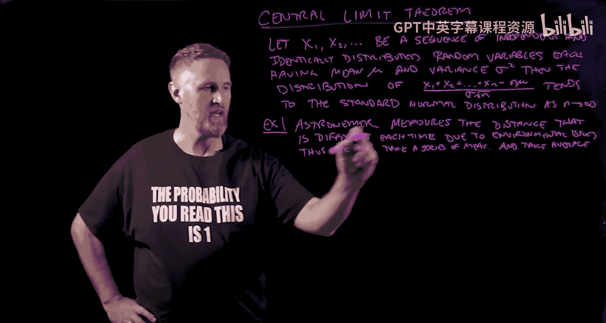
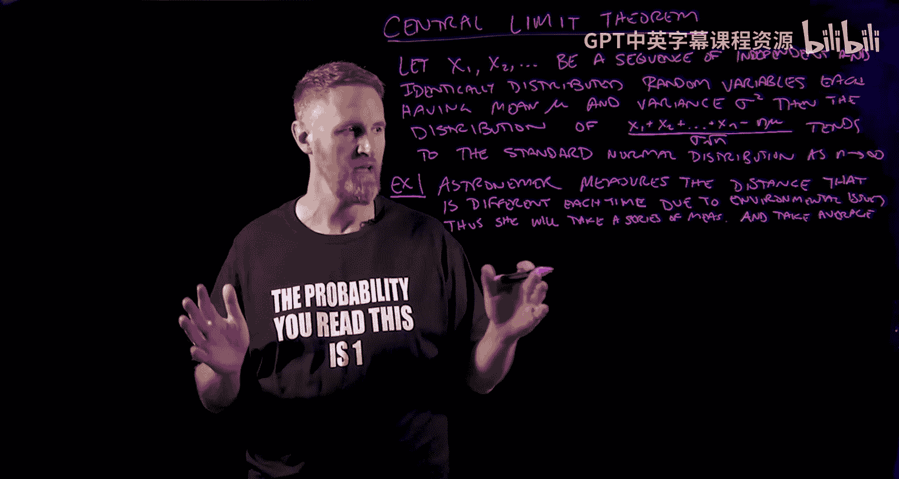
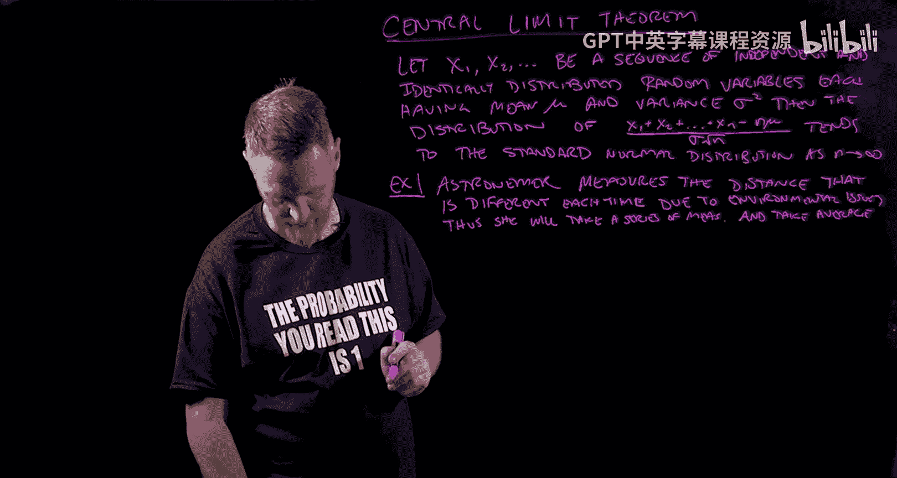
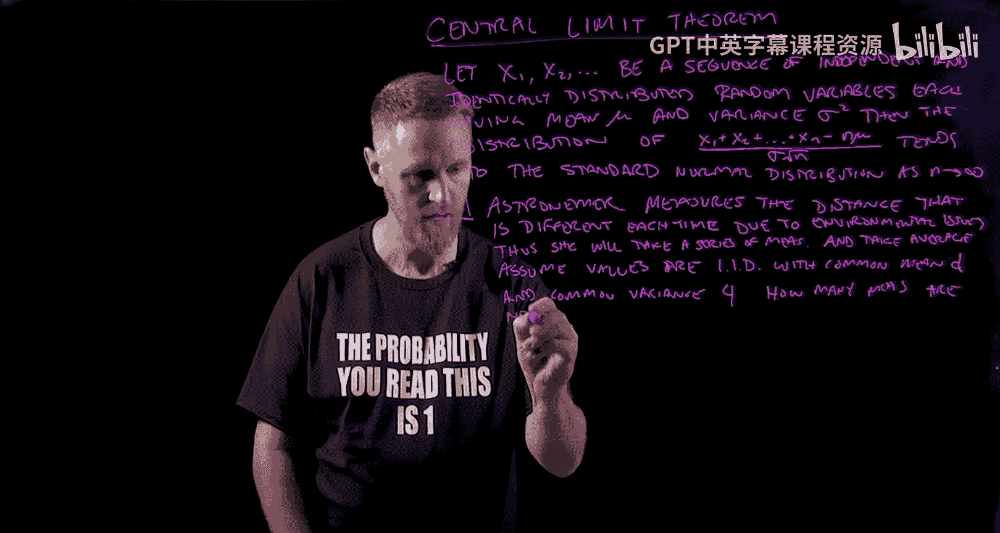
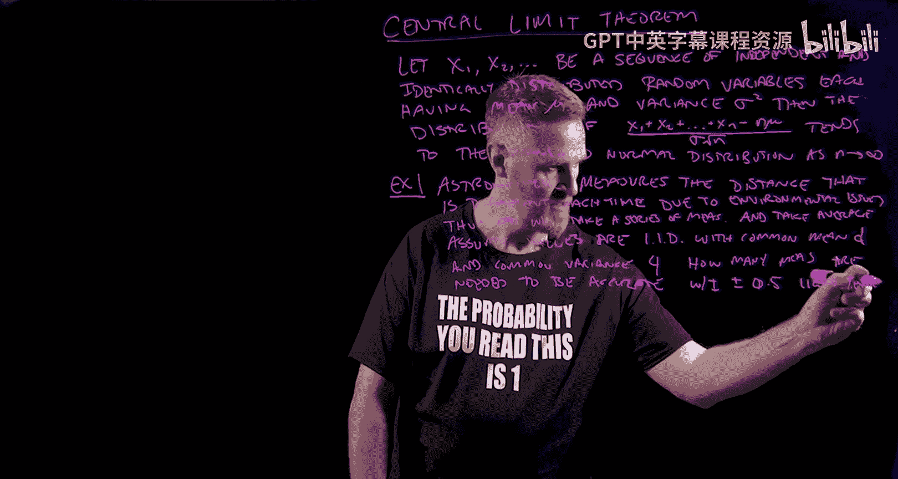
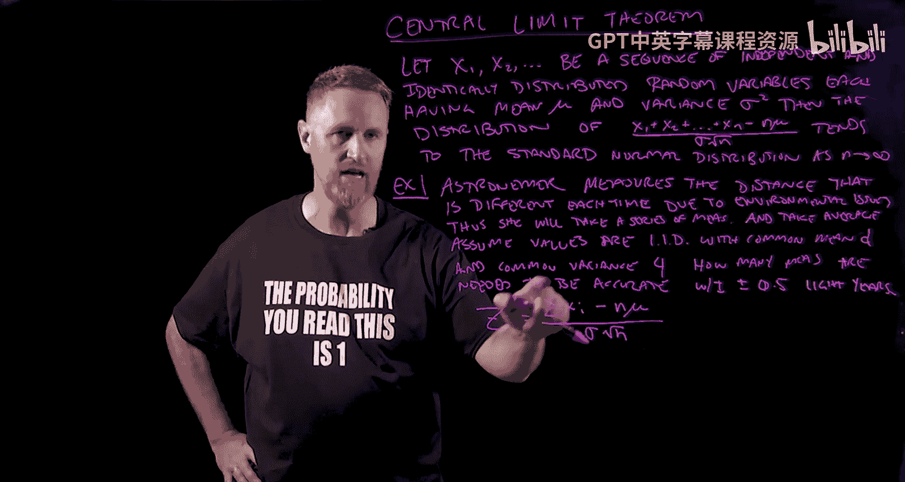
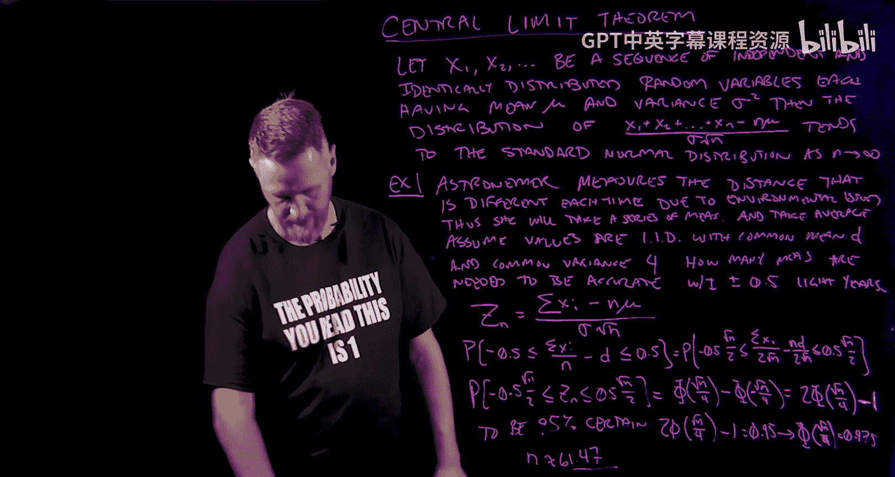

#  065：中心极限定理 📊

在本节课中，我们将要学习中心极限定理。这是概率论与统计学中最重要的定理之一，它解释了为什么许多独立随机变量之和的分布会趋近于正态分布。

## 概述

在本模块中，我们已经讨论了多个极限定理。我们介绍了马尔可夫定理，探讨了墨菲定律及其启示，并学习了切比雪夫不等式。现在，我们将探讨一个可能最重要、也最常用的定理——中心极限定理。

## 中心极限定理的定义

中心极限定理的表述如下：

设 **X₁, X₂, ...** 是一系列独立同分布的随机变量。

每个变量具有均值 **μ** 和方差 **σ²**。

那么，以下标准化和式的分布：

**Zₙ = (X₁ + X₂ + ... + Xₙ - nμ) / (σ√n)**

当 **n** 趋近于无穷大时，会趋近于标准正态分布。

标准正态分布是指均值为 **0**、方差为 **1** 的正态分布。我们不会在此证明该定理，因为它在任何统计学教材中都有详细记载。我们将通过一个示例问题来解释其应用。

## 应用示例：天文学家的测量问题

假设一位天文学家正在测量一个距离。由于环境因素，每次测量结果都会有所不同。她将进行一系列测量，然后计算这些测量值的平均值，以获得该距离的中心趋势。

我们假设这些测量值是独立同分布的。这意味着每次观测不依赖于前一次观测，并且所有观测都来自同一个分布。

我们进一步假设这些观测值具有共同的均值 **μ** 和共同的方差 **σ²**。为了具体说明，我们设方差 **σ² = 4**。

现在的问题是：这位天文学家需要进行多少次测量，才能以95%的置信度确保其样本平均值与真实均值 **μ** 的误差在 **±0.5** 光年之内？

## 问题求解过程

首先，我们定义标准化变量 **Zₙ**：

**Zₙ = (Σᵢ Xᵢ - nμ) / (σ√n)**

我们的目标是求解概率：

**P( -0.5 ≤ (Σᵢ Xᵢ / n) - μ ≤ 0.5 ) ≥ 0.95**

为了应用中心极限定理，我们对不等式进行变换。将不等式两边同时乘以 **√n / σ**（其中 σ = 2），得到：

**P( -0.5 * (√n / 2) ≤ Zₙ ≤ 0.5 * (√n / 2) ) ≥ 0.95**

根据中心极限定理，当 **n** 足够大时，**Zₙ** 近似服从标准正态分布 **N(0, 1)**。因此，上述概率可以表示为标准正态分布的累积分布函数 **Φ**：

**Φ(0.5√n / 2) - Φ(-0.5√n / 2) ≥ 0.95**

由于标准正态分布是对称的，**Φ(-a) = 1 - Φ(a)**，因此上式可简化为：

**2Φ(√n / 4) - 1 ≥ 0.95**

**Φ(√n / 4) ≥ 0.975**

接下来，我们查找标准正态分布表，找到使得 **Φ(z) = 0.975** 的 **z** 值。该值约为 **1.96**。

因此，我们建立方程：

**√n / 4 ≈ 1.96**

解这个方程求 **n**：

**√n ≈ 1.96 * 4 = 7.84**

**n ≈ (7.84)² ≈ 61.47**

## 结论

本节课中我们一起学习了中心极限定理及其应用。

中心极限定理指出，无论原始随机变量服从何种分布（只要其具有有限的均值和方差），大量独立同分布随机变量之和的标准化形式，其分布都会趋近于标准正态分布。

通过天文学家测量距离的示例，我们展示了如何利用该定理来确定所需的样本量，以达到特定的精度和置信水平。计算结果表明，大约需要 **62** 次测量，才能以95%的置信度将误差控制在 ±0.5 光年之内。

这个定理是统计学中许多推断方法（如置信区间和假设检验）的理论基础，理解它对于掌握更高级的统计概念至关重要。