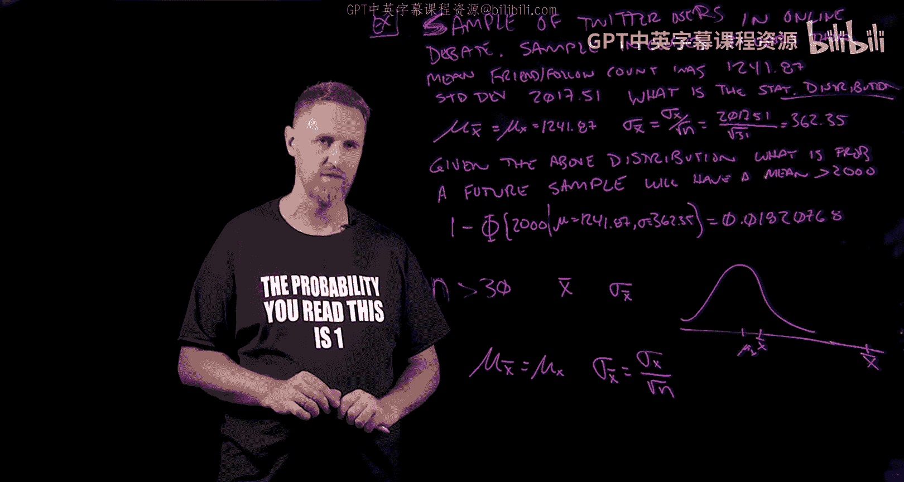

#  066：中心极限定理应用实例 📊


在本节课中，我们将学习中心极限定理的一个强大应用：如何利用它从任何分布的数据中推断总体特性，并进行概率预测。我们将通过一个具体的例子来演示这个过程。

## 概述


上一节我们介绍了中心极限定理，并了解了如何用它来估算达到特定置信水平所需的样本量。本节中，我们来看看中心极限定理的另一个核心应用：它如何帮助我们理解任何分布的数据，从而进行假设检验或预测。


中心极限定理指出，无论原始数据来自何种分布（例如高度偏斜的指数分布或正态分布），当我们从该分布中抽取多个观测值，计算其样本均值，并进行标准化处理后，这个标准化后的统计量会随着样本量 `n` 的增大而趋向于服从标准正态分布。


其核心公式如下：


```
Z = (X̄ - μ) / (σ / √n)
```


其中：
*   `X̄` 是样本均值。
*   `μ` 是总体均值。
*   `σ` 是总体标准差。
*   `n` 是样本量。


当 `n` 足够大时，`Z` 近似服从标准正态分布。这意味着，即使我们不知道原始数据的精确分布，只要样本量足够大，我们就能利用正态分布的性质对样本均值进行推断。


## 应用实例：推特用户关注者数量分析


让我们通过一个例子来具体说明。假设我们研究一群参与在线辩论的推特用户。


我们抽取了一个包含 **31** 名用户的样本。经计算，该样本用户的平均关注者数量为 **1241.87**，标准差为 **2017.51**。


现在，我们想知道：如果未来再抽取一个由31名用户组成的新样本，其平均关注者数量大于2000的概率是多少？


即使我们清楚推特关注者数量的原始分布是高度右偏的（少数名人拥有海量关注者，而大多数普通用户关注者较少），中心极限定理也允许我们进行此项计算。


### 利用中心极限定理进行推断


根据中心极限定理，对于样本量 `n = 31` 的样本均值 `X̄`，我们可以确定其分布特性。


以下是关键的计算步骤：


1.  **样本均值的均值**：样本均值 `X̄` 的期望值等于总体均值 `μ`。
    ```
    μ_X̄ = μ = 1241.87
    ```


2.  **样本均值的标准差**：样本均值 `X̄` 的标准差（即标准误）等于总体标准差 `σ` 除以样本量 `n` 的平方根。
    ```
    σ_X̄ = σ / √n = 2017.51 / √31 ≈ 362.35
    ```


3.  **分布形态**：当 `n >= 30` 时，我们可以认为样本均值 `X̄` 的分布近似服从正态分布，其均值为 `μ_X̄`，标准差为 `σ_X̄`。


因此，问题“新样本均值大于2000的概率”转化为：在一个均值为1241.87、标准差为362.35的正态分布中，随机变量取值大于2000的概率。

### 计算概率


我们可以使用统计软件来计算这个概率。计算逻辑是：
```
P(X̄ > 2000) = 1 - P(X̄ ≤ 2000)
```


在Excel中，可以使用公式：
```
=1 - NORM.DIST(2000, 1241.87, 362.35, TRUE)
```
在R语言中，可以使用代码：
```r
1 - pnorm(2000, mean = 1241.87, sd = 362.35)
```


计算结果约为 **0.0182** 或 **1.82%**。


这意味着，未来随机抽取一个31名用户的样本，其平均关注者数量超过2000的概率大约为1.82%，这是一个较小概率事件。


## 中心极限定理的威力与要点总结


本节课中，我们一起学习了中心极限定理如何将现实世界中复杂、未知的分布问题，转化为我们熟悉的正态分布问题，从而进行概率推断和假设检验。


中心极限定理之所以强大，是因为它为我们提供了一套工具，只要样本量足够大（通常以 `n >= 30` 作为经验法则），我们就可以：
*   用样本均值 `X̄` 估计总体均值 `μ`。
*   计算样本均值的变异程度（标准误 `σ/√n`）。
*   最重要的是，**认定样本均值 `X̄` 的分布近似为正态分布**。


这使得我们可以绘制正态概率分布图，并判断一个新的样本均值是否属于“正常”波动范围。如果某个样本均值落在分布极端的位置（例如尾部），我们就有理由怀疑这可能是一个统计异常值，或许意味着总体发生了某些变化。

最后，请务必牢记中心极限定理应用中的两个核心公式，它们是进行一切后续推断的基础：


1.  样本均值的均值：`μ_X̄ = μ`
2.  样本均值的标准差（标准误）：`σ_X̄ = σ / √n`




掌握这两个要点，你就能利用中心极限定理，对来自几乎任何分布的数据进行有效的统计分析了。