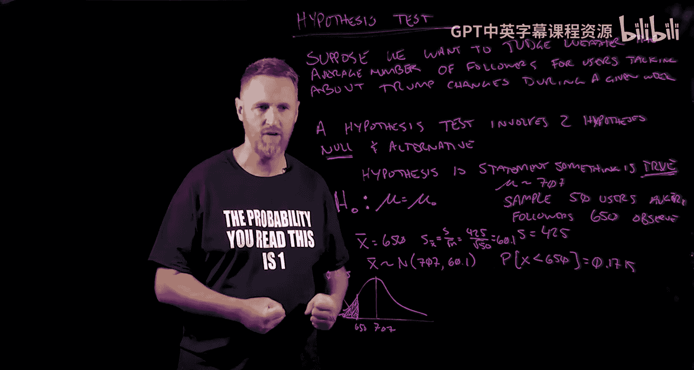
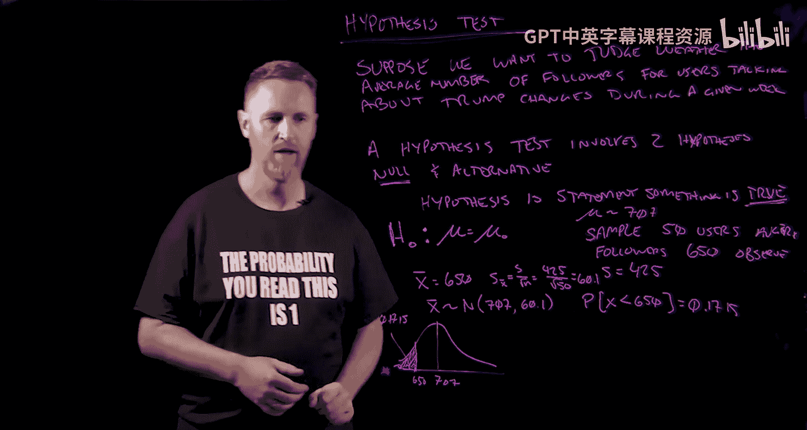
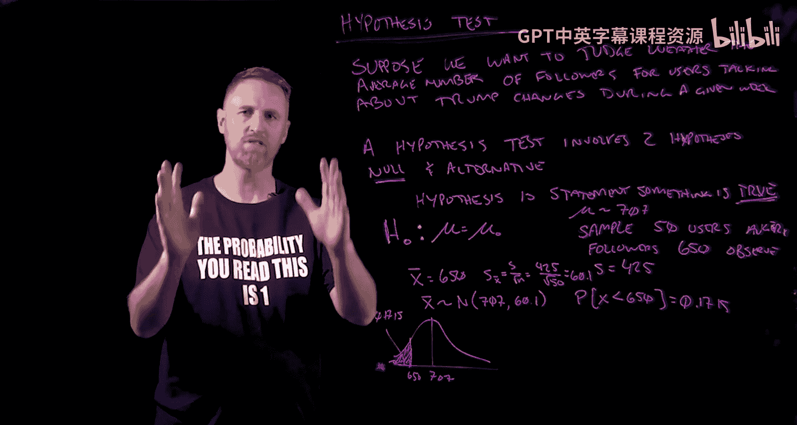
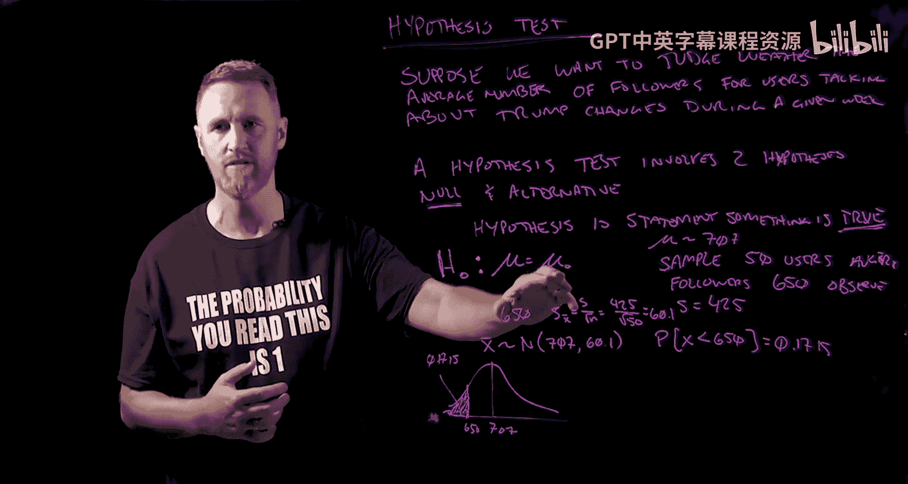
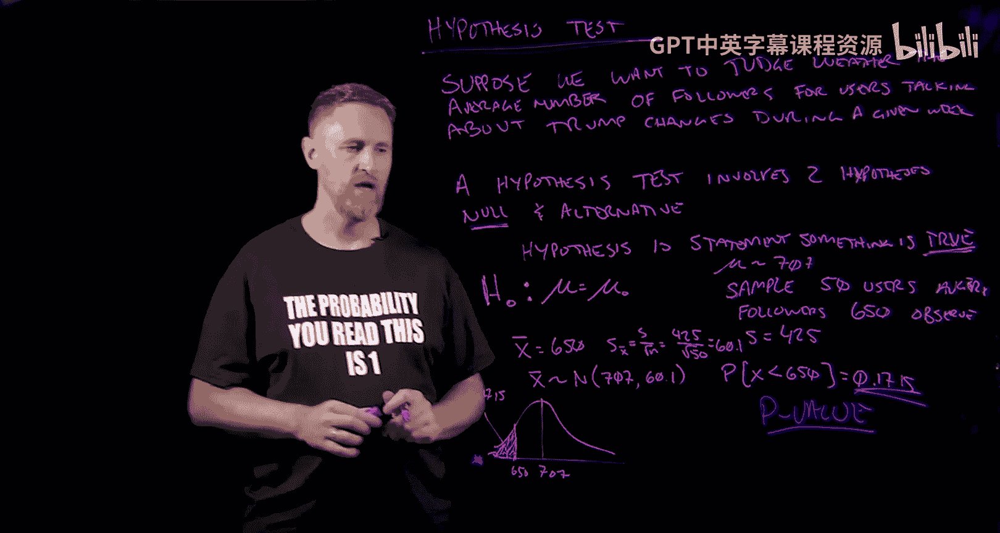
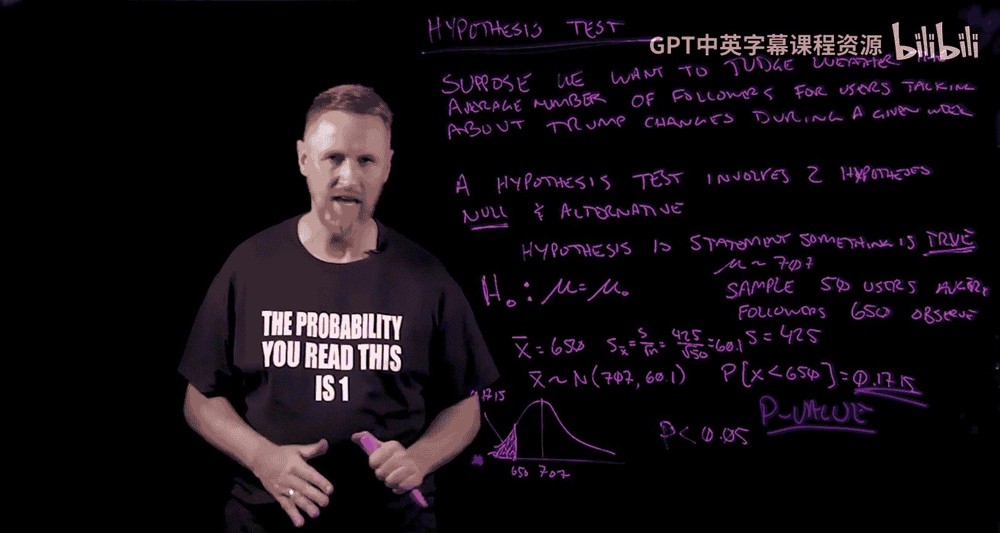
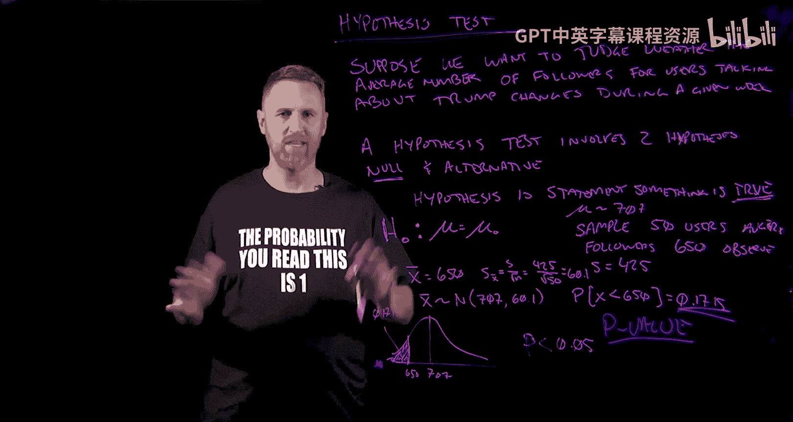
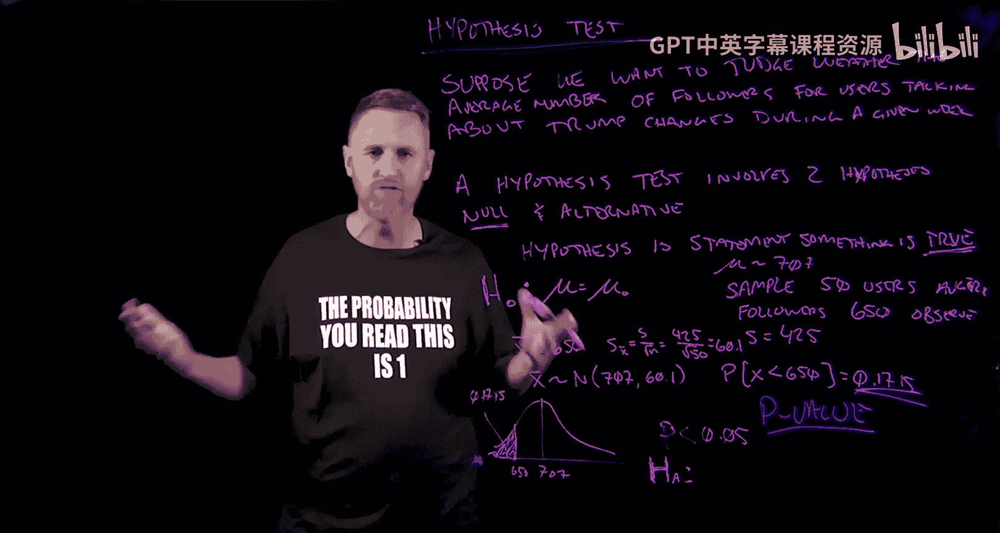
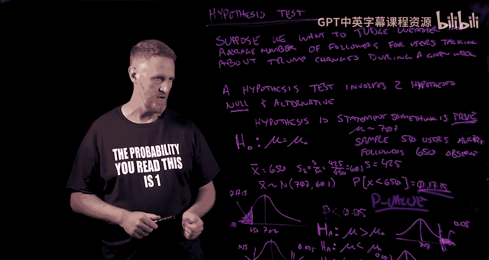

#  067：假设检验 📊

在本节课中，我们将要学习统计学中一个极其重要的概念——**假设检验**。假设检验是建模、预测和异常检测的核心工具，它允许我们基于数据，对某个关于总体的陈述（即假设）进行统计上的检验，以判断其是否显著成立。

上一节我们介绍了中心极限定理等极限定理，本节中我们来看看如何利用这些定理进行假设检验。

## 假设检验的基本概念

假设检验涉及两个对立的陈述，我们称之为**假设**。

以下是假设检验的两个核心组成部分：

*   **零假设**：通常记作 **H₀**。这是一个关于总体参数的明确陈述，例如“总体均值等于某个特定值”。它代表了“没有变化”或“基准状态”。
*   **备择假设**：通常记作 **H₁** 或 **Hₐ**。这是与零假设对立的陈述，代表了研究者想要验证的“有变化”或“实验效应”。

一个**假设**必须是一个关于某事为真的**明确陈述**。例如，我们不说“均值没有变化”，而说“均值等于707”。

## 一个实例：特朗普的粉丝数变化

为了理解假设检验，我们来看一个例子：判断在某一周内，讨论特朗普的用户平均粉丝数是否发生了变化。

假设我们已知上个月（基准期）讨论特朗普的用户平均粉丝数为 **μ = 707**。
本周，我们随机抽取了 **n = 50** 名用户，计算得到样本平均粉丝数 **x̄ = 650**，样本标准差 **s = 425**。

我们的零假设是：本周的平均粉丝数没有变化，即 **H₀: μ = 707**。
备择假设是：本周的平均粉丝数发生了变化，即 **H₁: μ ≠ 707**。

## 利用中心极限定理进行计算

根据中心极限定理，当样本量足够大（n > 30）时，样本均值 **x̄** 的抽样分布近似服从正态分布。

其分布的均值为我们假设的总体均值 **μ₀ = 707**。
其分布的标准差（即标准误）为：**σₓ̄ = s / √n**。

代入我们的数据：
**σₓ̄ = 425 / √50 ≈ 60.1**

因此，在零假设成立的前提下，我们本周观测到的样本均值 **x̄** 应服从 **N(707， 60.1²)** 的正态分布。

接下来，我们计算在当前分布下，观测到 **x̄ ≤ 650**（或更极端情况）的概率。这可以通过计算正态分布的累积概率得到：
**P(x̄ ≤ 650 | μ=707， σₓ̄=60.1)**

使用统计软件（如R）计算，得到该概率 **P ≈ 0.1715**。

## 理解P值与决策

计算出的概率 **0.1715** 被称为 **P值**。它表示，如果零假设（平均粉丝数为707）是真的，那么我们观测到样本平均粉丝数为650或更低（更极端）的概率是17.15%。

这个概率不算很小。在统计学中，我们通常会预先设定一个显著性水平 **α**（常设为0.05）。如果P值小于α，我们认为观测到的数据在零假设下极不可能发生，从而有足够证据**拒绝零假设**。

在此例中，P值 (0.1715) > α (0.05)，因此我们没有足够证据拒绝零假设。我们不能断定本周的平均粉丝数发生了显著变化。样本均值650与基准值707的差异，很可能只是随机抽样波动造成的。

## 单尾检验与双尾检验

在上面的例子中，我们的备择假设是 **μ ≠ 707**，这意味着我们关心均值在**任何一个方向**（增加或减少）上的变化。这称为**双尾检验**。我们将显著性水平α平分到正态分布的两侧尾部（每侧α/2 = 0.025）。

然而，有时研究者的兴趣只在**一个方向**上。这引出了**单尾检验**的概念：

*   **右侧单尾检验**：例如，特朗普团队可能只关心粉丝数是否**显著增加**。此时备择假设为 **H₁: μ > 707**。全部α=0.05的拒绝域都在分布的右尾。
*   **左侧单尾检验**：例如，竞争对手可能只关心粉丝数是否**显著减少**。此时备择假设为 **H₁: μ < 707**。全部α=0.05的拒绝域都在分布的左尾。

**关键区别**：在相同的α水平下，单尾检验比双尾检验更容易拒绝零假设（因为拒绝域全部集中在一侧，阈值更宽松），但前提是你必须事先有明确的方向性预测。

## 假设检验的逻辑总结

本节课中我们一起学习了假设检验的核心逻辑：

1.  **提出假设**：建立明确的零假设 **H₀** 和备择假设 **H₁**。
2.  **构建检验统计量**：在 **H₀** 为真的假设下，利用中心极限定理等工具，确定样本统计量（如样本均值）的抽样分布。
3.  **计算P值**：根据实际观测到的数据，计算在 **H₀** 成立时，得到当前结果或更极端结果的概率。
4.  **做出决策**：将P值与预先设定的显著性水平α进行比较。如果 **P值 < α**，则拒绝 **H₀**，接受 **H₁**，认为变化是统计显著的；否则，不拒绝 **H₀**。

其根本思想是：**我们假设H₀为真，然后看数据是否与此假设严重矛盾。如果矛盾程度足够大（P值很小），我们就怀疑并拒绝这个初始假设。** 中心极限定理为我们提供了将实际问题转化为已知分布（正态分布）进行计算的理论基础。

这是一个需要仔细理解的概念，在后续模块中，我们将对假设检验进行更深入的探讨和练习。