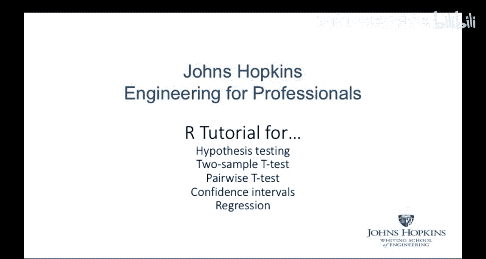

#  073：概述


在本教程中，我们将学习如何使用R语言进行统计检验和线性回归分析。我们将涵盖假设检验、置信区间以及线性回归模型的构建与诊断。通过具体的代码示例，我们将一步步演示如何从数据中得出结论。

## R语言统计检验教程：2：假设检验

上一节我们介绍了本教程的主要内容，本节中我们来看看如何进行假设检验。我们将从一个关于推特账户关注者数量的例子开始。

首先，我们需要清理工作空间，确保没有遗留的变量影响分析。

```r
# 清理工作空间
rm(list = ls())
```

假设我们有一个基线数据：一个月前，推特账户的平均关注者数量为707。现在我们收集了一个包含50个账户的新样本，其平均关注者数量为650，样本标准差估计为425。问题是，这个下降是否具有统计显著性？

我们首先应用中心极限定理来计算样本均值的标准差。

```r
# 输入数据
x <- 650          # 新样本均值
x_bar <- 707      # 基线均值
s <- 425          # 样本标准差
n <- 50           # 样本量

# 计算样本均值的标准差
s_x_bar <- s / sqrt(n)
```

接下来，我们使用`pnorm`函数计算P值，检验新观测值650是否显著低于基线均值707。

```r
# 计算单侧（下尾）P值
p_value_norm <- pnorm(x, mean = x_bar, sd = s_x_bar)
p_value_norm
```

得到的P值约为0.17，大于常用的显著性水平0.05。因此，我们没有足够的证据拒绝原假设。即使平均减少了57个关注者，这种差异在统计上并不显著。

如果我们观测到的均值是608，结果会如何？

```r
# 测试另一个值
x2 <- 608
p_value_norm2 <- pnorm(x2, mean = x_bar, sd = s_x_bar)
p_value_norm2
```

此时P值小于0.05，我们可以得出结论，关注者数量显著下降。

然而，为了减少偏差，通常更推荐使用t检验。以下是使用t检验的步骤。

```r
# 计算t检验统计量
t_stat <- (x - x_bar) / (s / sqrt(n))

# 计算t分布下的P值（单侧，下尾）
p_value_t <- pt(t_stat, df = n - 1)
p_value_t
```

t检验得到的P值约为0.1738，与正态近似的结果相似，但通常更保守。

如果观测值大于均值（例如764），我们需要计算上尾概率。

```r
# 测试大于均值的情况
x3 <- 764
t_stat3 <- (x3 - x_bar) / (s / sqrt(n))
p_value_t3 <- 1 - pt(t_stat3, df = n - 1) # 计算上尾概率
p_value_t3
```

## R语言统计检验教程：3：双样本t检验

上一节我们介绍了单样本t检验，本节中我们来看看如何比较两个独立样本的均值，即双样本t检验。

我们以大学教师薪资数据为例。私立学院35名教师的平均薪资为88.19k，标准差为26.21k。公立学院30名教师的平均薪资为73.18k，标准差为23.95k。问题是两者是否存在显著差异。

首先输入数据。

```r
# 私立学院数据
x1 <- 88.19
s1 <- 26.21
n1 <- 35

# 公立学院数据
x2 <- 73.18
s2 <- 23.95
n2 <- 30
```

计算合并标准差和t统计量。

```r
# 计算合并标准差
s_pooled <- sqrt(((n1 - 1) * s1^2 + (n2 - 1) * s2^2) / (n1 + n2 - 2))

# 计算t统计量
t_stat_two <- (x1 - x2) / (s_pooled * sqrt(1/n1 + 1/n2))
t_stat_two
```

由于t统计量为正，我们计算上尾概率。对于双侧检验，需要将单侧P值乘以2。

```r
# 计算单侧P值（上尾）
p_one_sided <- 1 - pt(t_stat_two, df = n1 + n2 - 2)

# 计算双侧P值
p_two_sided <- 2 * p_one_sided
p_two_sided
```

双侧P值约为0.0196，小于0.05，因此我们可以得出结论，私立和公立学院教师的平均薪资存在显著差异。

R语言内置的`t.test`函数可以简化这个过程。以下是使用模拟数据的例子。

```r
# 生成两个模拟数据集
set.seed(123) # 确保结果可重现
set_one <- rnorm(30, mean = 5, sd = 2)
set_two <- rnorm(30, mean = 7, sd = 2)

# 使用t.test函数进行双侧检验
test_result <- t.test(set_one, set_two, alternative = "two.sided")
test_result
```

查看输出的P值，可以判断是否拒绝原假设。

## R语言统计检验教程：4：配对样本t检验

上一节我们比较了两个独立样本，本节中我们来看看配对样本t检验。这种检验适用于两组观测值来自同一受试者或配对对象的情况，例如品尝两种配方的饼干。

假设我们有每位受试者对两种配方（A和B）的评分。我们关心的是评分差异，而不是单独的均值。

```r
# 假设set_one和set_two是配对数据（例如，同一批人品尝两种饼干）
# 计算差异向量
difference <- set_one - set_two

# 对差异进行t检验，检验其均值是否显著不为0
paired_test <- t.test(difference, mu = 0, alternative = "two.sided")
paired_test
```

配对t检验考虑了配对关系，通常能提供更精确的检验。如果差异均值为负（即大多数人更喜欢配方B），但我们在检验中指定`alternative = "greater"`（检验配方A是否更好），则会得到一个很大的P值，表明该假设不被支持。

```r
# 错误方向的检验示例
paired_test_wrong <- t.test(difference, mu = 0, alternative = "greater")
paired_test_wrong
```

## R语言统计检验教程：5：置信区间

上一节我们介绍了各种t检验，本节中我们来看看如何为总体均值构建置信区间。

回到推特关注者的例子。我们有一个样本均值`x_bar = 707`，样本标准差`s = 425`，样本量`n = 50`。我们希望构建总体均值的95%置信区间。

计算过程如下：

```r
# 计算t分布的分位数（双侧，95%置信水平）
t_critical <- qt(0.975, df = n - 1) # 0.025在每侧尾部

# 计算误差范围
margin_of_error <- t_critical * (s / sqrt(n))

# 计算置信区间下限和上限
ci_lower <- x_bar - margin_of_error
ci_upper <- x_bar + margin_of_error
c(ci_lower, ci_upper)
```

我们得到置信区间约为[586, 828]。这意味着我们有95%的信心认为真实的平均关注者数量在这个区间内。如果未来的观测值落在这个区间外，我们可能认为发生了显著变化。

对于已有的数据集，我们可以直接从`t.test`的结果中提取置信区间。

```r
# 对set_one数据计算置信区间
test_for_ci <- t.test(set_one)
confidence_interval <- test_for_ci$conf.int
confidence_interval
```

## R语言统计检验教程：6：线性回归入门

上一节我们学习了参数估计的区间，本节中我们将转向预测模型，学习线性回归。

我们使用一个关于汽车加油量和行驶里程的示例数据集。目标是建立行驶里程（因变量）关于加油量（自变量）的线性模型。

首先，创建数据框并查看数据。

```r
# 创建数据框
gas_data <- data.frame(
  gallons = c(10, 15, 8, 12, 9, 11, 7, 14, 13, 10),
  miles = c(250, 380, 200, 300, 230, 280, 180, 350, 320, 255)
)

# 查看数据
head(gas_data)
```

## R语言统计检验教程：7：数据探索与可视化

在构建模型前，进行数据探索至关重要。以下是关键步骤。

首先，绘制散点图观察变量间关系。

```r
# 绘制散点图与平滑曲线
scatter.smooth(gas_data$gallons, gas_data$miles,
               xlab = "Gallons of Gas",
               ylab = "Miles Driven",
               main = "Miles vs. Gallons")
```

图形大致呈线性关系，适合线性回归。

其次，检查异常值。我们可以使用箱线图。

```r
# 将图形区域分为1行2列，并排绘制箱线图
par(mfrow = c(1, 2))
boxplot(gas_data$gallons, main = "Gallons")
boxplot(gas_data$miles, main = "Miles")
par(mfrow = c(1, 1)) # 恢复默认图形设置
```

如果发现异常值（如数据录入错误），应在分析前修正或决定其处理方式。

第三，检查正态性假设。我们可以绘制密度图。

```r
# 绘制密度图检查正态性
par(mfrow = c(1, 2))
plot(density(gas_data$gallons), main = "Density of Gallons", col = "lightblue", lwd = 2)
polygon(density(gas_data$gallons), col = "lightblue")
plot(density(gas_data$miles), main = "Density of Miles", col = "lightcoral", lwd = 2)
polygon(density(gas_data$miles), col = "lightcoral")
par(mfrow = c(1, 1))
```

分布大致呈钟形，正态性假设基本合理。

最后，计算相关系数。

```r
# 计算相关系数
correlation <- cor(gas_data$gallons, gas_data$miles)
correlation
```

相关系数接近1，表明强正相关。

## R语言统计检验教程：8：构建与评估线性模型

现在我们可以构建线性回归模型。

使用`lm()`函数拟合模型，并使用`summary()`查看结果。

```r
# 拟合线性模型
model <- lm(miles ~ gallons, data = gas_data)

# 查看模型摘要
summary(model)
```

模型摘要包含丰富信息：
*   **系数估计**：`(Intercept)`是截距，`gallons`是斜率。斜率估计值约为24.6，P值极小（`<2e-16`），表明加油量对里程有显著影响。
*   **截距**：P值较大（0.584），统计上不显著。但从业务角度（加油量为0时里程应为0），我们可能选择保留截距。
*   **R-squared**：多重R平方为0.94，说明模型能解释94%的里程变异，拟合度很好。
*   **Adjusted R-squared**：调整R平方考虑了预测变量数量，在多元回归中更有参考价值。

## R语言统计检验教程：9：回归诊断

得到模型后，必须检查回归假设是否成立，特别是残差的正态性和同方差性。

首先，检查残差的正态性。使用Q-Q图。

```r
# 获取标准化残差
standardized_residuals <- rstandard(model)

# 绘制Q-Q图
qqnorm(standardized_residuals, main = "Q-Q Plot of Standardized Residuals")
qqline(standardized_residuals, col = "red")
```

理想情况下，点应大致落在红色参考线上。若有明显偏离的点，可能需要检查对应数据。

其次，检查残差的同方差性。绘制残差与拟合值的散点图。

```r
# 获取普通残差和拟合值
regular_residuals <- resid(model)
fitted_values <- fitted(model)

# 绘制残差 vs. 拟合值图
plot(fitted_values, regular_residuals,
     xlab = "Fitted Values",
     ylab = "Residuals",
     main = "Residuals vs. Fitted")
abline(h = 0, col = "red", lty = 2) # 添加y=0参考线
```

我们希望残差随机、均匀地分布在0线周围，无明显模式。如果出现漏斗形或曲线模式，则可能违反同方差假设。

若发现异常点，应检查原始数据，决定是否修正或剔除，并重新评估模型。

## R语言统计检验教程：10：总结

在本教程中，我们一起学习了使用R语言进行统计推断和建模的核心方法。

我们首先从**假设检验**开始，涵盖了单样本t检验、双样本t检验以及配对样本t检验，并演示了如何计算P值并做出统计决策。

接着，我们探讨了如何构建总体均值的**置信区间**，为参数估计提供了范围。

最后，我们深入学习了**线性回归**。从数据探索和可视化开始，到使用`lm()`函数构建模型，解读`summary()`输出中的系数、P值和R平方，最后通过残差分析进行回归诊断，确保模型假设的合理性。



通过本教程，你应该已经掌握了利用R语言对数据进行基本统计检验和建立简单线性回归模型的完整流程。这些技能是数据分析和科学计算的基础。