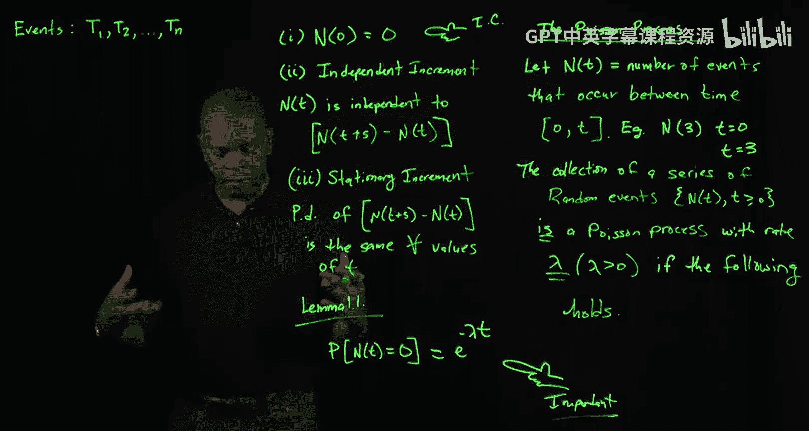

#  074：泊松过程 🧮

在本节课中，我们将要学习泊松过程。泊松过程是一种用于描述随机事件在时间上发生的模型，它在计算机科学、网络流量分析、排队论等领域有广泛应用。我们将从定义开始，逐步探讨其核心性质，并学习如何计算事件间的到达时间。

---

## 泊松过程的定义

上一节我们介绍了随机事件计数的概念，本节中我们来看看泊松过程的正式定义。

假设我们用一个随机变量 **N(t)** 来表示在时间区间 **[0, t]** 内发生的事件数量。例如，**N(3)** 表示在时间 0 到 3 之间发生的事件数。

如果一系列随机事件 **{N(t), t ≥ 0}** 的集合满足以下三个条件，那么我们就称这个集合是一个**速率为 λ (λ > 0)** 的泊松过程。

以下是泊松过程必须满足的三个条件：

1.  **初始条件**：在时间 **t = 0** 时，没有事件发生。即 **N(0) = 0**。
2.  **独立增量**：对于任意时间 **t** 和 **s (s > 0)**，在时间区间 **(t, t+s]** 内发生的事件数 **N(t+s) - N(t)**，与时间 **t** 之前发生的事件数 **N(t)** 相互独立。
3.  **平稳增量**：对于任意时间 **t** 和 **s**，在时间区间 **(t, t+s]** 内发生的事件数 **N(t+s) - N(t)** 的概率分布，只依赖于区间长度 **s**，而与起始时间 **t** 无关。

---

## 核心性质与公式

基于以上定义，我们可以推导出泊松过程的一些重要性质。

一个关键的引理是：在泊松过程中，在时间区间 **[0, t]** 内没有事件发生的概率服从指数分布。

其公式为：
**P(N(t) = 0) = e^{-λt}**

这个公式表明，事件发生的间隔时间与指数分布密切相关。

---

## 事件到达时间分析

理解了事件计数的分布后，我们很自然地会问：事件之间的时间间隔有什么规律？

假设我们记录了一系列连续事件的到达时间，记为 **T₁, T₂, ..., Tₙ**。我们关心的是事件之间的**到达间隔时间**。

这里有一个重要的命题：

如果事件到达时间 **T₁, T₂, ..., Tₙ** 是**独立**的，并且每个间隔时间都服从**指数分布**，那么对于每一个间隔时间 **Tᵢ**，其期望值（均值）为：
**E[Tᵢ] = 1/λ**

这个结论非常重要。它意味着在速率为 λ 的泊松过程中，事件之间的平均等待时间是 **1/λ**。速率 λ 越高，平均等待时间就越短。

---

## 总结

本节课中我们一起学习了泊松过程的核心内容。

我们首先定义了泊松过程，它需要满足**初始条件**、**独立增量**和**平稳增量**三个特性。接着，我们推导出在给定时间内无事件发生的概率公式 **P(N(t)=0) = e^{-λt}**。最后，我们探讨了事件到达间隔时间，并得出了一个关键结论：在泊松过程中，事件间隔时间是独立的指数随机变量，其平均间隔时间为 **1/λ**。

理解泊松过程是分析许多随机系统（如服务器请求、粒子衰变、电话呼叫中心）的基础。在接下来的课程中，我们将以此为基础，继续学习马尔可夫链等相关概念。