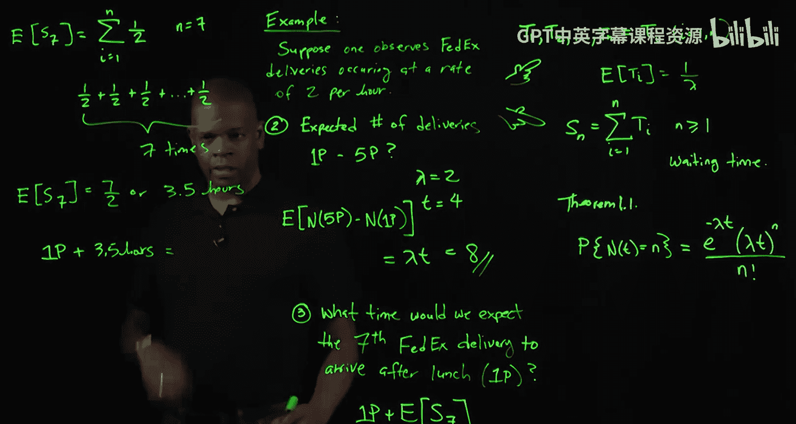

#  075：泊松过程的应用与问题求解

在本节课中，我们将学习如何应用泊松过程的理论知识来解决实际问题。我们将通过几个具体的例子，展示如何计算事件发生的概率、期望数量以及期望等待时间。

## 概述

上一节我们介绍了泊松过程中的事件到达时间、等待时间等核心概念。本节中，我们来看看如何利用这些概念来解决三类典型问题：计算特定时间段内无事件发生的概率、计算期望事件数量，以及计算特定事件（如第n次事件）的期望到达时间。

## 问题一：无事件发生的概率

首先，我们考虑一个关于概率的问题。假设我们观察到联邦快递（FedEx）的包裹投递以每小时2次的速率发生（即 λ = 2）。我们想知道在上午11点到下午2点这3个小时内，没有任何投递发生的概率是多少。

以下是解决此问题的步骤：
1.  确定时间间隔长度 t = 3 小时。
2.  利用泊松过程的**平稳增量**性质。这意味着，对于任何长度为 t 的区间，事件数量 N(t) 的分布是相同的。
3.  因此，计算 P(N(3) = 0) 等价于计算 P(N(2 PM) - N(11 AM) = 0)。
4.  根据泊松分布的性质，在时间 t 内事件数为0的概率公式为：**P(N(t) = 0) = e^{-λt}**。
5.  代入 λ=2, t=3，得到概率为 **e^{-6}**。

所以，在上午11点到下午2点之间没有包裹投递的概率是 e^{-6}。

## 问题二：期望事件数量

接下来，我们看一个关于期望值的问题。在相同的投递过程（λ = 2）中，我们想计算在下午1点到5点这4个小时内，期望的投递数量是多少。

以下是解决此问题的步骤：
1.  确定时间间隔长度 t = 4 小时。
2.  对于泊松过程，在时间 t 内发生的事件数量 N(t) 的期望值公式为：**E[N(t)] = λt**。
3.  我们要求的是 E[N(5 PM) - N(1 PM)]，根据平稳增量性，这等于 E[N(4)]。
4.  代入 λ=2, t=4，得到期望值为 **2 * 4 = 8**。

因此，在下午1点到5点之间，我们预计平均会有8次投递。

## 问题三：第n次事件的期望到达时间

最后，我们处理一个稍复杂的问题：计算特定事件（如第7次投递）的期望到达时间。假设我们从下午1点开始观察，问第7次联邦快递投递预计在什么时间到达？

以下是解决此问题的步骤：
1.  我们关注的是**等待时间** S_n，即第n次事件到达所需的时间。其定义为前n个事件间隔时间之和：**S_n = T_1 + T_2 + ... + T_n**。
2.  在泊松过程中，每个间隔时间 T_i 都服从参数为 λ 的指数分布，其期望值为 **E[T_i] = 1/λ**。
3.  因此，第n次事件的期望等待时间为：**E[S_n] = n * (1/λ)**。
4.  在本例中，n=7, λ=2，所以 E[S_7] = 7 * (1/2) = 3.5 小时。
5.  从起始时间下午1点开始，加上3.5小时的期望等待时间，得到期望到达时间为 **下午4点30分**。

所以，从下午1点算起，我们预计第7次投递将在下午4点30分到达。

## 总结

本节课中我们一起学习了如何将泊松过程的理论应用于实际问题求解。我们通过三个案例，分别计算了：
1.  特定时间段内无事件发生的概率，使用了公式 **P(N(t)=0) = e^{-λt}**。
2.  特定时间段内期望的事件数量，使用了公式 **E[N(t)] = λt**。
3.  第n次事件的期望到达时间，通过计算期望等待时间 **E[S_n] = n/λ** 并加上起始时间得到。

掌握这些方法，你就能分析各种涉及随机事件到达时间、频率和概率的问题了。