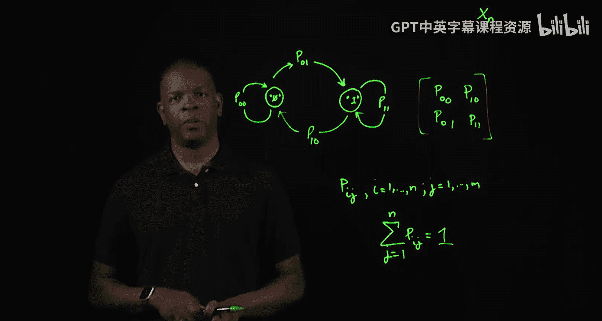

#  076：马尔可夫链 🧮

在本节课中，我们将要学习马尔可夫链。这是继之前讨论的泊松过程之后的内容。在泊松过程中，我们探讨了到达间隔时间、事件发生、等待时间以及等待第n个事件等概念。本节我们将转向马尔可夫链，它描述的是一个系统在不同状态间随时间演变的随机过程。

## 马尔可夫链的基本概念

上一节我们介绍了泊松过程，本节中我们来看看马尔可夫链。在马尔可夫链中，我们希望将随机变量 \( X_n \) 解释为系统在某个离散时间点 \( n \) 所处的状态。时间在此模型中仍然是相关的，但现在是离散递增的。

我们可以考虑特定的状态。例如，假设有两个状态：状态0和状态1。马尔可夫链的核心在于捕捉这两个状态之间的关系，以及变量如何在它们之间移动。

## 状态转移与概率矩阵

为了完整定义这个过程，我们需要描述状态间的转移概率。以下是状态转移的完整描述：

*   如果系统当前处于状态0，它可能转移到状态1，其概率记为 \( P_{01} \)。
*   如果系统当前处于状态0，它也可能保持在状态0，其概率记为 \( P_{00} \)。
*   如果系统当前处于状态1，它可能保持在状态1，其概率记为 \( P_{11} \)。
*   如果系统当前处于状态1，它也可能转移回状态0，其概率记为 \( P_{10} \)。

通过这种方式，我们捕捉到了这个过程中所有可能的结果。我们可以将这些概率组织成一个矩阵，称为转移概率矩阵。

该矩阵的形式如下：

\[
P = \begin{bmatrix}
P_{00} & P_{10} \\
P_{01} & P_{11}
\end{bmatrix}
\]

在这个矩阵中，行索引 \( i \) 代表当前状态，列索引 \( j \) 代表下一个状态。元素 \( P_{ij} \) 表示从状态 \( i \) 转移到状态 \( j \) 的概率。

## 转移矩阵的性质

现在你可能会问，这个矩阵有什么用处？为了有效地使用它，我们首先需要了解这个过程的一些基本性质。

首先，我们称这些概率为 \( P_{ij} \)。其中 \( i \) 代表行（当前状态），取值范围从1到 \( n \)，\( n \) 是状态总数；\( j \) 代表列（下一状态），取值范围从1到 \( m \)。在常规的马尔可夫链中，状态空间是相同的，因此通常 \( n = m \)。

其次，也是最重要的一点，因为这些是概率，所以对于任意给定的当前状态 \( i \)，转移到所有可能状态的概率之和必须为1。这可以用以下公式表示：

\[
\sum_{j=1}^{n} P_{ij} = 1 \quad \text{对于所有 } i
\]

这意味着转移矩阵的每一行之和必须等于1。具体到我们的两状态例子，必须满足：
*   \( P_{00} + P_{01} = 1 \)
*   \( P_{10} + P_{11} = 1 \)

如果矩阵的任一行之和不为1，那么它就不是一个有效的转移概率矩阵。

## 小结与预告

本节课中我们一起学习了马尔可夫链的核心思想：系统在离散时间点上处于不同状态，并通过转移概率矩阵描述状态间的随机转移。我们定义了状态、转移概率，并介绍了转移矩阵必须满足行和为1的关键性质。

理解这些基本概念是分析马尔可夫链模型的第一步。在接下来的视频中，我们将通过一个具体的例子来演示如何应用这些概念。