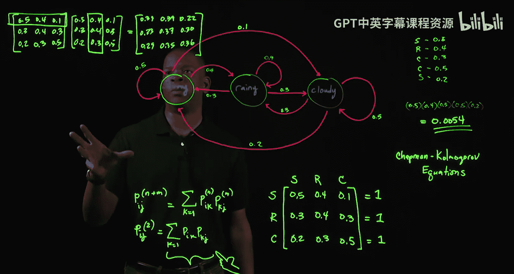

#  077：马尔可夫链实例研究 🌦️➡️☀️

在本节课中，我们将通过一个具体的天气预测例子，学习如何应用马尔可夫链进行计算和概率推断。我们将从理解基本概念开始，逐步深入到使用查普曼-科尔莫戈罗夫方程进行多步预测。

## 概述

马尔可夫链是一种描述系统状态随时间随机转移的数学模型，其核心特性是“无记忆性”，即未来状态的概率分布只依赖于当前状态。本节我们将通过一个包含三种天气状态（晴天、雨天、多云）的例子，演示如何构建转移矩阵，并计算特定事件序列的概率以及未来某天的状态概率。

## 构建天气模型

假设明天的天气仅依赖于今天的天气。这是一个典型的马尔可夫链应用场景。我们定义三个状态：**晴天**、**雨天**和**多云**。

根据给定的状态转移图，我们可以确定从一个状态转移到另一个状态的概率。例如，如果今天是晴天，那么明天是晴天的概率是0.5，是雨天的概率是0.4，是多云的概率是0.1。

## 计算特定路径的概率

首先，我们来看一个简单的问题：已知今天是晴天，求未来连续几天的天气为“晴天 -> 雨天 -> 多云 -> 多云 -> 晴天”这一特定序列发生的概率。

以下是计算步骤：
1.  从晴天开始：概率为 **1**（给定条件）。
2.  晴天转移到雨天：概率为 **0.4**。
3.  雨天转移到多云：概率为 **0.3**。
4.  多云保持为多云：概率为 **0.5**。
5.  多云转移到晴天：概率为 **0.2**。

该特定路径的总概率是这些转移概率的乘积：
`总概率 = 1 * 0.4 * 0.3 * 0.5 * 0.2 = 0.012`

## 引入转移矩阵

为了处理更复杂的问题（例如多日后的状态概率），我们需要一个更强大的工具——转移矩阵。转移矩阵 `P` 以矩阵形式系统地描述了所有状态间的转移概率。

对于我们的三状态天气系统，转移矩阵是一个3x3的矩阵：

`P = [[0.5, 0.4, 0.1],
     [0.3, 0.4, 0.3],
     [0.2, 0.3, 0.5]]`

其中，`P[i][j]` 表示从状态 `i` 转移到状态 `j` 的概率。注意，矩阵每一行的概率之和必须为1。

## 查普曼-科尔莫戈罗夫方程

上一节我们介绍了转移矩阵，本节我们来看看如何预测多天后的状态。这需要用到**查普曼-科尔莫戈罗夫方程**。该方程指出，经过 `n+m` 步从状态 `i` 转移到状态 `j` 的概率，等于所有可能中间状态 `k` 的概率之和。

其数学公式为：
`P^(n+m)[i][j] = Σ_k ( P^n[i][k] * P^m[k][j] )`

特别地，经过2步转移的概率矩阵，就是1步转移矩阵的平方：
`P² = P * P`

## 应用：预测未来天气

现在，让我们应用这个方程来解决一个实际问题：已知今天是晴天，求四天后是雨天的概率。

我们可以将四步分解为两个两步过程。首先，我们需要计算两步转移矩阵 `P²`。

通过矩阵乘法计算 `P²`：
`P² = P * P`

计算后得到的 `P²` 矩阵中，`P²[sunny][rainy]` 这个元素的值（例如0.39）就代表了从晴天开始，两天后是雨天的概率。

为了得到四天后的概率，我们需要计算 `P⁴`。根据查普曼-科尔莫戈罗夫方程，`P⁴` 可以通过 `P² * P²` 得到。最终，在 `P⁴` 矩阵中，位于“晴天”行与“雨天”列交叉位置的值，就是我们要求的“从晴天开始，四天后是雨天”的概率。具体的数值计算将在相关的R语言教程中演示。

## 总结

本节课中我们一起学习了马尔可夫链的核心应用。我们从一个简单的天气模型出发，学会了如何计算特定状态序列的概率。接着，我们引入了转移矩阵这一关键工具，并利用查普曼-科尔莫戈罗夫方程，掌握了预测系统在多个时间步长后处于某一状态的概率的方法。这个过程清晰地展示了如何将实际问题抽象为数学模型，并通过矩阵运算获得解答。