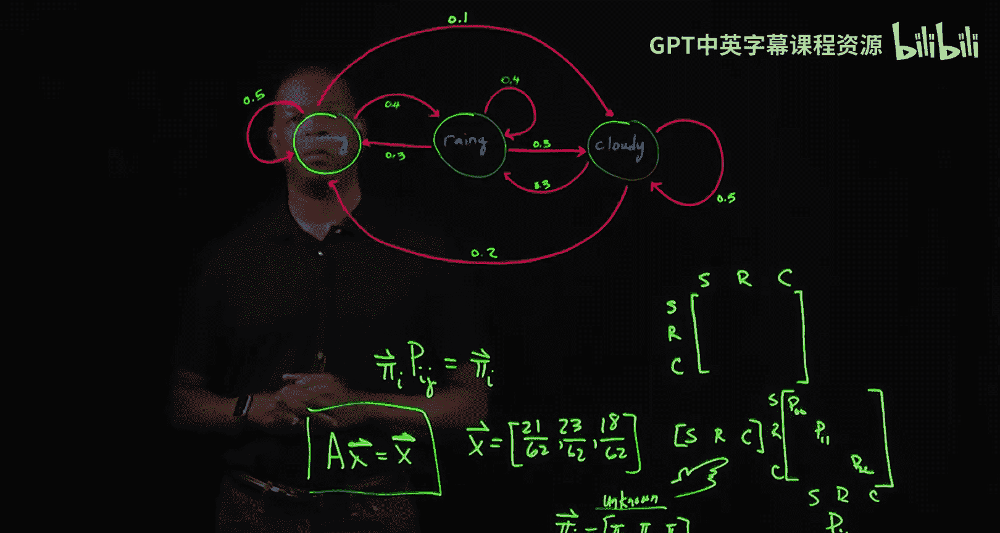
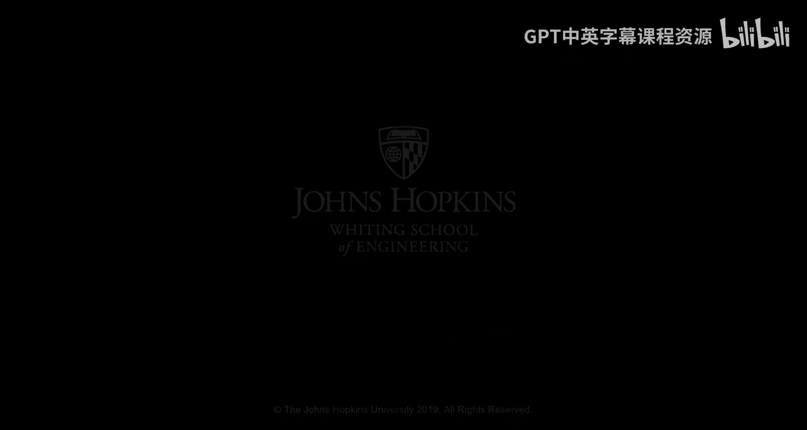

#  078：极限概率 📈

在本节课中，我们将要学习马尔可夫链中一个更强大的概念——极限概率。这个概念帮助我们理解当系统经过无限多步状态转移后，会达到一个怎样的稳定状态，并利用这个稳定状态来计算当前状态的概率。

## 从状态转移概率到稳态

上一节我们介绍了马尔可夫链，并探讨了如何用它来计算未来特定状态的概率，例如，如果今天是晴天，四天后是阴天的概率是多少。

但马尔可夫链还为我们提供了更强大的工具，这涉及到另一个问题：如果我想知道今天是雨天或阴天的概率，有多少条可能的路径会导向今天？答案是**无限多条**。存在无限多条路径会导向当前状态。因此，我们需要一个更强大的概念或原理来指导我们探索这类问题。

## 极限概率与稳态

如果我们不关心起始日期，那么在经过无限多步状态转移后，系统的影响会变得微乎其微。这意味着系统会趋近于一个所谓的**极限概率**，此时马尔可夫链达到了所谓的**稳态**。

那么，我们如何找到这个稳态呢？之前我们描述状态转移时，有源状态（如晴天、雨天、阴天）和目标状态。当我们只关心目标状态而不再关心源状态时，我们的矩阵表示就会发生变化。

## 稳态方程

在稳态下，我们只关心目标状态的概率分布。这意味着我们可以用一个向量来表示这个分布，我们称之为 **π**。这个向量包含了每个状态（如晴天、雨天、阴天）的未知概率。

设这个状态概率向量为 **π**，状态转移矩阵为 **P**。我们寻找的性质是：当 **π** 乘以 **P** 后，结果仍然是 **π** 本身。用公式表示就是：

**πP = π**

换句话说，当我们用稳态概率向量乘以转移矩阵时，得到的向量与原来的向量完全相同。这个 **π** 就是极限概率向量，它代表了马尔可夫链的稳态。一旦达到稳态，我们就可以基于这个极限概率来确定“今天”处于某个状态的概率，因为它是由无限多步转移后的概率给出的。

## 求解稳态概率

上述方程 **πP = π** 可以转化为一个线性代数问题：**Ax = x**，其中 **A** 是转移矩阵，**x** 是稳态概率向量 **π**。这正是求矩阵特征值为1时对应的**特征向量**的问题。

以下是求解稳态概率向量的一般步骤：
1.  建立方程 **πP = π**。
2.  将其重写为 **π(P - I) = 0**，其中 **I** 是单位矩阵。
3.  结合概率总和为1的约束条件：**π** 中所有元素之和为1。
4.  解这个线性方程组，即可得到稳态概率向量 **π**。

## 实例解析

以课程中的天气模型为例，通过求解上述方程，我们得到稳态概率向量为：

**π = [21/62, 23/62, 18/62]**

这个结果告诉我们：
*   今天是晴天的概率是 **21/62**。
*   今天是雨天的概率是 **23/62**。
*   今天是阴天的概率是 **18/62**。

我们将在本课配套的教程模块中详细探讨这个问题的求解过程。

## 总结

本节课中我们一起学习了马尔可夫链的**极限概率**与**稳态**概念。我们了解到，当不关心起始状态并经过无限步转移后，系统会达到一个稳定状态，其概率分布由方程 **πP = π** 决定。通过求解这个方程得到的特征向量 **π**，就是系统的稳态概率分布，它使我们能够回答关于长期或“今天”状态概率的问题。这是马尔可夫链分析中一个非常强大且实用的工具。