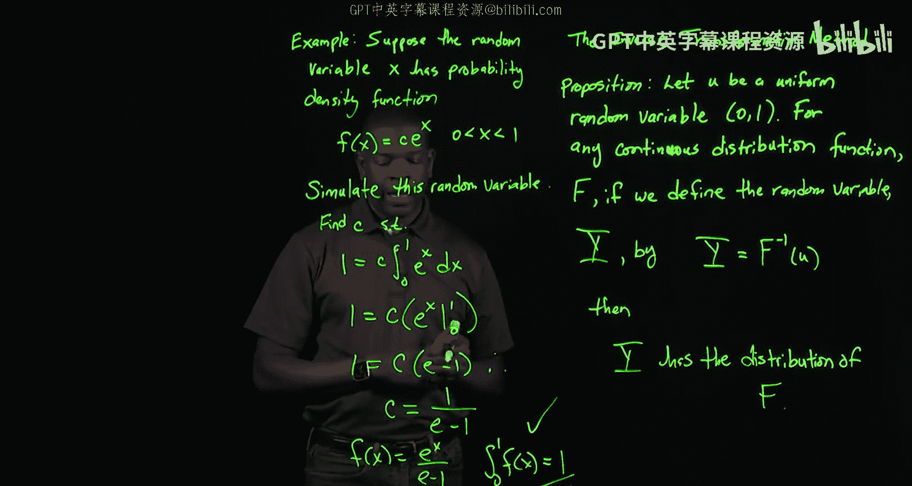

#  082：逆变换生成法 📊

在本节课中，我们将学习一种重要的随机变量模拟方法——逆变换生成法。该方法基于一个核心命题，允许我们利用均匀分布生成任意连续分布的随机变量。我们将通过一个具体示例，逐步讲解其原理和应用步骤。

---

## 概述

逆变换生成法的核心思想是：若我们有一个在区间 [0,1] 上均匀分布的随机变量 **U**，并且已知目标连续分布的概率分布函数 **F(x)**，那么通过计算 **F** 的逆函数 **F⁻¹(U)**，得到的随机变量 **Y** 将服从分布 **F**。

**核心命题公式**：
若 **U ~ Uniform(0,1)**，且 **Y = F⁻¹(U)**，则 **Y** 的分布函数为 **F**。

---

## 示例详解：模拟一个特定随机变量

上一节我们介绍了逆变换法的核心命题。本节中，我们通过一个具体例子来演示如何应用该方法。

假设我们有一个随机变量 **X**，其概率密度函数为：
**f(x) = C * e^x**，其中 **0 ≤ x ≤ 1**。

我们的目标是：模拟生成服从该密度函数 **f(x)** 的随机变量。

### 第一步：确定常数 C

由于 **f(x)** 是一个概率密度函数，其在定义域上的积分必须等于 1。这是使用任何密度函数进行模拟前必须验证的第一步。

以下是确定常数 **C** 的步骤：

1.  根据PDF的性质，建立方程：
    **1 = ∫₀¹ C * e^x dx**
2.  计算积分：
    **∫₀¹ e^x dx = e - 1**
3.  解出 **C**：
    **C = 1 / (e - 1)**
4.  因此，完整的概率密度函数为：
    **f(x) = e^x / (e - 1)**

### 第二步：计算概率分布函数 F(x)

根据逆变换法的命题，我们需要的是概率分布函数 **F(x)**，而非密度函数 **f(x)**。**F(x)** 是 **f(x)** 的累积积分。

我们通过积分 **f(x)** 来得到 **F(x)**：

**F(x) = ∫₀ˣ f(y) dy = ∫₀ˣ [e^y / (e - 1)] dy**

计算该积分，我们得到概率分布函数：
**F(x) = (e^x - 1) / (e - 1)**，其中 **0 ≤ x ≤ 1**。

### 第三步：求逆函数 F⁻¹(u)

这是逆变换法的关键步骤。我们需要对 **F(x)** 表达式进行逆运算，解出 **x**。

设 **u = F(x)**，即：
**u = (e^x - 1) / (e - 1)**

现在，我们求解 **x**：

1.  两边乘以 **(e - 1)**：
    **u(e - 1) = e^x - 1**
2.  移项：
    **e^x = u(e - 1) + 1**
3.  两边取自然对数：
    **x = ln[ u(e - 1) + 1 ]**

至此，我们得到了逆函数：
**F⁻¹(u) = ln[ u(e - 1) + 1 ]**

### 第四步：应用命题进行模拟

根据命题，若 **U** 服从 Uniform(0,1) 分布，则随机变量 **Y = F⁻¹(U)** 将服从我们目标分布 **F**。

因此，我们的模拟算法非常简单：
**Y = ln[ U * (e - 1) + 1 ]**

其中，**U** 是来自均匀分布 Uniform(0,1) 的随机数。通过生成大量的 **U**，并代入上述公式，我们就能得到服从原密度函数 **f(x)** 的随机样本 **Y**。

---

## 总结

本节课中，我们一起学习了逆变换生成法。我们首先理解了其核心命题：利用均匀分布和概率分布函数的逆函数来生成特定分布的随机变量。随后，我们通过一个完整的示例，演练了应用该方法的四个关键步骤：
1.  验证并确定概率密度函数中的常数。
2.  通过积分概率密度函数得到概率分布函数 **F(x)**。
3.  求解概率分布函数的逆函数 **F⁻¹(u)**。
4.  将均匀随机数 **U** 代入 **F⁻¹(u)**，得到目标分布的随机变量 **Y**。

这种方法原理清晰，步骤直接，是模拟连续型随机变量的强大工具。