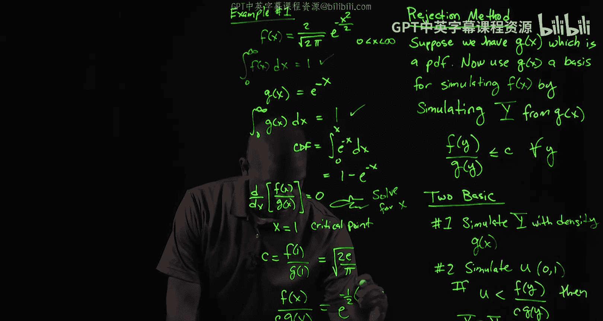

#  083：拒绝采样法第一部分

在本节课中，我们将要学习一种新的随机变量模拟方法——拒绝采样法。上一节我们介绍了逆变换法，它要求概率密度函数（PDF）必须可逆。然而，并非所有PDF都满足这个条件。因此，本节中我们来看看一种更通用、更稳健的方法。

## 方法概述

拒绝采样法从一个已知的、易于模拟的PDF `G(x)` 出发，以其为基础来模拟目标PDF `F(x)`。其核心思想是：先根据 `G(x)` 生成一个候选值，然后根据 `F(x)` 与 `G(x)` 的比例关系，以一定的概率决定接受或拒绝这个候选值。

具体而言，我们需要找到一个常数 `C`，使得对于所有 `y`，都满足以下不等式：
**F(y) / G(y) ≤ C**

## 实施步骤

以下是使用拒绝采样法的两个基本步骤。

**步骤一：生成候选值**
首先，根据密度函数 `G(x)` 模拟一个随机变量 `Y`。我们可以使用上一节学习的逆变换法来完成这一步。

**步骤二：接受/拒绝决策**
接着，模拟一个在区间 `[0, 1]` 上均匀分布的随机变量 `U`。然后进行判断：如果 `U` 小于 `F(Y) / (C * G(Y))`，则接受该候选值，并令 `X = Y`；否则，拒绝该候选值，并返回步骤一重新生成。

## 示例解析

为了更好地理解，让我们通过一个具体例子来演示这个过程。

**目标函数 `F(x)`**
假设我们要模拟的PDF `F(x)` 定义在 `[0, ∞)` 上：
**F(x) = (2 / √(2π)) * e^(-x²/2)**
可以验证，该函数在定义域上的积分为1，是一个有效的PDF。

**建议函数 `G(x)`**
我们选择一个更易于模拟的PDF `G(x)`，同样定义在 `[0, ∞)` 上：
**G(x) = e^(-x)**
其累积分布函数（CDF）为：**CDF_G(x) = 1 - e^(-x)**

**寻找常数 `C`**
我们需要找到常数 `C`，使得 `F(x) / G(x) ≤ C` 恒成立。一个有效的方法是求 `F(x)/G(x)` 的最大值。通过求导并令其为零，我们找到临界点 `x = 1`，该点即为最大值点。因此：
**C = F(1) / G(1) = √(2e / π)**

此时，接受条件中的比例项可以简化为：
**F(x) / (C * G(x)) = e^(-1/2 * (x - 1)²)**

**模拟过程演示**
现在，我们手动模拟一次以验证流程。

1.  生成均匀随机数 `U`。假设我们得到：**U = 0.5352**
2.  根据 `G(x)` 的CDF逆变换生成候选值 `Y`。由于 `CDF_G(x) = 1 - e^(-x)`，其逆函数为 `x = -ln(1 - U)`。又因为 `1-U` 与 `U` 同为 `[0,1]` 上的均匀分布，我们可以简化为：
    **Y = -ln(U) = -ln(0.5352) ≈ 0.625115**
3.  计算接受概率：
    **F(Y) / (C * G(Y)) = e^(-1/2 * (0.625115 - 1)²) ≈ 0.932143**
4.  进行判断：由于 `U = 0.5352` 小于 `0.932143`，因此我们**接受**这个候选值。
5.  最终，我们模拟得到的随机变量取值为：**X = Y ≈ 0.625115**

请注意，这个值 `0.625115` 是我们本次模拟的最终输出，而不是中间计算出的接受概率 `0.932143`。

## 总结

本节课中我们一起学习了拒绝采样法的基本原理和实施步骤。该方法不要求目标PDF `F(x)` 可逆，只需找到一个易于模拟的建议PDF `G(x)` 和一个合适的常数 `C` 即可。其过程分为生成候选值和依概率接受两步。通过一个具体示例，我们演示了从计算常数 `C` 到完成一次模拟的完整流程。为了生成大量样本，你需要将上述步骤编写成循环代码。