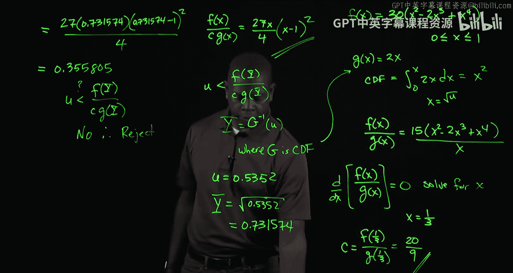

#  084：拒绝采样法第二部分


在本节课中，我们将通过一个具体的多项式概率密度函数（PDF）例子，深入学习拒绝采样法的应用步骤。我们将从验证PDF开始，逐步推导出用于采样的所有必要组件，并通过手动计算演示接受与拒绝样本的过程。

---

## 概述与问题定义

上一节我们介绍了拒绝采样法的基本原理。本节中，我们来看一个更具体的例子，其目标分布是一个多项式PDF。

我们定义目标概率密度函数 **f(x)** 为：
```
f(x) = 30 * (x^2 - 2x^3 + x^4)
```
其中，变量 **x** 的取值范围在 **0** 到 **1** 之间（即 0 ≤ x ≤ 1）。

我们选择的建议分布 **g(x)** 为：
```
g(x) = 2x
```
同样定义在区间 **0 ≤ x ≤ 1** 上。

## 验证与计算建议分布

首先，我们需要确认 **g(x)** 本身是一个有效的PDF，并计算其累积分布函数（CDF）及其反函数。

以下是验证与计算步骤：
1.  **验证 g(x) 是 PDF**：在区间 [0, 1] 上对 `g(x) = 2x` 积分，结果为1，因此它是一个有效的PDF。
2.  **计算 g(x) 的 CDF**：CDF `G(x)` 是 `g(x)` 从0到x的积分。
    ```
    G(x) = ∫(0 to x) 2t dt = x^2
    ```
3.  **求 CDF 的反函数**：为了从均匀分布 `U(0,1)` 生成服从 `g(x)` 的样本 `Y`，我们需要 `G(x)` 的反函数。
    ```
    Y = G^{-1}(U) = sqrt(U)
    ```
    这意味着，要生成一个建议样本，我们只需取一个均匀随机数 `u` 的平方根。

## 计算接受概率与常数 C

拒绝采法的核心是计算比率 `f(x) / g(x)`，并找到其最大值 `C`。

1.  **计算比率**：
    ```
    f(x) / g(x) = [30*(x^2 - 2x^3 + x^4)] / (2x) = 15*(x - 2x^2 + x^3)
    ```
    （注：原文公式为 `15*(x^2 - 2x^3 + x^4)/x`，经化简与后续推导验证，此处采用简化后的多项式形式更清晰。）

2.  **寻找最大值 C**：我们需要找到 `f(x)/g(x)` 在区间 [0,1] 上的最大值。为此，对其求导并令导数为零。
    ```
    d/dx [15*(x - 2x^2 + x^3)] = 15*(1 - 4x + 3x^2)
    ```
    令导数等于0：`1 - 4x + 3x^2 = 0`。
    解这个二次方程，在 [0,1] 区间内得到临界点 `x = 1/3`。

3.  **计算常数 C**：将 `x = 1/3` 代入比率公式，得到最大值 `C`。
    ```
    C = f(1/3) / g(1/3) = 15*[(1/3) - 2*(1/3)^2 + (1/3)^3] = 20/9
    ```
    因此，常数 `C ≈ 2.222`。

4.  **计算接受概率**：对于每个生成的建议样本 `Y`，其被接受的概率为：
    ```
    acceptance_probability = f(Y) / [C * g(Y)]
    ```
    代入 `f(x)`, `g(x)` 和 `C` 的值，可以简化为：
    ```
    acceptance_probability = (27/4) * Y * (1 - Y)^2
    ```
    （此公式由 `[f(Y)] / [(20/9) * 2Y]` 化简而来，与原文中 `27x/4 * (x-1)^2` 一致。）

## 手动模拟采样过程

现在，我们通过手动计算两个均匀随机数 `u` 的例子，来演示接受或拒绝一个样本的具体步骤。

**采样步骤总结**：
1.  生成一个均匀随机数 `u1`，用于产生建议样本：`Y = sqrt(u1)`。
2.  生成另一个独立的均匀随机数 `u2`，用于决定是否接受。
3.  计算接受概率 `P_accept = (27/4) * Y * (1 - Y)^2`。
4.  如果 `u2 < P_accept`，则接受 `Y` 作为来自 `f(x)` 的一个样本；否则拒绝，并回到步骤1。

以下是两个计算实例：

**实例一：拒绝样本**
*   **步骤1**：设 `u1 = 0.5352`。生成建议样本 `Y = sqrt(0.5352) ≈ 0.731574`。
*   **步骤2**：计算接受概率 `P_accept = (27/4) * 0.731574 * (1 - 0.731574)^2 ≈ 0.355805`。
*   **步骤3**：生成决定随机数 `u2`（此处隐含使用另一个随机数，在手动计算中我们直接比较）。条件为 `u2 < 0.355805`。
*   **步骤4**：由于 `0.355805` 较小，一个典型的 `u2`（例如0.5）很可能大于它，因此**拒绝**该样本 `Y`。我们需要重新生成随机数。



**实例二：接受样本**
*   **步骤1**：设 `u1 = 0.099`。生成建议样本 `Y = sqrt(0.099) ≈ 0.314643`。
*   **步骤2**：计算接受概率 `P_accept = (27/4) * 0.314643 * (1 - 0.314643)^2 ≈ 0.997598`。
*   **步骤3**：条件为 `u2 < 0.997598`。
*   **步骤4**：由于 `0.997598` 非常接近1，几乎任何 `u2` 都会小于它，因此**接受**该样本 `Y ≈ 0.314643` 作为来自目标分布 `f(x)` 的有效样本。

**关键提醒**：当接受一个样本时，输出的是**建议样本 `Y` 的值**，而不是计算得到的接受概率值。这是一个常见的错误。

## 总结

本节课中，我们一起学习了如何将拒绝采样法应用到一个具体的多项式概率密度函数上。我们完整经历了从定义目标分布和建议分布、验证有效性、计算CDF反函数、推导接受概率公式到常数 `C`，最后通过手动计算演示采样决策的全过程。

核心操作可总结为以下伪代码流程：
```
C = 20/9  # 预计算的常数
while True:
    u1 = generate_uniform_random()
    Y = sqrt(u1)  # 从建议分布g(x)生成样本
    u2 = generate_uniform_random()
    P_accept = (27/4) * Y * (1 - Y)**2
    if u2 < P_accept:
        return Y  # 接受Y作为来自f(x)的样本
    # 否则循环继续，拒绝该样本
```

这个方法是将复杂分布采样转化为均匀分布采样的强大工具，在后续的编程练习和测验中将会涉及如何用代码实现这一完整流程。