#  085：R语言模拟方法教程 🎲

在本教程中，我们将学习如何使用R语言实现模块10讲座中讨论的模拟概念。我们将从生成均匀分布开始，然后探索逆变换法和拒绝法这两种关键的模拟技术，最后通过蒙特卡洛模拟进行应用。教程内容力求简单直白，适合初学者理解。

## 生成均匀分布随机变量 📊

上一节我们介绍了模拟的基本概念，本节中我们来看看如何生成一个均匀分布的随机变量。虽然R语言内置了`runif`函数，但理解其底层原理是有益的。

一种生成伪均匀随机变量的方法是线性同余法。其核心思想是使用一个线性递推公式，并通过取模运算来生成看似随机的序列。

以下是实现线性同余法的步骤：

1.  **初始化参数**：设定序列长度`n`、斜率`a`、截距`b`和一个很大的模数`m`。
2.  **创建初始向量**：创建一个长度为`n`的零向量，但第一个元素设为1。
3.  **生成序列**：对于`i`从2到`n`，使用公式 `x[i] = (a * x[i-1] + b) mod m` 计算下一个值。
4.  **归一化**：将生成的序列除以模数`m`，得到[0, 1)区间内的均匀分布。

```r
# 线性同余法生成均匀分布示例
n <- 10000
a <- 1664525
b <- 0
m <- 2^32
x <- numeric(n)
x[1] <- 1
for (i in 2:n) {
  x[i] <- (a * x[i-1] + b) %% m
}
u <- x / m  # 均匀随机变量
hist(u, main = "线性同余法生成的均匀分布")
```

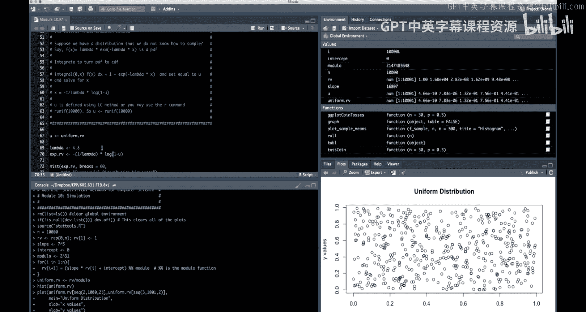

运行上述代码，你会得到一个近似均匀分布的直方图。虽然这不是真正的随机，但对于许多模拟目的来说已经足够。

## 逆变换法 🔄

上一节我们学会了生成均匀随机变量，本节中我们来看看如何利用它通过逆变换法生成其他分布的随机变量。该方法的核心思想是：如果我们能找到一个目标分布累积分布函数的反函数，就可以将均匀随机变量映射到该分布。

**核心公式**：若 `U ~ Uniform(0,1)`，且 `F_X` 是目标随机变量 `X` 的CDF，其反函数为 `F_X^{-1}`，则 `X = F_X^{-1}(U)` 服从目标分布。

让我们以指数分布为例。指数分布的CDF为 `F(x) = 1 - exp(-λx)`，其反函数为 `x = -log(1-U)/λ`。

```r
# 使用逆变换法生成指数分布
lambda <- 0.5
u <- runif(10000) # 使用R内置均匀分布，也可用上节自生成的u
x_exp <- -log(1 - u) / lambda
hist(x_exp, main = "逆变换法生成的指数分布", probability = TRUE)
curve(dexp(x, rate = lambda), add = TRUE, col = "red")
```

运行代码后，直方图将很好地拟合红色的理论指数分布曲线。

我们可以将此方法应用于任何能求出CDF反函数的分布。以下是通用步骤：

1.  确定目标概率密度函数`f(x)`。
2.  计算其累积分布函数`F(x) = ∫ f(t) dt`。
3.  求反函数 `x = F^{-1}(u)`。
4.  生成均匀随机变量`u`，代入反函数得到目标分布的样本`x`。

## 拒绝采样法 🎯

逆变换法需要可逆的CDF，但并非所有分布都满足此条件。本节中我们介绍拒绝采样法，它通过一个易于采样的建议分布`g(x)`来生成难以直接采样的目标分布`f(x)`的样本。

**核心思想**：寻找一个常数`C`，使得对于所有`x`，满足 `C * g(x) >= f(x)`。然后从`g(x)`中采样，并以概率 `f(x) / (C * g(x))` 接受该样本。

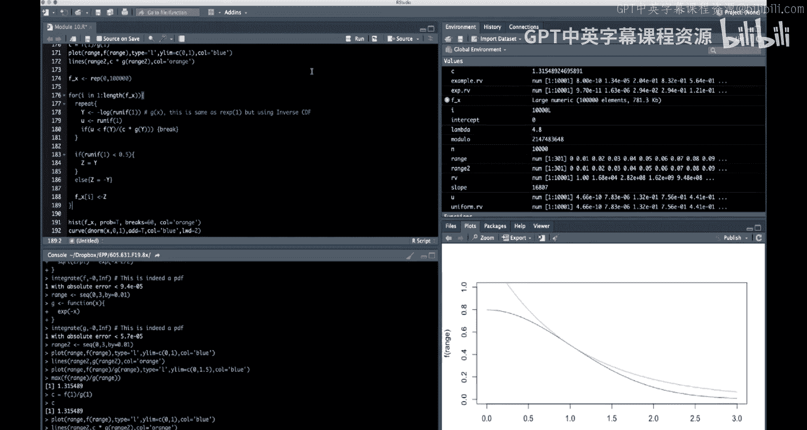

以下是实现拒绝采样法的步骤：

1.  **确定包络**：找到一个建议分布`g(x)`和常数`C`，使得`C*g(x)`始终在`f(x)`上方。
2.  **生成候选样本**：从`g(x)`中生成一个样本`y`。
3.  **生成均匀随机数**：生成一个`u ~ Uniform(0, 1)`。
4.  **接受/拒绝判断**：如果 `u <= f(y) / (C * g(y))`，则接受`y`作为`f(x)`的一个样本；否则拒绝并重复步骤2。

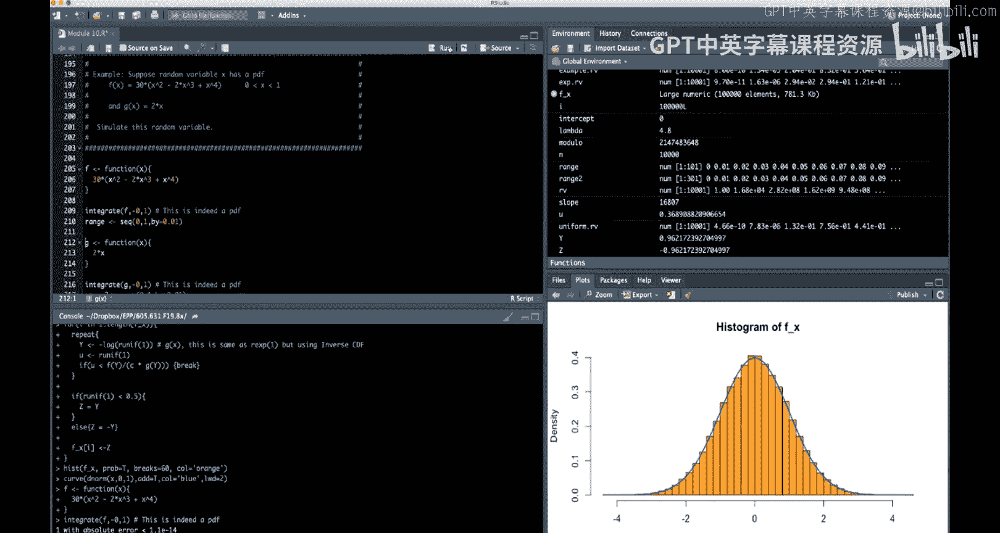

让我们模拟一个PDF为 `f(x) = (3/2) * x^2`（定义在[-1,1]）的分布。我们选择均匀分布`U(-1,1)`作为`g(x)`。

```r
# 拒绝采样法示例
f <- function(x) (3/2) * x^2 * (abs(x) <= 1) # 目标PDF
g <- function(x) dunif(x, -1, 1) # 建议分布PDF（均匀分布）
# 寻找常数C，使得 C*g(x) >= f(x) 对所有x成立
# 在[-1,1]上，f(x)的最大值为3/2 (在x=±1处)，g(x)恒为1/2
C <- (3/2) / (1/2) # C = 3

n_samples <- 10000
samples <- numeric(n_samples)
count <- 0
while(count < n_samples) {
  y <- runif(1, -1, 1) # 从g(x)采样
  u <- runif(1)
  if (u <= f(y) / (C * g(y))) {
    count <- count + 1
    samples[count] <- y
  }
}
hist(samples, main = "拒绝采样法生成的样本", probability = TRUE)
curve(f(x), add = TRUE, col = "red")
```

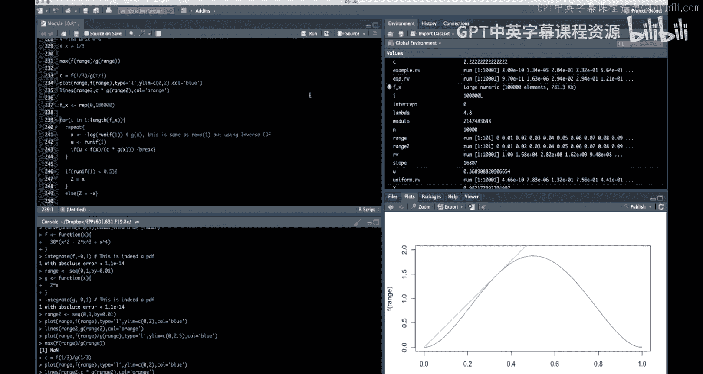

选择与目标分布形状接近的建议分布`g(x)`能显著提高接受率，使模拟更高效。

## 蒙特卡洛模拟 🎲

前面我们学习了生成特定分布样本的方法，本节中我们来看看如何利用这些样本进行蒙特卡洛模拟。蒙特卡洛模拟是一种通过重复随机抽样来获得数值结果的强大技术，常用于估计概率、积分等。

一个简单的例子是估计标准正态分布随机变量的绝对值大于2的概率。

```r
# 蒙特卡洛估计概率
set.seed(123)
n <- 100000
x <- rnorm(n) # 从标准正态分布抽样
y <- as.integer(abs(x) > 2) # 指示变量，满足条件为1
estimated_prob <- mean(y) # 等于 sum(y)/n
true_prob <- 2 * pnorm(-2) # 理论值
cat("蒙特卡洛估计值:", estimated_prob, "\n")
cat("理论值:", true_prob)
```

蒙特卡洛模拟也可用于计算积分。例如，估计函数 `h(x)=x*sqrt(x)` 在[0,1]上的积分（即面积）。

```r
# 蒙特卡洛积分
n <- 100000
x <- runif(n) # 在[0,1]上均匀抽样
h <- x * sqrt(x)
estimated_integral <- mean(h)
true_integral <- integrate(function(t) t*sqrt(t), 0, 1)$value
cat("蒙特卡洛估计积分:", estimated_integral, "\n")
cat("理论积分值:", true_integral)
```

最经典的蒙特卡洛应用之一是估计圆周率π。考虑一个边长为1的正方形及其内切四分之一圆（半径1）。随机向正方形投点，点落在四分之一圆内的概率等于圆面积与正方形面积之比，即 `(π*1^2/4) / (1^1) = π/4`。因此，`π ≈ 4 * (圆内点数 / 总点数)`。

```r
# 蒙特卡洛估计π
estimate_pi <- function(n) {
  x <- runif(n)
  y <- runif(n)
  in_circle <- (x^2 + y^2) <= 1
  pi_est <- 4 * sum(in_circle) / n
  return(pi_est)
}
cat("n=1000时估计的π:", estimate_pi(1000), "\n")
cat("n=100000时估计的π:", estimate_pi(100000))
```

随着抽样次数`n`的增加，估计值会越来越接近真实的π。

## 总结 📝

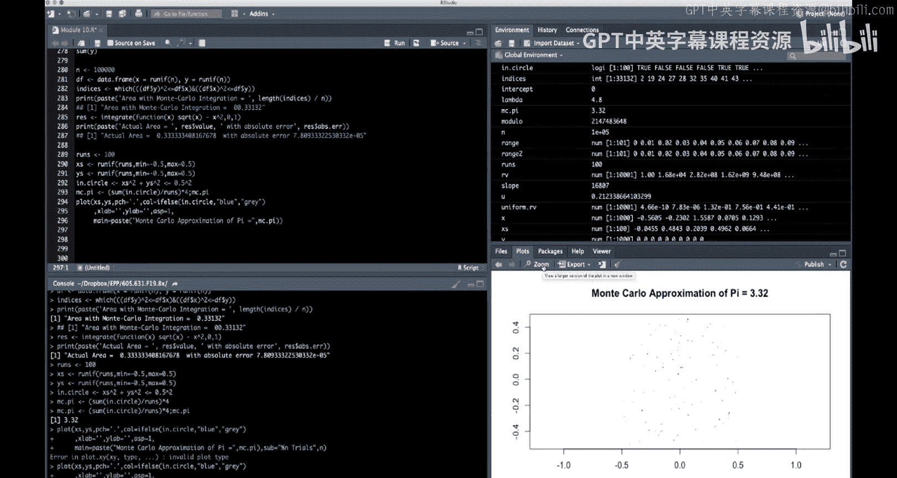

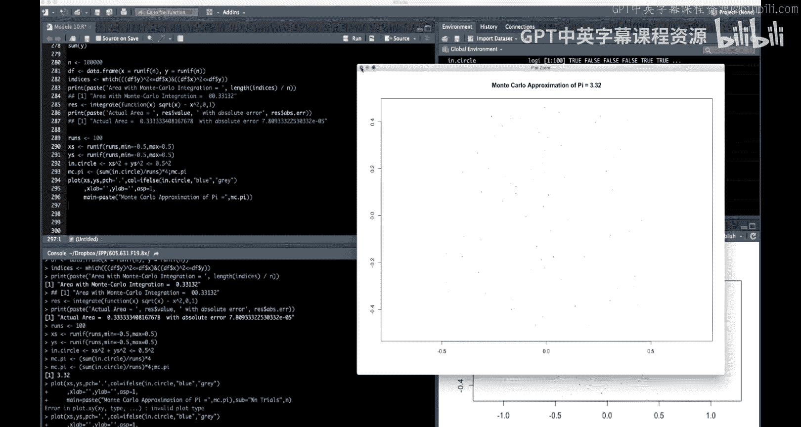

本节课中我们一起学习了在R语言中实现统计模拟的核心方法。

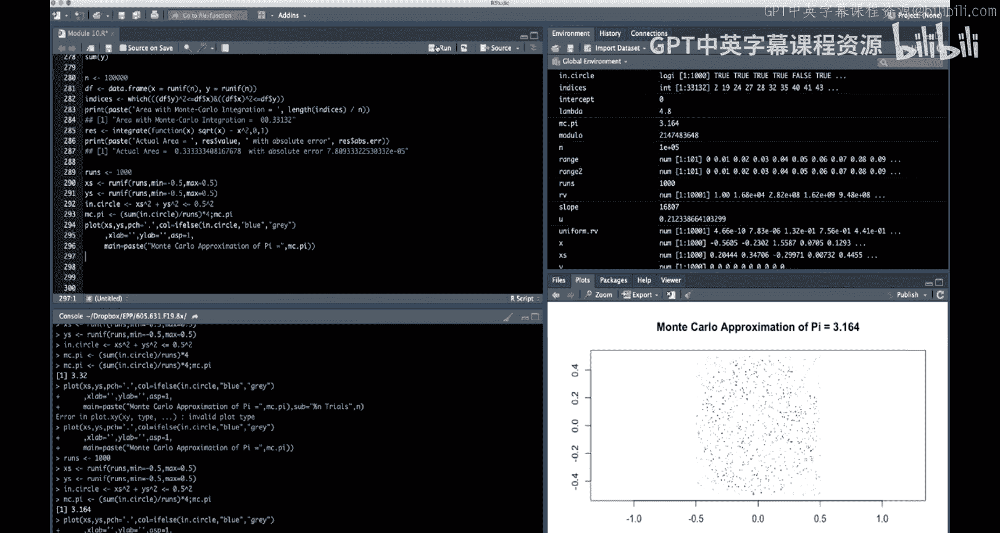

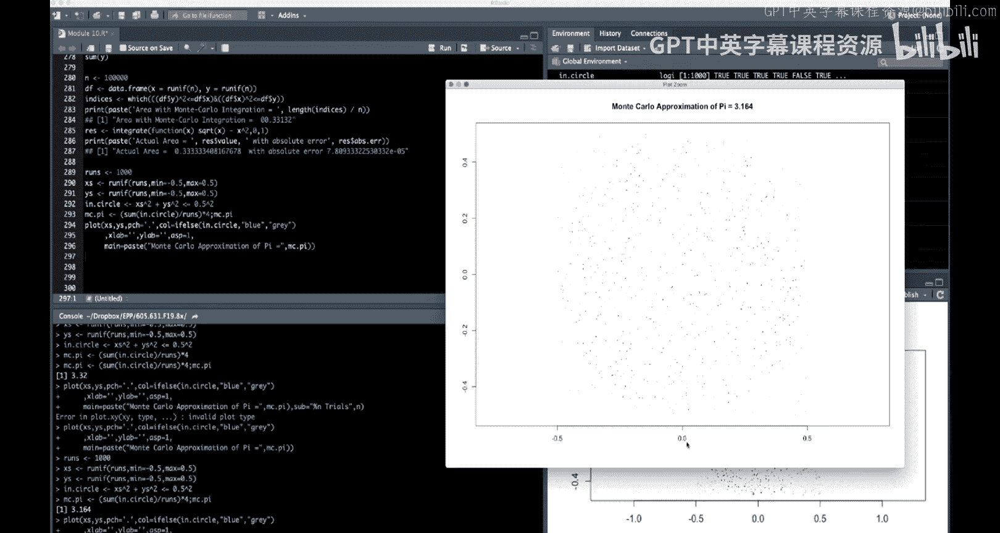

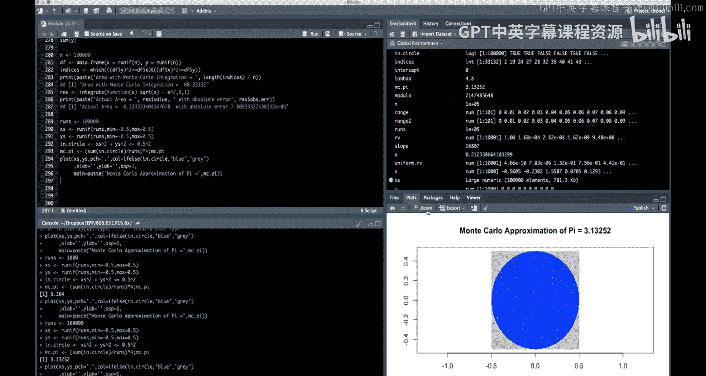

我们首先从**生成均匀分布随机变量**开始，了解了线性同余法的基本原理。接着，我们深入探讨了**逆变换法**，它利用均匀分布和CDF的反函数来生成其他复杂分布的样本。对于CDF不易求反的情况，我们引入了**拒绝采样法**，该方法通过一个易于采样的建议分布和接受-拒绝机制来生成目标分布的样本。最后，我们展示了如何运用这些抽样技术进行**蒙特卡洛模拟**，以解决概率估计、数值积分等实际问题。

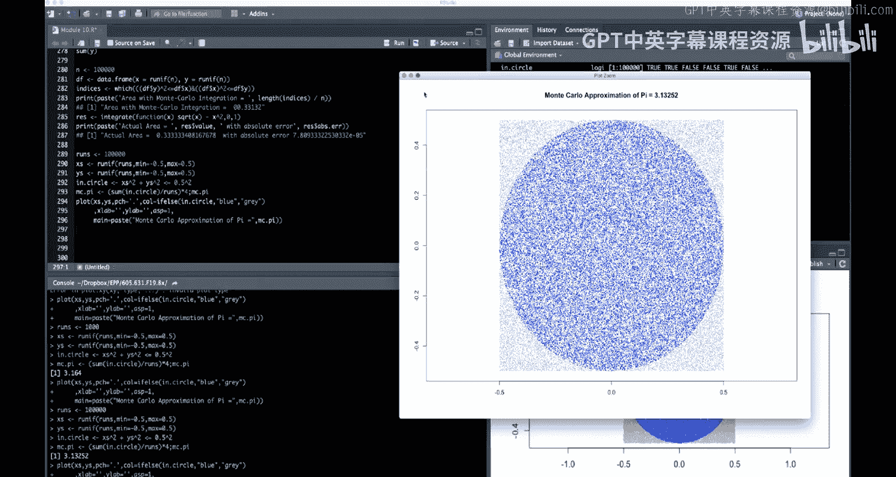

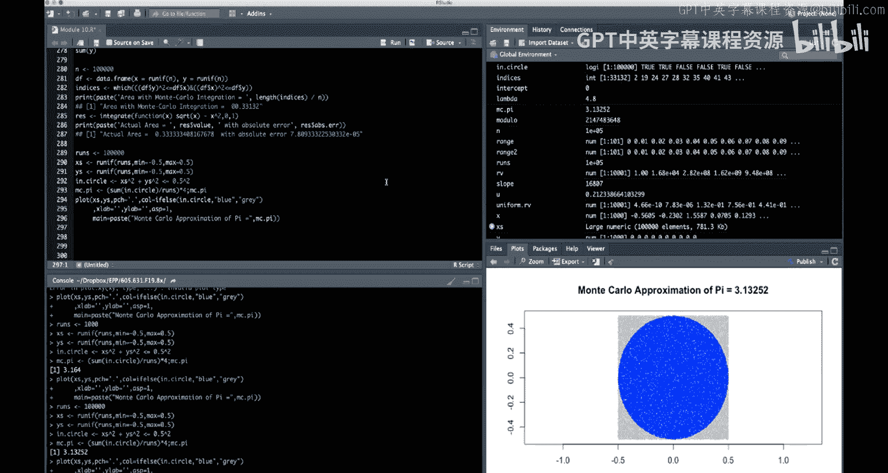


掌握这些模拟技术，你将能够处理许多缺乏解析解或理论分布复杂的统计计算问题。