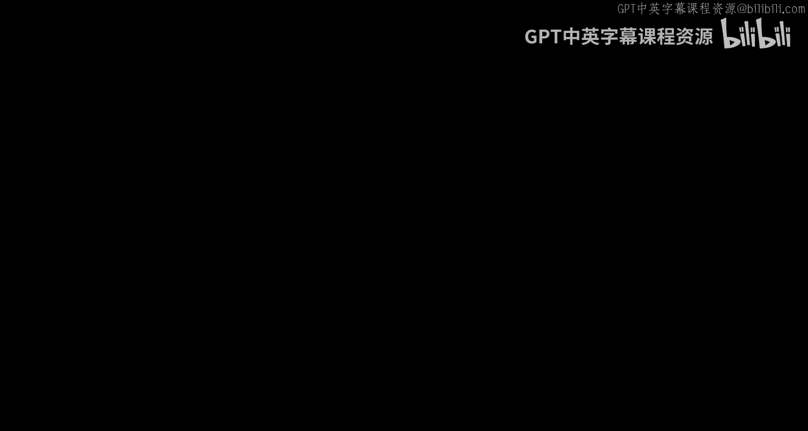

#  087：随机行动者导向模型 (Siena模型) 🎯



在本节课中，我们将学习如何分析随时间变化的网络数据。我们将理解网络中的结构依赖性如何影响统计分析，并重点学习纵向网络行为。我们将使用经验数据对网络中的社会力量进行假设检验，并最终使用R语言中的RSiena包构建一个随机行动者导向模型。

## 概述

随机行动者导向模型，也称为Siena模型，用于研究网络和行为如何随时间共同演化。它帮助我们理解社会力量（如互惠性、传递性）如何影响网络结构的变化，以及个体属性（如行为）如何与网络动态相互作用。

上一节我们介绍了用于横截面网络的指数随机图模型（ERGM）。本节中，我们来看看当数据包含多个时间点时，应如何进行分析。

## 数据准备与模型假设

在开始建模之前，需要准备好纵向网络数据并理解模型的基本假设。

Siena模型的核心假设是：行动者基于给定时刻的网络状态，对其网络连接和行为做出选择。模型模拟从时间1到时间2的网络演化过程，通过生成一系列微步骤（micro-steps）来模拟数据可能的演变方式。

一个可能破坏模型有效性的情况是多个连接同时形成或改变。例如，在国际象棋网络中，移动一个棋子会同时切断并建立多个连接，这违反了行动者进行独立选择的假设。对于大规模通信（如邮件群发）如何影响模型收敛，仍是开放性问题。

另一个假设是行动者做决策的局部规则会对全局结构产生影响。

## Siena模型建模五步法

以下是使用RSiena进行分析的五个主要步骤。

### 第一步：数据格式化

此步骤将网络和行为数据读入R，并格式化为RSiena所需的格式。

以下是读取网络数据（三个时间点）和行为属性数据（吸烟、饮酒）的示例代码：

```r
# 读取网络数据（时间点1）
s501 <- read.table("s50-network1.dat", header=FALSE, sep=" ")
s50.net1 <- as.matrix(s501[, 2:51]) # 处理多余列

# 对时间点2和3重复类似操作
# s502 <- read.table("s50-network2.dat", ...)
# s50.net2 <- as.matrix(s502[, 2:51])
# s503 <- read.table("s50-network3.dat", ...)
# s50.net3 <- as.matrix(s503[, 2:51])

# 读取行为属性数据
drink <- read.table("s50-alcohol.dat", header=FALSE, sep=" ")
smoke <- read.table("s50-smoking.dat", header=FALSE, sep=" ")
drink1 <- as.matrix(drink[, 2:4]) # 三个时间点的饮酒数据
smoke1 <- as.matrix(smoke[, 2])   # 吸烟数据（示例中设为恒定协变量）
```

### 第二步：数据设定

此步骤定义模型中将使用的变量类型，包括网络、恒定协变量和变化协变量。

RSiena中主要有五类解释变量：
1.  恒定行动者协变量（如种族）。
2.  变化行动者协变量（如随时间变化的行为）。
3.  恒定二元协变量（如家庭关系）。
4.  变化二元协变量（如友谊强度）。
5.  组合变化指标（本课不涉及）。

**注意**：对于任何变化协变量，至少需要三个时间点的数据，因为模型估计的是时间1到时间2以及时间2到时间3之间的变化。

以下代码展示如何创建Siena数据对象：

```r
library(RSiena)
# 创建纵向网络对象
friendship <- sienaDependent(array(c(s50.net1, s50.net2, s50.net3),
                                   dim = c(50, 50, 3)))
# 定义协变量
smoke1 <- coCovar(smoke1[, 1])          # 恒定协变量
alcohol <- varCovar(drink1)             # 变化协变量
# 组合成Siena数据对象
myData <- sienaDataCreate(friendship, smoke1, alcohol)
```

### 第三步：模型设定

此步骤指定模型中要包含的效应（即待检验的社会力量），定义目标函数。

以下是查看、添加和移除模型效应的代码：

```r
# 获取初始效应集（受限模型）
myEffects <- getEffects(myData)
print(myEffects)

# 添加效应：传递性三元组和三环
myEffects <- includeEffects(myEffects, transTrip, cycle3)

# 移除效应（例如移除三环）
myEffects <- includeEffects(myEffects, cycle3, include=FALSE)
```

模型通常从包含**出度**（类似密度）和**互惠性**的受限模型开始，因为它们解释了网络结构的大部分方差。

### 第四步：模型估计

此步骤运行模型，使用马尔可夫链蒙特卡洛方法进行模拟，以估计参数。

以下是创建算法对象、设定最终模型并运行估计的代码：

```r
# 创建算法对象
myAlgorithm <- sienaAlgorithmCreate(projname = 's50_3waves')
# 定义包含多种效应的模型（示例）
myEffects <- includeEffects(myEffects, egoX, altX, egoXaltX, interaction1 = "alcohol")
# 运行模型估计
ans <- siena07(myAlgorithm, data = myData, effects = myEffects)
```

### 第五步：结果解读

此步骤分析模型输出，识别显著影响网络演化的因素。

模型结果会给出每个效应的估计值、标准误差和收敛性统计量。判断一个效应是否显著，通常看其估计值是否远离零（例如，绝对值大于两倍标准误差）。

以下是如何解读关键参数：
*   **出度**：通常应为显著负值，反映个体建立连接的能力有限。
*   **互惠性**：显著正值表明相互连接的趋势很强。
*   **传递性三元组**：显著正值表明朋友的朋友容易成为朋友。
*   **行为同质性**：如`alcohol egoXaltX`效应显著，表明饮酒行为相似的人更容易成为朋友（同质性）。

## 总结

本节课我们一起学习了随机行动者导向模型（Siena模型）。

*   **ERGM** 用于分析单个时间点的静态网络，控制结构依赖性。
*   **Siena模型** 则允许我们分析纵向网络数据，区分**选择**（行为影响友谊形成）和**影响**（友谊影响行为采纳）过程。
*   我们逐步介绍了从数据准备、设定、估计到解读的完整建模流程。
*   该模型在公共卫生等领域有重要应用，但需要注意其对数据规模（节点数、时间点）和模型假设的要求。


通过本课提供的R脚本和示例数据，你可以开始探索网络与行为随时间共同演化的复杂动态。