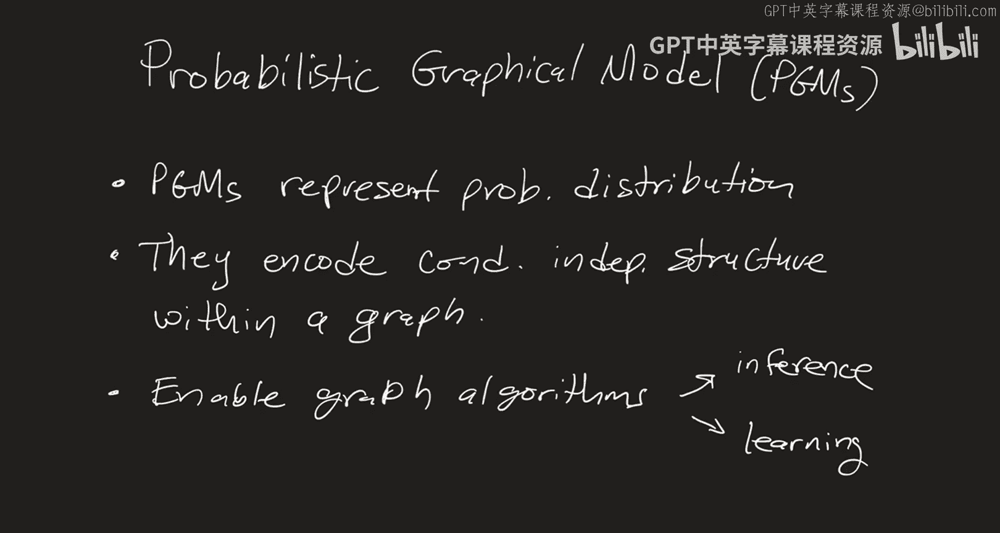
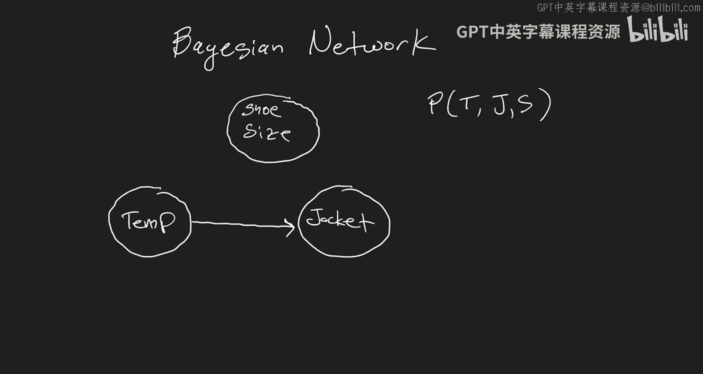
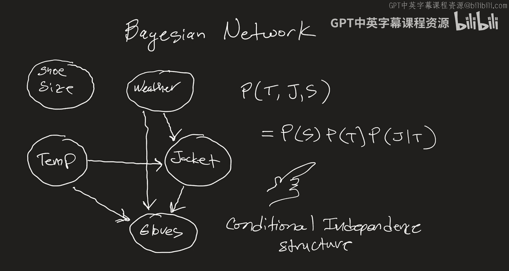

#  088：贝叶斯网络 🕸️

在本节课中，我们将要学习概率图模型，特别是贝叶斯网络。我们将了解它们如何表示复杂的概率分布，以及如何利用图结构来编码变量之间的条件独立关系。掌握这一概念，将使我们能够运用成熟的图算法进行高效的推断和学习。

## 概述

概率图模型是一种强大的工具，它使用图结构来表示概率分布。其核心优势在于，能够将复杂的联合概率分布中蕴含的**条件独立结构**编码在一个图中。这为我们带来了两大好处：第一，它使得复杂的概率分布更易于计算机处理和表示；第二，我们可以利用图论中成熟的算法，在这个模型上进行**推断**（如计算某些变量的概率）和**学习**（如从数据中估计模型参数）。

上一节我们介绍了概率图模型的核心思想，本节中我们来看看一个具体的例子：贝叶斯网络。

## 贝叶斯网络示例

贝叶斯网络是一种有向无环图。在图中，每个节点代表一个随机变量，而有向边则代表了变量之间的**依赖关系**。箭头的方向表示条件依赖：箭头指向的变量概率，取决于箭头来源的变量。

让我们通过一个简单的例子来理解。假设我们考虑三个变量：温度（T）、是否穿夹克（J）和鞋码（S）。我们可以构建如下网络：

在这个网络中：
*   箭头从 **T** 指向 **J**，这表示“是否穿夹克”的概率**依赖于**“温度”。用概率公式表示为：`P(J | T)`。
*   变量 **S**（鞋码）与其他两个变量之间没有连接，这意味着鞋码与温度和是否穿夹克都**相互独立**。

因此，这个图结构编码了我们的先验知识：一个人穿夹克的可能性取决于天气温度，但与他穿多大码的鞋无关。

## 从图结构到联合概率

贝叶斯网络的核心价值在于，它提供了一种分解高维联合概率分布的方法。对于上述三个变量的联合概率 `P(T, J, S)`，如果直接建模会非常复杂。但利用图中编码的条件独立关系，我们可以将其重写为更简单的因子乘积形式。

根据上图的结构，联合概率可以分解为：
`P(T, J, S) = P(S) * P(T) * P(J | T)`

这个公式的意义在于：
*   `P(S)` 和 `P(T)` 是**边缘概率**，没有条件依赖。
*   `P(J | T)` 是**条件概率**，表示在已知温度的条件下穿夹克的概率。

通过这种方式，我们将一个三维的联合概率分布，分解为了几个更易处理和估计的低维概率（一个一维分布、一个一维分布和一个二维条件分布）。这大大简化了建模和计算的复杂度。

## 网络的扩展与威力

贝叶斯网络的威力在于其可扩展性。我们可以轻松地向网络中添加新的变量和关系。

例如，我们可以在原有网络中加入“天气（W）”和“是否戴手套（G）”两个变量：

在这个扩展网络中：
*   天气（W）可能同时影响温度（T）和是否穿夹克（J）。
*   温度（T）和是否穿夹克（J）都可能影响是否戴手套（G）。
*   鞋码（S）仍然独立于其他所有变量。

此时，联合概率 `P(S, T, W, J, G)` 可以根据新的图结构进行分解。虽然变量增多使得联合空间维度更高，但利用条件独立结构分解后，我们只需要估计一系列相对简单的局部条件概率（例如 `P(G | J, T)`），就能表征整个复杂的联合分布。

这正是概率图模型，特别是贝叶斯网络的强大之处：它将一个难以直接处理的**高维概率空间**，转化为一个结构清晰的**图模型**。这个模型可以被计算机高效地存储和操作，并利用图算法进行各种概率推断和参数学习。

## 总结

本节课中我们一起学习了贝叶斯网络的基础知识。我们了解到：
1.  贝叶斯网络是一种**有向无环图**，用于表示变量间的依赖关系。
2.  图中的**节点**代表随机变量，**有向边**代表条件依赖关系。
3.  网络结构编码了联合概率分布中的**条件独立信息**，允许我们将复杂的联合分布分解为一系列局部条件概率的乘积，公式为：`P(X1, X2, ..., Xn) = ∏ P(Xi | Parents(Xi))`。
4.  这种表示方法极大地简化了高维概率模型的建模、计算和学习过程，是连接概率论与图论的有力工具。