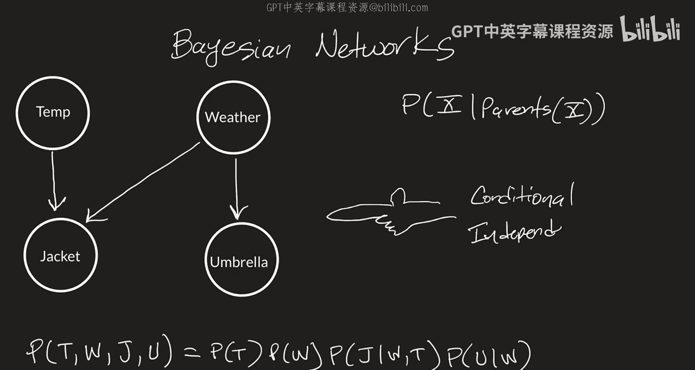
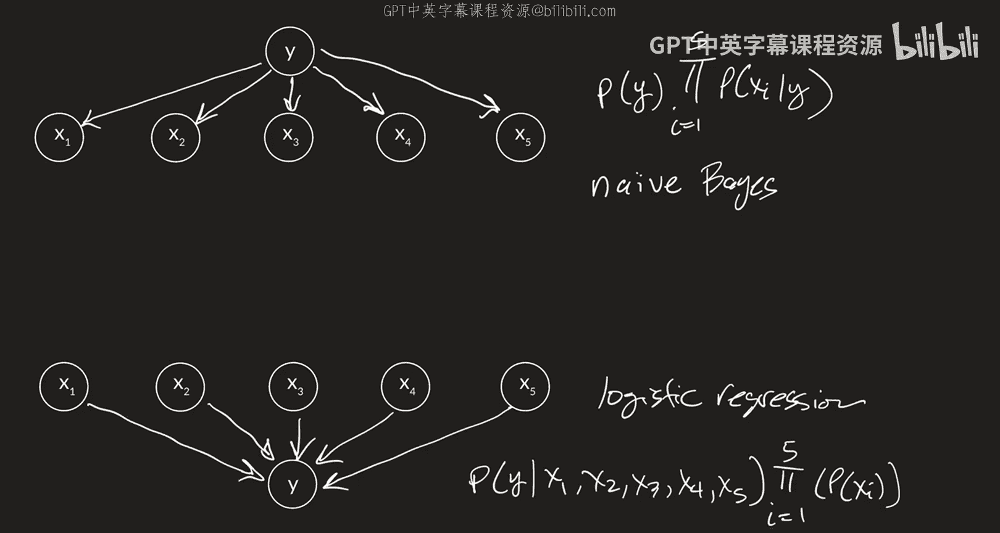

#  089：朴素贝叶斯 🧠

在本节课中，我们将深入探讨贝叶斯网络，并重点介绍一种特殊且实用的简化模型——朴素贝叶斯。我们将学习其核心概念、公式表示，并理解它为何在分类问题中如此受欢迎。

上一节我们介绍了贝叶斯网络的基本结构和条件独立性的概念。本节中，我们来看看一种基于强独立性假设的简化模型。

## 从一般网络到简化模型

回顾上一讲的例子，我们有一个关于温度、天气、夹克和雨伞的贝叶斯网络。其联合概率可以分解为：
`P(T, W, J, U) = P(T) * P(W) * P(J | T, W) * P(U | W)`

在这个网络中，每个节点的概率都**条件依赖于**其在图中的父节点。例如，雨伞`U`的概率只依赖于其父节点天气`W`。这意味着，如果我们知道了一个节点的父节点状态，那么该节点就与网络中其他非后代节点条件独立。这种特性允许我们简化计算。

## 两种网络结构的对比

以下是两种截然不同的贝叶斯网络结构，它们体现了建模思路的根本差异。

**第一个网络（上方）**：变量`Y`是父节点，`X1`到`X5`都是它的子节点，且每个`Xi`只有一个父节点`Y`。其联合概率分解为：
`P(Y, X1, X2, X3, X4, X5) = P(Y) * ∏_{i=1}^{5} P(Xi | Y)`

**第二个网络（下方）**：变量`Y`是子节点，`X1`到`X5`都是它的父节点。其联合概率分解为：
`P(Y, X1, X2, X3, X4, X5) = P(Y | X1, X2, X3, X4, X5) * ∏_{i=1}^{5} P(Xi)`

## 理解朴素贝叶斯

第一个网络的结构正是**朴素贝叶斯（Naive Bayes）** 模型的图形化表示。它之所以“朴素”，是因为它做了一个很强的假设：在给定父节点`Y`（通常是类别标签）的条件下，所有特征`X1, ..., Xn`之间是**相互条件独立**的。

以下是朴素贝叶斯的核心特点：
*   **简化公式**：`P(Y | X1, ..., Xn) ∝ P(Y) * ∏_{i=1}^{n} P(Xi | Y)`
*   **模型优势**：计算极其简单高效。只需要估计每个特征`Xi`在各类别`Y`下的条件概率`P(Xi | Y)`以及类别的先验概率`P(Y)`，避免了像下方网络那样需要估计`P(Y | X1,...,Xn)`这个具有指数级复杂度的条件概率表。
*   **应用场景**：尽管独立性假设在现实中很少完全成立，但朴素贝叶斯因其简单、快速且通常效果不错的特性，被广泛用于文本分类（如垃圾邮件过滤）、情感分析等任务。

相比之下，第二个网络的结构更接近**逻辑回归（Logistic Regression）** 的思维方式，其中结果`Y`依赖于多个特征`X`的线性组合。这种模型表达能力强，但需要更多的数据和计算来估计参数。

## 总结与展望

本节课中我们一起学习了朴素贝叶斯模型。我们了解到，它是贝叶斯网络的一个特例，通过假设特征在给定类别下条件独立，将复杂的联合概率分布简化为一系列单变量条件概率的乘积。这种简化使得模型易于构建和计算，非常适合作为高维数据分类的基线模型。

朴素贝叶斯是贝叶斯网络框架下利用条件独立性进行简化建模的典范。在接下来的课程中，我们将继续探索如何将这种条件独立性的思想推广到更复杂的网络结构中，以构建既能表达变量间依赖关系，又保持计算可行性的通用贝叶斯网络模型。

