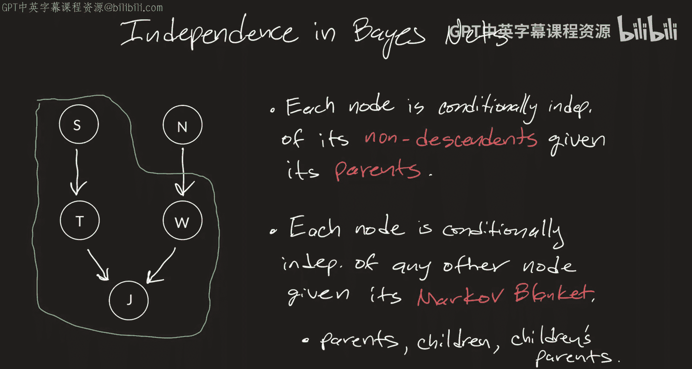

#  090：马尔可夫毯 🧠

在本节课中，我们将要学习贝叶斯网络中的核心概念——条件独立性，并重点介绍一个非常强大的工具：**马尔可夫毯**。理解这个概念能让我们在处理复杂的贝叶斯网络时，极大地简化概率计算。

上一节我们介绍了朴素贝叶斯网络，它利用了条件独立性来简化计算。本节中，我们来看看在更一般的贝叶斯网络中，条件独立性是如何体现的，以及如何利用马尔可夫毯来界定一个节点的“影响范围”。

## 贝叶斯网络中的条件独立性

在贝叶斯网络中，每个节点都遵循一个基本规则：**给定其父节点，该节点条件独立于其所有非后代节点**。

这个性质是贝叶斯网络结构带来的核心优势，它使得我们无需计算整个高维联合概率分布，就能进行高效的推理。

为了说明这个规则，让我们看一个具体的例子。

## 示例解析：天气与穿衣网络 🌦️

考虑左侧的贝叶斯网络图。我们假设有以下变量：
*   **E**：是否为厄尔尼诺年。
*   **W**：天气状况（受E影响）。
*   **S**：季节。
*   **T**：温度（受S影响）。
*   **J**：是否穿夹克（受W和T共同影响）。

现在，让我们应用条件独立性规则来分析几个节点。

首先，我们来看温度节点 **T**。

**T** 的父节点是 **S**，它的后代节点是 **J**。根据规则，**给定其父节点 S**，**T** 条件独立于其所有非后代节点。

以下是 **T** 的非后代节点：
*   **E** (厄尔尼诺)
*   **W** (天气)

这意味着，一旦我们知道了季节 **S** 的信息，那么关于 **E** 或 **W** 的任何信息都不会再影响我们对 **T** 的判断。**T** 与 **E**、**W** 在给定 **S** 的条件下是独立的。

接下来，我们看看夹克节点 **J**。

**J** 的父节点是 **T** 和 **W**。根据规则，**给定其父节点 T 和 W**，**J** 条件独立于其所有非后代节点。

以下是 **J** 的非后代节点：
*   **S** (季节)
*   **E** (厄尔尼诺)

这意味着，如果我们已经掌握了温度 **T** 和天气 **W** 的证据，那么关于季节 **S** 或厄尔尼诺 **E** 的信息，对于判断是否穿夹克 **J** 就没有任何额外影响了。

通过以上分析，我们看到了条件独立性如何根据网络结构来简化变量之间的关系。然而，还有一个更强大、更通用的概念可以帮助我们界定任意节点的“信息边界”。

## 马尔可夫毯：节点的信息边界 🛡️

马尔可夫毯是一个非常重要的定义。它指出：**在贝叶斯网络中，每个节点都条件独立于网络中所有其他节点，只要给定了它的马尔可夫毯**。

那么，什么是马尔可夫毯呢？一个节点的马尔可夫毯包括以下三类节点：
1.  该节点的所有**父节点**。
2.  该节点的所有**子节点**。
3.  该节点所有子节点的其他**父节点**（即“配偶”节点）。

让我们再次以温度节点 **T** 为例，来找出它的马尔可夫毯。

以下是构成 **T** 的马尔可夫毯的节点：
*   **父节点**：季节 **S**。
*   **子节点**：夹克 **J**。
*   **子节点的其他父节点**：天气 **W**（因为 **J** 的父节点是 **T** 和 **W**）。

因此，节点 **S**、**J**、**W** 共同构成了 **T** 的马尔可夫毯。

这个概念的强大之处在于，**无论网络其余部分有多大、多复杂，只要给定了马尔可夫毯中的节点（即这些节点被观测到并有了具体取值），那么该节点就与网络中所有其他节点条件独立**。

在计算某个节点的概率时，我们只需要考虑其马尔可夫毯内的节点。这使我们将计算从一个巨大的、与所有变量相关的联合概率空间，简化到一个只与少数几个变量相关的小空间，计算复杂度因此呈数量级地降低。

## 总结

本节课中我们一起学习了贝叶斯网络中两个关键的条件独立性概念。

首先，我们回顾了**给定父节点条件下的条件独立性**规则，它定义了节点与其非后代节点之间的关系。

接着，我们深入探讨了更强大的**马尔可夫毯**概念。马尔可夫毯明确界定了一个节点的“信息边界”，包含其父节点、子节点以及子节点的其他父节点。给定马尔可夫毯，该节点便与网络中的其他所有节点条件独立。

掌握马尔可夫毯的概念，是理解贝叶斯网络如何高效进行概率推理的核心。它让我们能够化整为零，无论网络结构多么庞大，都能专注于局部关系进行计算，这是贝叶斯网络得以实用的重要基石。