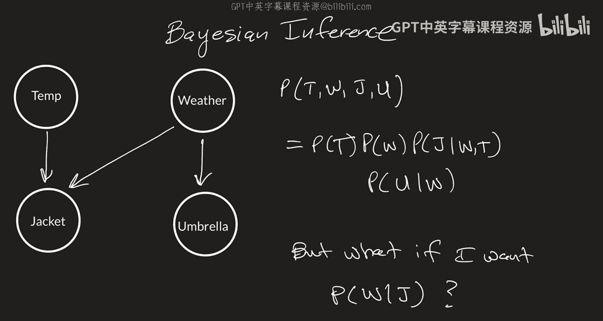
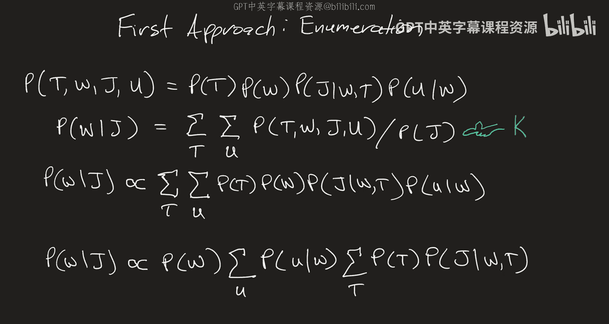
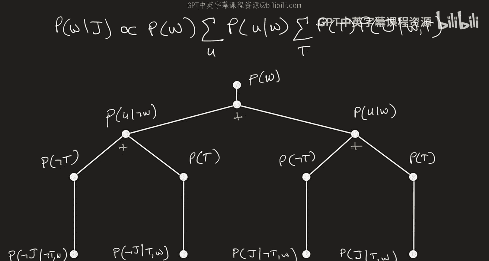
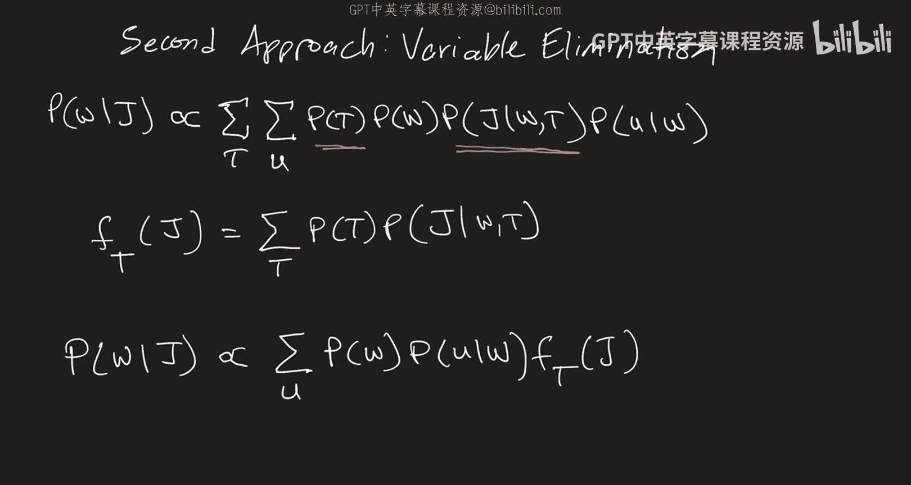
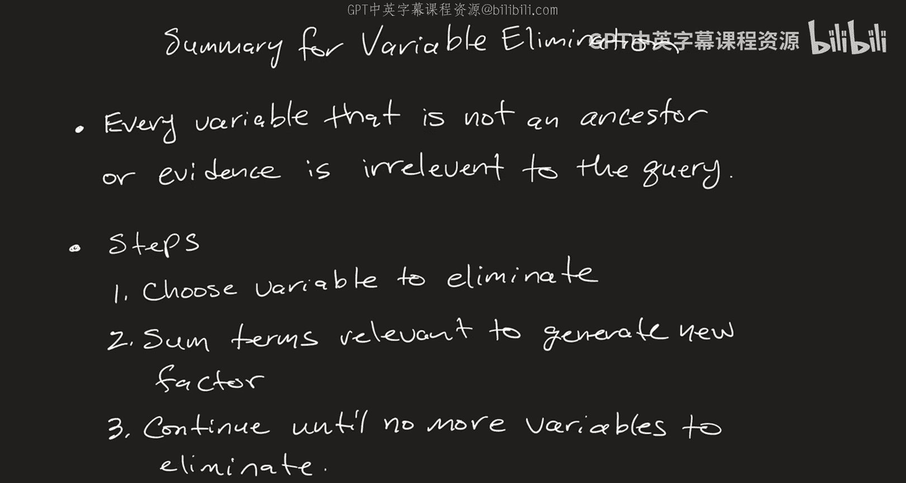

#  091：贝叶斯推断 🧠

在本节课中，我们将要学习贝叶斯推断。我们将探讨如何利用贝叶斯网络，在已知部分变量的情况下，推断出其他未知变量的概率。我们将介绍两种核心方法：枚举法和变量消除法。

## 问题引入

考虑一个包含四个变量的贝叶斯网络：温度（T）、天气（W）、是否穿夹克（J）和是否带伞（U）。其联合概率分布可以依据网络结构进行分解：

**P(T, W, J, U) = P(T) * P(W) * P(J | T, W) * P(U | W)**

然而，推断问题通常是条件概率问题。例如，我们可能想知道：**在观察到某人穿了夹克（J）的情况下，天气（W）的概率分布是怎样的？** 即求 **P(W | J)**。

上一节我们介绍了贝叶斯网络的联合概率表示，本节中我们来看看如何进行这种条件概率推断。

## 方法一：枚举法 🔢

根据条件概率的定义，我们可以通过边缘化（求和）来求解：

**P(W | J) = Σ_T Σ_U P(T, W, J, U) / P(J)**

其中，分母 P(J) 是一个归一化常数。在推断中，我们通常先计算未归一化的比例项：

**P(W | J) ∝ Σ_T Σ_U P(T, W, J, U)**

将联合概率分解式代入，我们可以通过枚举所有可能的 T 和 U 值来计算这个求和。这个过程可以形象地表示为一棵决策树：
1.  从根节点 P(W) 开始。
2.  对每个天气状态，考虑所有可能的温度值 P(T)。
3.  对每个（天气，温度）组合，考虑是否穿夹克的概率 P(J | T, W)。
4.  最后，对每个分支，还需考虑并求和所有带伞的可能性 P(U | W)。

以下是枚举计算的关键步骤：
*   在树的每个层级，我们需要对当前变量的所有可能取值进行求和。
*   最终，沿着特定天气（W）分支的所有路径的概率乘积之和，就正比于 P(W | J)。

当变量数量较少时，枚举法是可行的。但如果网络庞大，计算量会呈指数级增长。

## 方法二：变量消除法 🧹

变量消除法提供了一种更系统、更高效的计算方式。其核心思想是：**按顺序对非查询变量进行求和（消除），并逐步生成新的中间因子**。

对于我们的问题 P(W | J)，目标是消除变量 T 和 U。
首先，从联合概率中提取出与待消除变量 T 相关的项：

**P(W) * [Σ_T P(T) * P(J | T, W)] * [Σ_U P(U | W)]**

注意，P(W) 与 T 和 U 无关，可以单独提出。方括号内的求和分别消除了变量 T 和 U。

具体来说，我们可以定义一个关于 J 和 W 的新函数 **f_T(J, W)**，来封装对 T 的求和结果：

**f_T(J, W) = Σ_T P(T) * P(J | T, W)**

同样，对 U 的求和结果是一个关于 W 的函数 **f_U(W) = Σ_U P(U | W)**。

于是，我们的推断问题简化为：

**P(W | J) ∝ P(W) * f_T(J, W) * f_U(W)**

这样，我们通过两次局部的求和操作（生成新因子），避免了像枚举法那样对整个巨大状态空间进行遍历，大大提升了计算效率。

## 变量消除法的要点与步骤 📝

变量消除法的优势在于它能识别并忽略无关变量。一个重要的规则是：**任何既不是查询变量的祖先，也不属于证据（已观察）变量的变量，对于该查询都是无关的**，可以在计算前被移除。

以下是执行变量消除的标准步骤：
1.  **选择消除顺序**：确定消除非查询变量的顺序。
2.  **求和生成新因子**：对于要消除的变量，将所有包含该变量的概率项相乘，然后对该变量的所有可能取值求和，生成一个新的因子（函数）。
3.  **迭代消除**：用新因子替换原来的相关项，在更新后的表达式中继续消除下一个变量。
4.  **归一化**：当所有非查询变量都被消除后，得到的是一个正比于目标概率的表达式。最后进行归一化，使其总和为1，即得到最终的条件概率分布。

## 总结

本节课中我们一起学习了贝叶斯推断的两种核心方法。
*   **枚举法** 直观但计算成本高，适用于小型网络。
*   **变量消除法** 通过系统性地求和消除变量并生成中间因子，显著提高了计算效率，是处理大型贝叶斯网络推断的实用技术。

这两种方法都使我们能够利用贝叶斯网络的结构，从部分已知信息中推断出未知变量的概率。在实际应用中，我们可以借助 R 等工具中的专门程序包来轻松实现这些推断算法。