# 计算机科学的统计方法：05：圆周排列问题 🔄

在本节课中，我们将要学习一种特殊的排列类型——圆周排列。我们将了解其定义、核心公式，并通过几个具体例子来掌握如何计算圆周排列的数量，以及如何处理排列中“特定元素必须相邻”或“永不相邻”等约束条件。

---

## 圆周排列的定义

上一节我们介绍了线性排列的基本概念。本节中，我们来看看圆周排列。

圆周排列是一种排列方式，其核心在于**固定一个对象**，然后以线性方式排列剩余的对象。

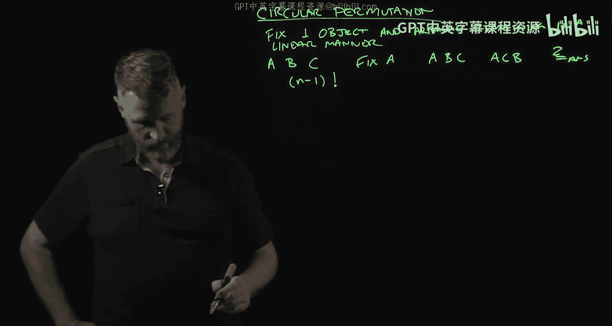

一个经典的例子是排列字母A、B、C。如果我们固定字母A的位置，那么剩余的B和C只能以线性方式排列在A之后。因此，可能的排列只有两种：A-B-C 和 A-C-B。

圆周排列的通用计算公式为：
**`(n - 1)!`**
其中，`n` 代表需要排列的对象总数。

---

## 基础圆周排列示例

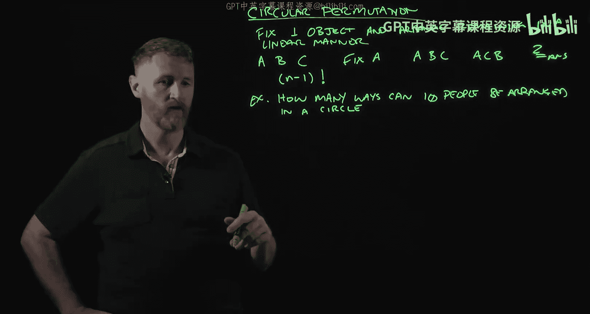

让我们通过一个具体问题来应用这个公式。

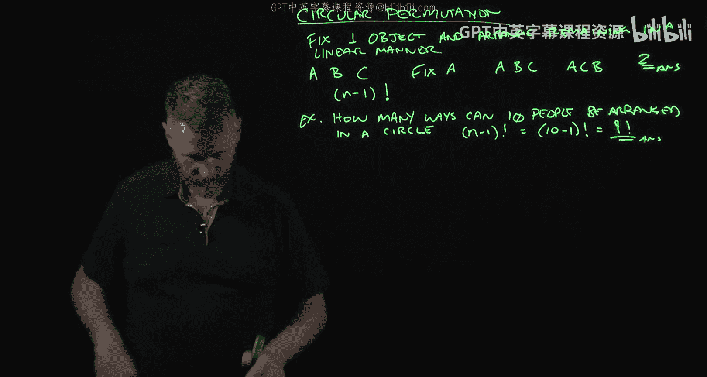

**问题**：10个人围坐在一张圆桌旁，有多少种不同的坐法？

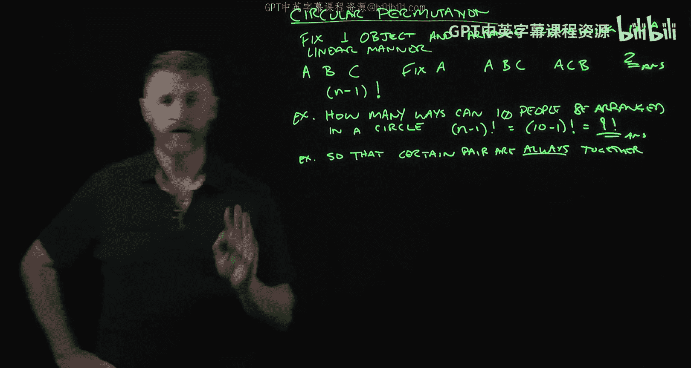

**解答**：在圆周排列中，我们可以先固定其中一个人的位置作为参考点。一旦这个人的位置固定，排列剩余9个人的问题就变成了一个线性排列问题。因此，总排列数为 `(10 - 1)! = 9!`。

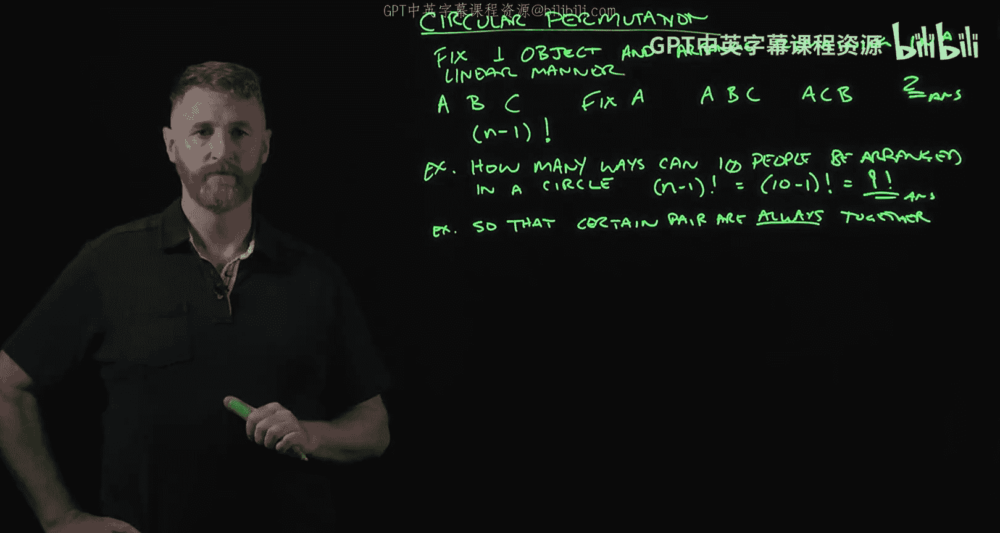

---

## 处理约束条件：特定元素必须相邻

现在，我们为基础问题增加一个约束条件。

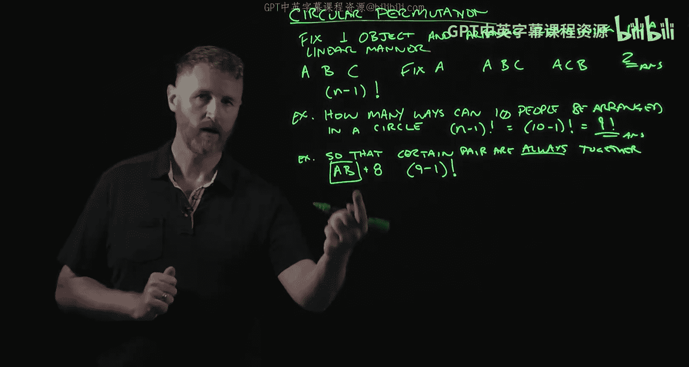

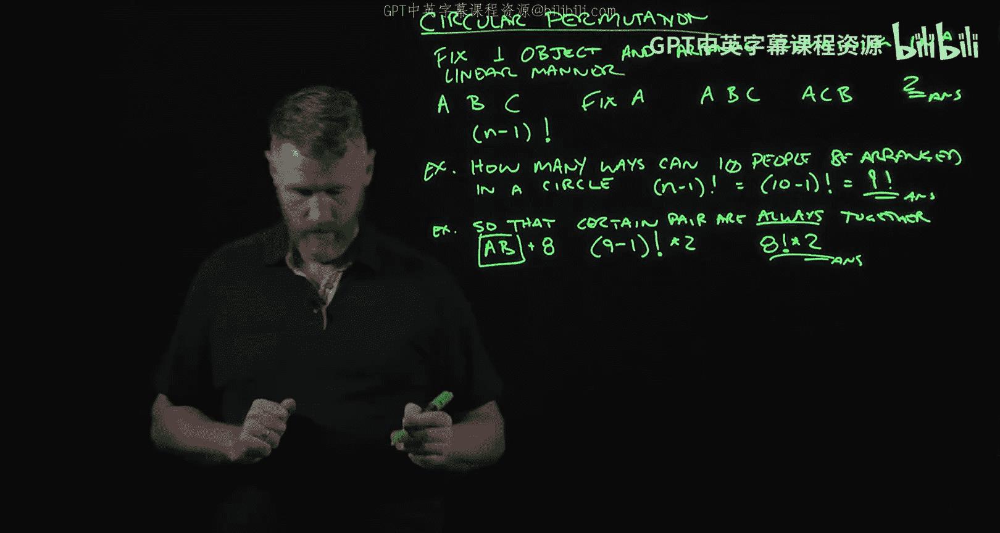

**问题**：10个人围坐在一张圆桌旁，但要求特定的两个人（例如A和B）必须坐在一起。有多少种坐法？

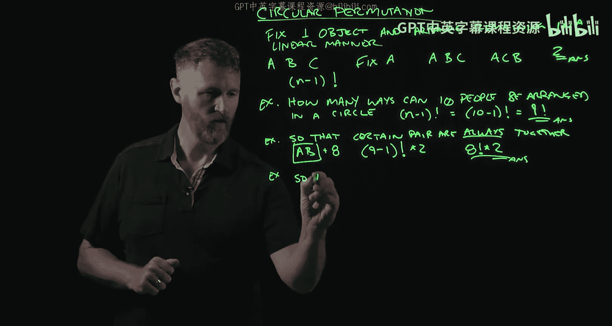

以下是解决此问题的步骤：
1.  首先，将必须坐在一起的A和B视为一个“整体”或“捆绑单元”。
2.  现在，我们有了这个“捆绑单元”加上剩下的8个人，总共 **9个单元** 需要围绕圆桌排列。
3.  计算这9个单元的圆周排列数：`(9 - 1)! = 8!`。
4.  最后，在“捆绑单元”内部，A和B两人可以互换位置（A-B或B-A），有 `2! = 2` 种内部排列方式。
5.  根据乘法原理，总排列数为 `8! × 2`。

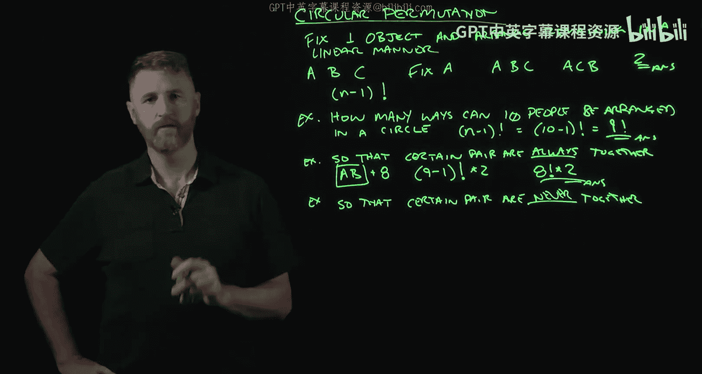

---

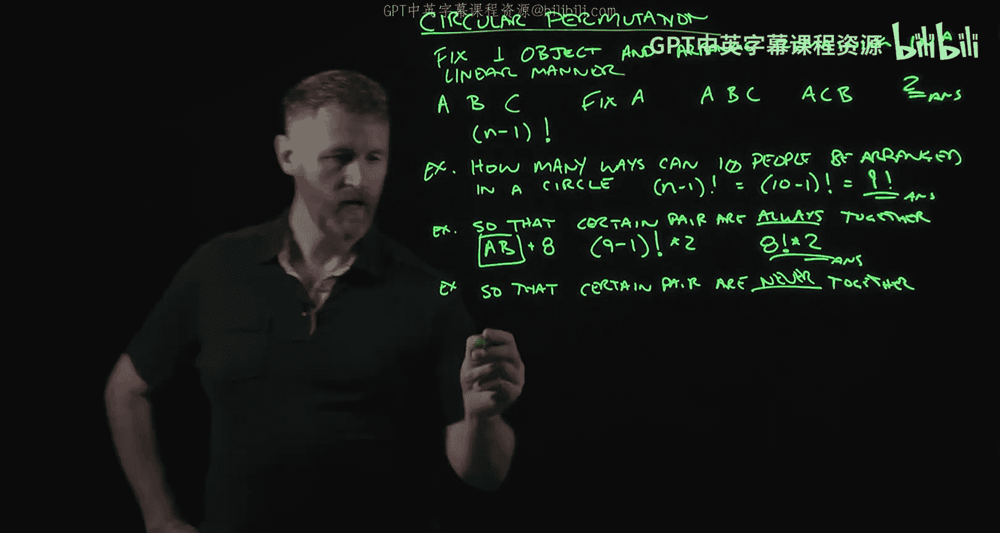

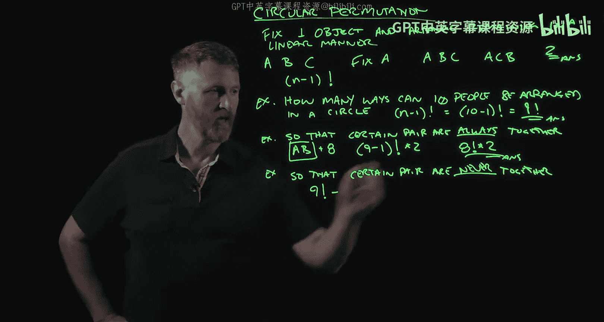

## 处理约束条件：特定元素永不相邻

理解了“必须相邻”的情况后，我们来看看其反面问题。

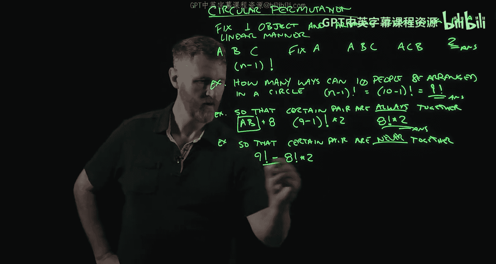

**问题**：同样是10个人围坐，但要求特定的两个人A和B**永不**相邻。有多少种坐法？

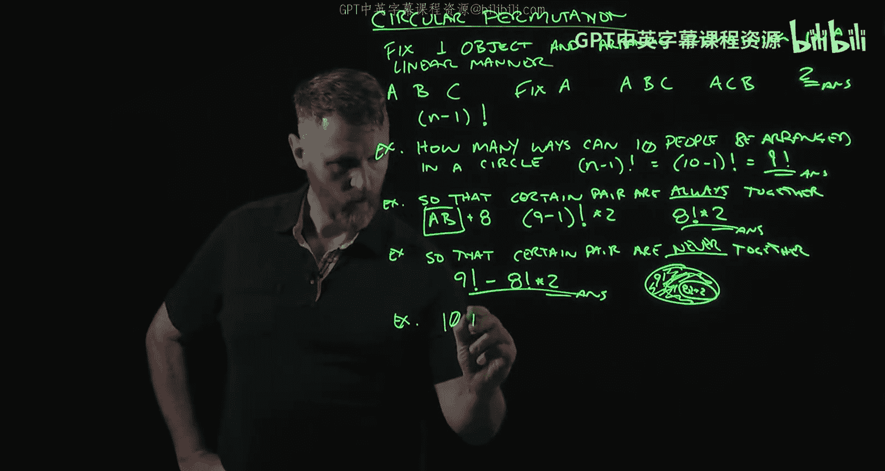

以下是解决此问题的思路：
1.  首先，计算没有任何限制时，10个人的总圆周排列数：`(10 - 1)! = 9!`。
2.  接着，计算A和B**必须相邻**的排列数，我们在上一节已经求出是 `8! × 2`。
3.  “A和B永不相邻”的排列数，就等于总排列数减去“A和B必须相邻”的排列数。
4.  因此，最终答案为 `9! - (8! × 2)`。

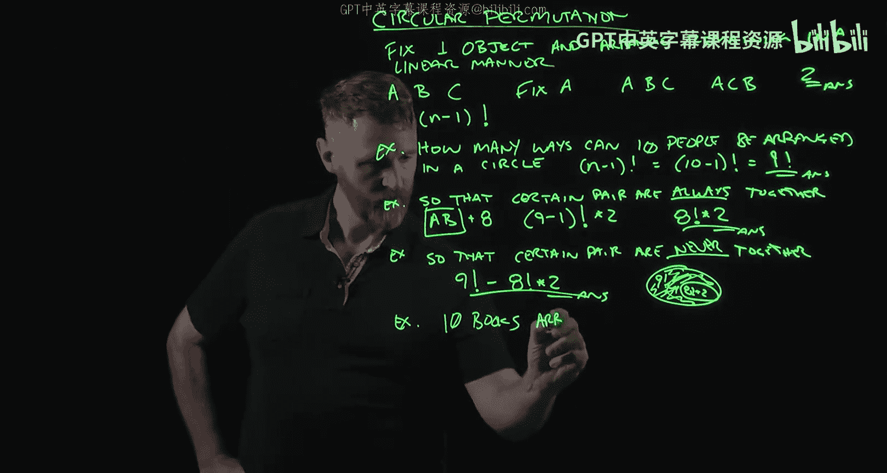

这种方法体现了概率论和组合数学中常用的思想：**从所有可能的情况中，减去不满足条件的情况**，从而得到满足条件的情况数量。

---

## 扩展到其他排列问题

圆周排列是排列问题的一个特例。排列问题还有许多其他变体，例如考虑对象分组或存在重复对象的情况。

**示例一：按科目排列书籍**
假设有10本书需要摆放在书架上：4本数学书、3本计算机科学书、2本统计学书、1本社交网络分析书。且同一科目的书必须放在一起。有多少种排列方式？

以下是计算步骤：
1.  首先，将同一科目的书各自视为一个整体。我们共有4个整体（数学、计算机科学、统计学、社交网络分析）。
2.  排列这4个整体的方式有 `4!` 种。
3.  在数学整体内部，4本书可以任意排列，有 `4!` 种方式。
4.  在计算机科学整体内部，3本书有 `3!` 种排列方式。
5.  在统计学整体内部，2本书有 `2!` 种排列方式。
6.  社交网络分析书只有1本，排列方式为 `1! = 1` 种。
7.  根据乘法原理，总排列数为：`4! × (4! × 3! × 2! × 1!)`。

**示例二：处理重复字母的排列**
计算单词 “COFFEE” 的所有不同字母排列数。

以下是计算步骤：
1.  单词 “COFFEE” 共有6个字母。
2.  如果所有字母都不同，排列数应为 `6!`。
3.  但其中字母 ‘F’ 出现了两次，这两个 ‘F’ 在排列中是不可区分的。所有包含这两个 ‘F’ 互换位置的排列实际上是同一种排列。因此，我们需要将 `6!` 除以这两个 ‘F’ 的内部排列数 `2!`。
4.  同理，字母 ‘E’ 也出现了两次，同样需要除以 `2!`。
5.  因此，不同的字母排列总数为 `6! / (2! × 2!)`。

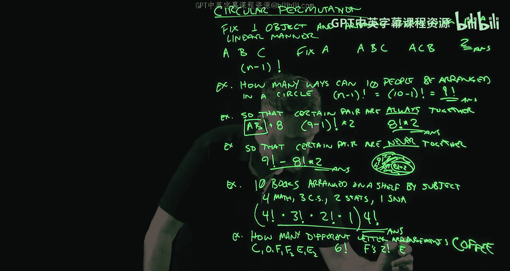

其通用公式为：当有 `n` 个对象，其中第1类有 `n₁` 个相同对象，第2类有 `n₂` 个相同对象……时，不同排列数为：
**`n! / (n₁! × n₂! × ...)`**

---

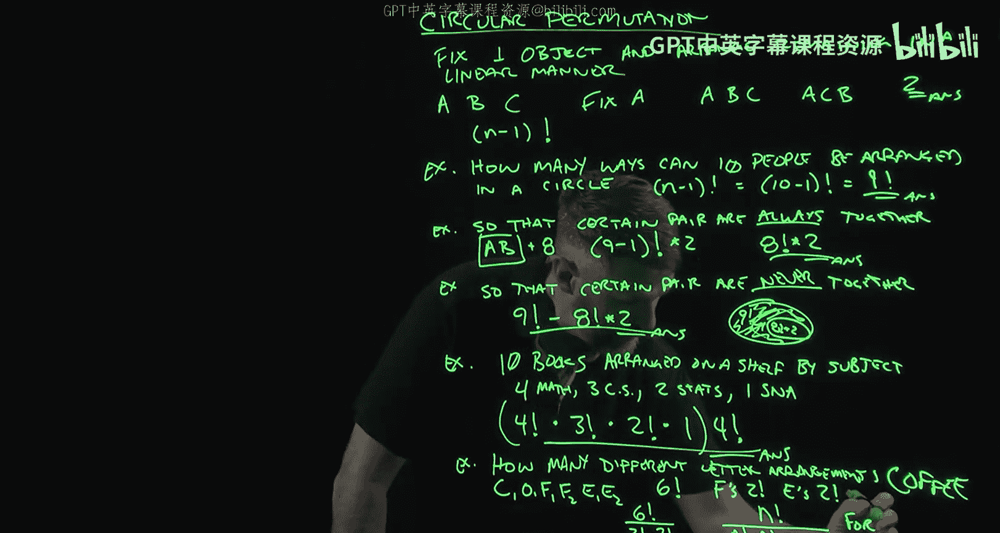

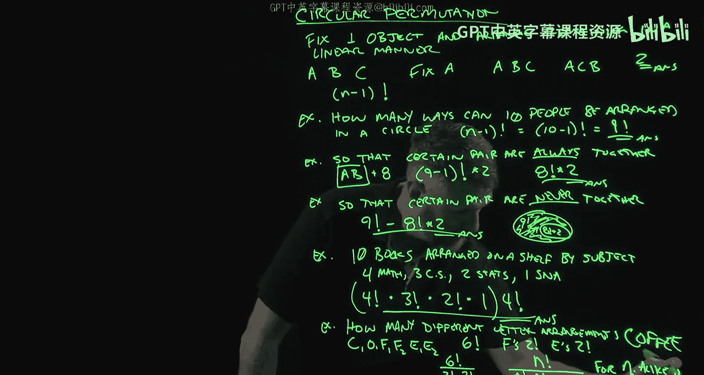

## 总结

本节课中我们一起学习了圆周排列及其相关计算。
*   我们首先定义了圆周排列，其核心是固定一个参考点，公式为 `(n - 1)!`。
*   接着，我们学习了如何处理“特定元素必须相邻”的约束，方法是将其捆绑并考虑内部排列。
*   然后，我们通过互补的思想解决了“特定元素永不相邻”的问题。
*   最后，我们将排列的知识扩展到分组排列和处理重复对象的情况，并介绍了相应的通用公式。

这些排列计数原理在计算机科学中有着广泛的应用，例如在分析密码强度、设计算法复杂度、处理数据结构的可能状态等场景中都非常重要。