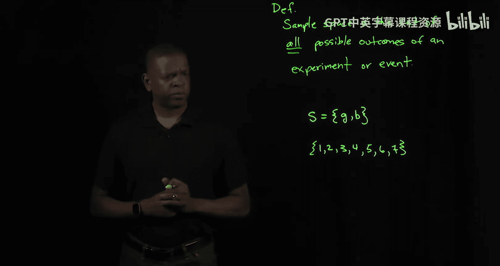
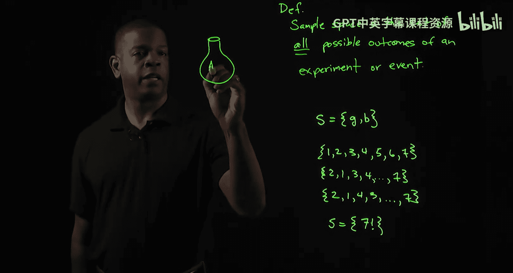
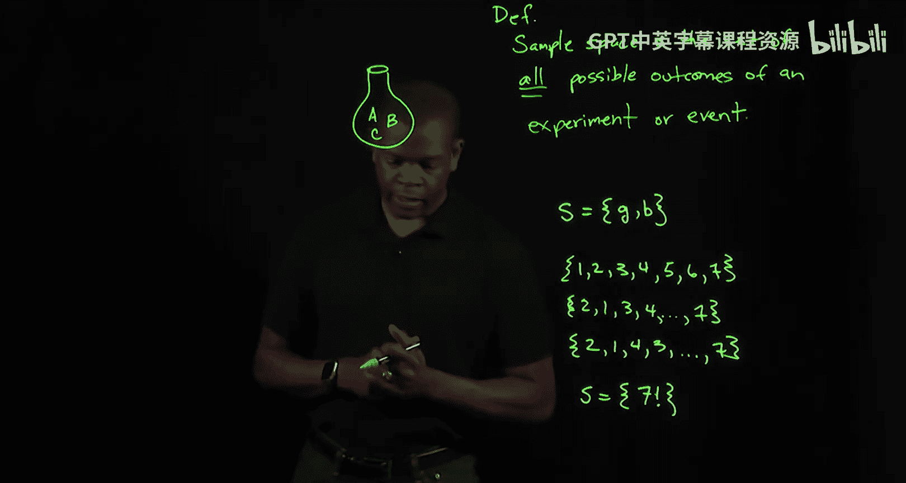
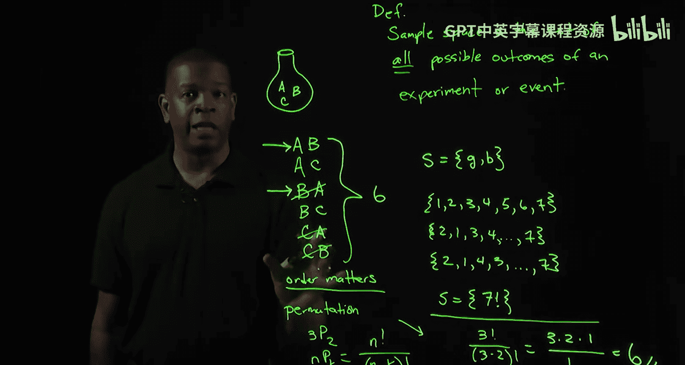
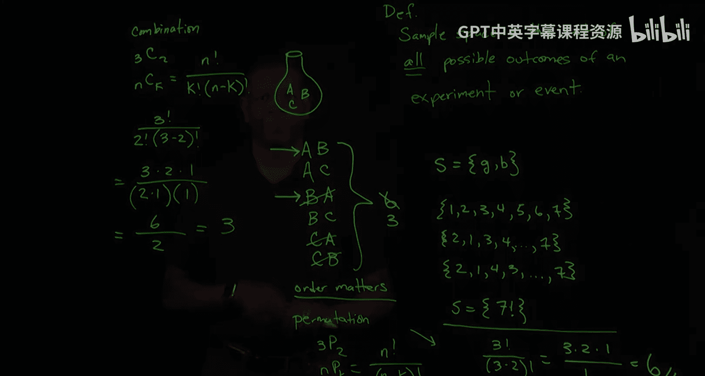

# 约翰霍普金斯大学《计算机科学的统计方法｜Statistical Methods for Computer Science》中英字幕 p10 9_样本空间.zh_en -BV1r483zbEzN_p10-

I'm Dr。 Tony Johnson from Johns Hopkins University。

 and this is module two of our course statisticalistical Method for Comp Scient。

In this lesson， we're going to be talking about sample spaces and events。

Now to begin our discussion of sample spaces， we'll just talk about a definition and this definition。

Basically says that a sample space。Is。The set。Of all possible outcomes of an experiment。Now。

 with this definition as a guy。When we're looking at these， the set。

It's very important that we have found and we have actually defined all possible outcomes。

 If we do not have all possible outcomes， you have not clearly established what your sample space is。

 So， for example。Suppose there's an experiment that consists of the determination of a newborn child。

 okay an experiment that consists of the determination of a newborn child。 so in that regard。

 the sample space which we'll denote as S is going to equal to the set of all possible outcomes of a newborn baby and so in that case we're going to have it can either be a girl or a boy。

Okay in this way we've established a sample space and this sample space basically means that any experiment。

 any observation that you have of a child being born。

 that observation will result in one or one of these outcomes and this is the total space or all such outcomes is' either going to be a girl or a boy。

Now， let's suppose the outcome of an experiment。iss the order in which a horse finishes a race， Okay。

 the order in which a horse finishes a race。 So if the horses are labeled， let's say one through 7。

We could say basically that you could you could have a permutation， which would be， let's say。

 horse1， two，3，4， five， six， and seven， that could be one permutation。And this is one outcome。

 horse number one comes in first， horse number two comes in second， so on and so forth。However。

Another outcome could be。In this case， it could be horse number two， then number one， then three。

 four。All the way to7。 that is another outcome that is equally likely。 That's another outcome。

 How about a third outcome， You may have a third outcome that could be。Two， one。And then four， three。

And then this would go all the way until you complete。 you exhaust all the number of horses。 Well。

 it turns out that in this case， the sample space。Of all such permutations。Okay？Will actually be。

7even。Factorial。Okay，7 factorial， this is the number of ways that seven horses can be permuted in all possible combinations。

 and so we're going to look at a little bit more about that。 Let's look at another example。

Suppose I have a bag。So we'll draw a little bag here。And inside of my bag， I have three letters。

 I have the letter A。

ButLet it be。The letter C。And so what would be the sample space if I remove？Two letters at a time。

Okay， if I remove two letters from the back and， but I remove those two letters。

 I should say one letter at a time。 Yeah， so I remove the two letters， one letter at a time。 Okay。

 so let's look at the sample space。 So let's say I remove a and I remove B。

And then I put the letters back in the bag， okay， I pull out the letter A again。

And if I pull out the letter B， then that is the same as A B。 so we disregard that one。

 so I keep doing this and now I pull out a first and this time I pull out a C。Okay。

This time I reach in the bag， I pull out of A again。The second time I reach in a bag， I pull out a B。

 that's already accounted for。 I I put them back in the bag。 I reach in the bag。 I pull out a A。

 and I pull out a C。 That's been accounted for。 So in terms of when I pull out an A first。

 I have exhausted all possible ways in which if I draw an a first。

The next letter is either going to be a B or C。 So there are no more other ways if I pull an A first that this experiment can have a different outcome。

All right， so then what I'm going to do so the next time I'm going to keep doing this until the first letter I pull out is a B。

Okay， so I pull out a B next time now I'm going to pull out another letter and this letter。

 it can't be a B because the B is already in my hand， so it's going to have to either be an A or a C。

 so I pull out a A。And then I pull out of B， and I pull out of C。Okay。

 then this has exhausted all possible combinations or all possible permutations where the first letter I pull out is a B。

Right， so now what I'm going to do is I'm going to say， okay， suppose the first letter is a C。

What are my possible permutations where wealth there could be an A？And then there could be a B。

So what I've done is I've exhausted all possible outcomes that are possible if I'm pulling two letters out of a bag that contains three letters。

And I'm pulling those two letters out of the back， one at a time。Okay， one at a time。

 and so let's see。What I have。 So what I end up with is I end up with。6。Possible permutations。

 so the sample space in this case， the sample space by outcome would be this list。

 but the sample space in terms of the number would be 6。 there are six possible ways。

 and in this case I want you to notice something。I want you to notice that order。Matterters。

Meaning that A B。Is not the same。SB。Okay。And so when order matters。When this is the case。

 then you know that if order matters that what you're dealing with is what's known as a。Permutation。

And you know that from the previous module， okay， you know that you're dealing with the permutation and in this case I have three and I'm going to choose two and so this will be three choose2。

 so3 P2 here。And so we know that in。P say K is going to be equal to。

 and so the definition for this is a permutation。 and so this is going to be in factial over。

N minus K。Factial。And so in this case， I have three and two。

 so what I get is I get for this particular one， I'm going to get and we'll write it over here。

I'm going to get three factoral。Over。嗯。So three factorial over。In minus-3 factorial。

 So that's going to be 3 minus-2。Factual。And so this is going to give me。

Three times two times1 divided by， and this is going to be one factorial。

 So this is going to be basically one okay。And so this gives me。6。

 and what I've done is I've calculated through counting the number of possible ways in which you could pull。

2 letters out of a bag containing three letters。 And that is the number for the sample space。

 This tells me how many items are actually in that sample space。

Now there's another thing that we need to take into consideration in an observation of sample space。

 we need to ask ourselves， okay， this occurs if order matters。

But what happens if order does not matter？In other words， if A B is the same as B A。

 then something drastic is going to happen to this list。In other words。If A B and BA are the same。

 then one of them would be disregarded。So this one would be disregarded。Okay， so then I go to BC。

 BC is not represented above。Then I go to CA， but CA is the same as AC， this one。Is cancel。

Then I go to the last one， C， but CB is the same as B here。 And so this one is also canceled。

 And so what was a permutation of6 now becomes a new type。 and this is what we call a combination。

 and as you've seen before， combination in a combination order does not matter。

 order is not relevant in determining the number of items that it would be in your sample space。

 And so in a combination， what was6 now becomes three。 And so as you know， for a combination。

And as a combination， we know that we're going to have three。And then we use C2。

And so the value here is going to be N CK， and that's going to be very similar to a permutation。

 except it's going to be n factorial over。This is going to be k factorial times n minus k。Factorial。

 and so now when we calculate for this particular case， knowing that order does not matter。 Okay。

 so in this particular case， what we're going to find is we're going to have。

 We're going to have three factorial。Over。And then this is going to be two factorial times3 minus2 factoral。

 And so when we calculate this then what we get is we get that this is equal to three times two times1 over。

So this is going to be2 times 1 k。Times1。Okay。So now what we have here then is six over two and that gives me three。

And so we have this mechanism now by using what we learned in module1 in terms of counting。

 we have a mechanism now to quantify the number of events that will be in our sample space and this is going to be extremely useful as we move forward in you know this topic and discussing sample spaces now。

😡，When we look at the quantity of values or the quantity of events or outcomes of a particular experiment。

This。Term when we quantify it， we're calling it the sample space。

Just keep in mind that the sample space can be the enumerated list of items that are in the space。

 but it is also the actual number of items that are in the space。 And so you have to be careful。

 just make sure you know what in what context that you're talking。 So in this case。

 both of these notations described the sample space。

 It is described as a set that contains a B A C and B， but it's also described as the number three。

 which is the number of items that are contained in that set and recall。

 it has to be the set of all possible outcomes。

