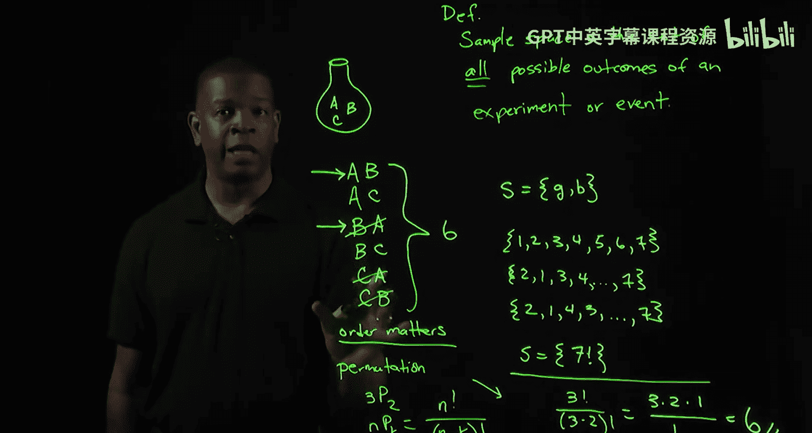
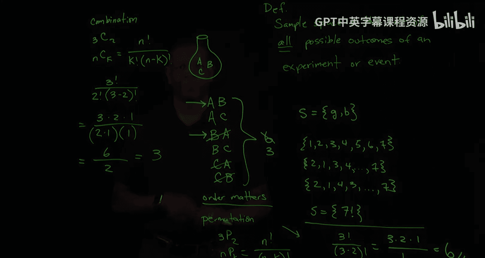

# 计算机科学的统计方法：2：样本空间与事件 🎲

在本节课中，我们将学习**样本空间**和**事件**的基本概念。样本空间是概率论的基础，它定义了某个实验所有可能结果的集合。理解样本空间是计算事件概率的第一步。

## 概述

首先，我们给出样本空间的定义。**样本空间**是一个实验所有可能结果的集合。关键在于，我们必须明确地定义**所有**可能的结果。如果遗漏了某些结果，就没有清晰地建立样本空间。

例如，假设有一个实验是确定新生儿的性别。那么样本空间 **S** 就是所有可能结果的集合：`S = {女孩, 男孩}`。任何一次新生儿性别的观察结果，都必然是这两个结果之一。

## 样本空间的例子

上一节我们介绍了样本空间的定义，本节中我们来看看几个具体的例子，以加深理解。

### 例子1：赛马排名

假设一个实验的结果是赛马比赛的名次顺序。如果有7匹马，编号为1到7。

*   一种可能的结果是马匹按 `1, 2, 3, 4, 5, 6, 7` 的顺序完成比赛。
*   另一种可能的结果是 `2, 1, 3, 4, 5, 6, 7`。
*   实际上，所有可能的结果是7匹马所有可能的排列顺序。

在这种情况下，样本空间的大小（即所有可能排列的数量）是 **7的阶乘**，记为：
**公式：** `7! = 7 × 6 × 5 × 4 × 3 × 2 × 1`

### 例子2：从袋中取字母

假设一个袋子里有三个字母：`A`, `B`, `C`。实验是**每次一个**地从袋中取出两个字母（取出后放回）。我们关心取出的顺序。

以下是所有可能的结果（排列）：
*   第一次取 `A`，第二次取 `B`：记为 `AB`
*   第一次取 `A`，第二次取 `C`：记为 `AC`
*   第一次取 `B`，第二次取 `A`：记为 `BA`
*   第一次取 `B`，第二次取 `C`：记为 `BC`
*   第一次取 `C`，第二次取 `A`：记为 `CA`
*   第一次取 `C`，第二次取 `B`：记为 `CB`

因此，样本空间是集合 `S = {AB, AC, BA, BC, CA, CB}`。总共有6种可能的结果。

## 排列与组合：顺序是否重要？ 🔀

在第二个例子中，我们注意到 `AB` 和 `BA` 被视为不同的结果，因为取出的**顺序不同**。当顺序重要时，我们处理的是**排列**问题。

从n个不同元素中取出k个元素的排列数公式为：
**公式：** `P(n, k) = n! / (n - k)!`

在我们的例子中，`n=3`, `k=2`，所以：
**计算：** `P(3, 2) = 3! / (3-2)! = (3×2×1) / 1 = 6`
这与我们手动列出的6种结果一致。

现在，考虑另一种情况：如果顺序**不重要**，即 `AB` 和 `BA` 被视为同一种结果（只关心最终拿到了A和B这两个字母）。

那么，样本空间将变为：
*   `A` 和 `B`
*   `A` 和 `C`
*   `B` 和 `C`

此时，样本空间的大小从6减少到了3。当顺序不重要时，我们处理的是**组合**问题。

从n个不同元素中取出k个元素的组合数公式为：
**公式：** `C(n, k) = n! / [k! × (n - k)!]`

在我们的例子中，`n=3`, `k=2`，所以：
**计算：** `C(3, 2) = 3! / [2! × (3-2)!] = (3×2×1) / [(2×1) × 1] = 6 / 2 = 3`
这与我们简化后的3种结果一致。

## 重要说明 📝

当我们谈论样本空间时，需要注意它有两种表示方式：
1.  **作为集合**：明确列出所有可能的结果，例如 `S = {AB, AC, BC}`。
2.  **作为数量**：指该集合中元素的总数，例如 `|S| = 3`。

在上下文中需要明确使用的是哪一种含义。无论如何定义，都必须确保它包含了实验的**所有可能**结果。

## 总结

本节课中我们一起学习了：
1.  **样本空间**的定义：一个实验所有可能结果的集合。
2.  通过新生儿性别、赛马排名和取字母等例子，理解了如何构建样本空间。
3.  区分了**排列**（顺序重要）和**组合**（顺序不重要）两种情况，并回顾了相应的计算公式 `P(n, k)` 和 `C(n, k)`。
4.  明确了样本空间既可以表示为一个结果列表，也可以表示为该列表的大小（结果数量）。

理解并准确定义样本空间，是后续学习事件概率计算的基石。