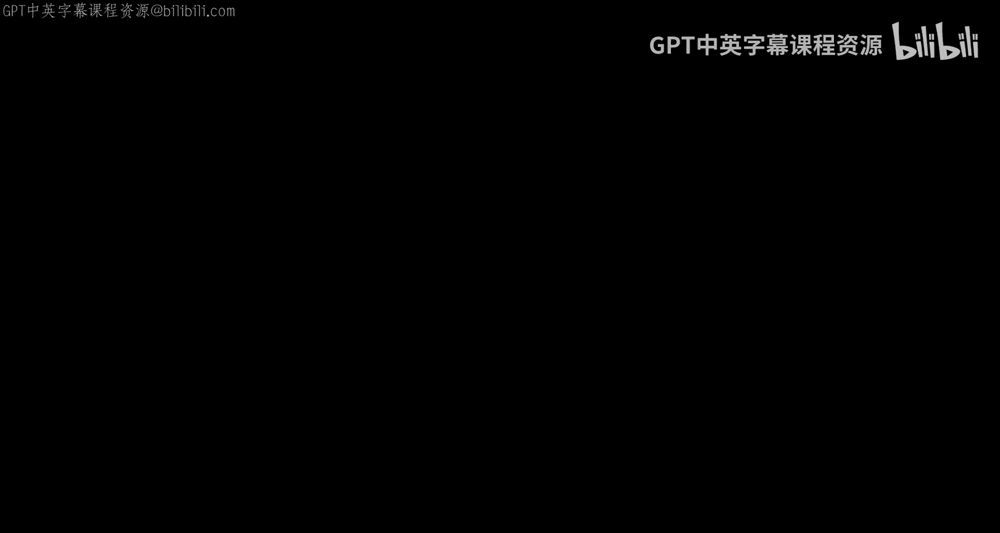
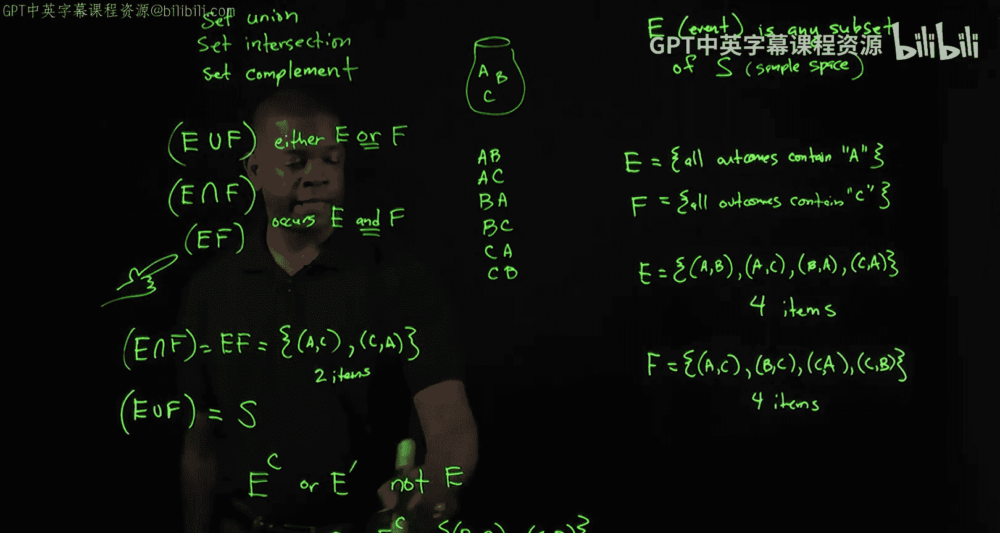

# 约翰霍普金斯大学《计算机科学的统计方法｜Statistical Methods for Computer Science》中英字幕 p11 10_事件论.zh_en -BV1r483zbEzN_p11-

Now， in a subset of a sample space is known as an event so。

So if and we're going to denote an event by in this case， we're going to say E， okay， so E。

 which is going to be， you know， this is an event。Is any？Subset。Of。S。Which is a sample。Space。Okay。

 and so in this way， we write things like if we had an event， we could say E。Is equal to。

 and we can say that this is the subset。Of all。Outcomes。Containing。The letter A。Okay。

So all outcomes contained in the letter A。 So we had our bag。Our bag had A， B， and C。

And we looked at in a permutation sense， we had AB。We had AC， we had B， A， we had B， we had C A。

 and we had C。OkayAnd so if you look at this particular case。

 the event of all outcomes containing the letter A， you would count1，2，3， and 4。

 there are four outcomes in this experiment that contain the letter A conversely you could additionally you could have an event。

 let's call it F， and this event could be all。Outcomes。That contain。The letter C。Again。

 you look at your sample space and you count all outcomes that fit that particular description。Okay。

 so if we were to write these things， we would write it out and we would say for this particular definition。

 we would say so E is equal to。And in this case， we would say。AB。Com， we would say a C。

We would say BA。And we would say。CA。Too easy。Clearly。

 I can count the number of items that are in this set E， and this would be full。Now。

We come to this idea now that when I have these different ways of determining events， and again。

 we talked about events as being subsets now of the sample space。I would ask you a question。

 could an event contain all？Items in S。 and the answer is yes， E can be a subset of S。

 even if E contains all items in S， but E cannot contain items that are not in S。

 because if E contains items that are not in S， then S is not， and what's never a sample space。 Okay。

 so yes what we have to understand。All right， so now let's look at。Some ideas。

So I have defined two different events。 So we had event E。 and I'm going to also enumerate event F。

 which in this case is going to be。 This is all they have a C。 So we're going to have。A C。

Notice that this is permutation， I didn't say that order was irrelevant， so order is mattering here。

 so I have AC。I have BC。I'm going to have CA。And then I'm going to have CB。All right。And again， in F。

 I have4。Items。What we like to talk about now is we want to talk about how。

When you have more than one event， how do those events relate okay。

 and really what we're what we're talking about is we're talking about some kind of set algebra here in terms of what we call set union。

Set。Intersection。Okay， and then we're going to also look at a set。Compliment。Okay。Okay， set union。

 set intersection， and set complement。So when we write， for instance。

 we're going to use a notation for union is's going to be E。For an event。And then we say union F。

Okay what this mean？This notation means that we're going to say that E， that the particular event。

Occurs in either E or F。 So this is。Either。一。Or as the key F。

So we're looking at events that occur in either E or F。Right？It's possible。That。

The union of E or F could equal S。That is possible， which is the entire sample space。

 which is the entire sample space。Let's look at intersection， so we could have E。

 and for intersection， we're going to use this guy。And we're going to say F。Now。

Where there's another way to do this notation that you're going to see commonly referred in your book。

 and that is where we say basically。嗯。F。Both of these notation， okay。

 whether it's the upside down U or just EF together， I know it looks like multiplication。

 but if E and F are events of a sample space， then E and F are not multiplied together in a sense of multiplication。

 this represents intersection。😡，Okay， that represents intersection。 And so in this case。

 we're saying that this is going to mean。That the outcome is。occursccur。When E。And。F。

Contain the event。Okay。E and so here's the thing。Okay， if it's union， it's ore， if it's intersection。

 it's and。 that's the key。 Okay， so let's take an let's look at an example， right。

 Sose we want to find， actually， we want to find we want to find E intercept F。

 which I say was equal to E F。Okay？What。Is that set？Okay， so we're looking at。一。

And we're looking at F。 Okay， so I have A， B and E。I do not have A， B and F。 I have A C and E。

 Theres an A C and F。 Then this becomes a comma C。 That is the first item in this intersection。

 All right， let's look at the next one。 I have a B， A and E。 I do not have a B A and F。 I have a C。

 A and E。 I have a C， A and F。 So that is the next item。In this intersection。And so as you can see。

 this guy， the intersection of E and F， contains two items。Okay， contains two items。Okay。

 suppose I'm looking for E union， okay， F。Okay， what would that be， Well。

 if I look at the sample space is very interesting in this case， A B is in E。 A C is in E。 D。

 A is in。E B is not an E， but the union is is it in either E or F。 So in this case， B is not an E。

 but B is in F C A is in E and F， and then B is not an E， but it is an F。 So in this case。

 the union of E and F is S。 it is the entire sample space。Finally。

 I want to talk about the compliment。The compliment。

Is the notation for the complement is going to be E。And then C， all right， and what does that mean。

 this is written as EC， or sometimes you might see it as E prime。Both of those。

 if E is a set variable。In other words， if E is an event。

Then both of these represent what we like to call。Not E。Not E。Okay。

So once E has been established as an event。 so in this case， E has been established as an event。

 then not E， Okay， not E， so E。嗯。Not a C， but E。Compliment is going to be equal to the set that's not an E。

That remains in the sample space。 So A B is in E。 A C is an E。 B， A is in E。 B is not in E， So B。

Ist is not an E， Okay， C A is an E， C is not an E。So this is E complement， okay， EC， E complement。

Notice that EC。

Is not equal to。F。Okay。Is not equal to F。However， an event can be defined that is equal to E's complement but in this case。

 E's complement is not equal to F， although the values that are not in E are also found in F。

 but F contains other values as well。

