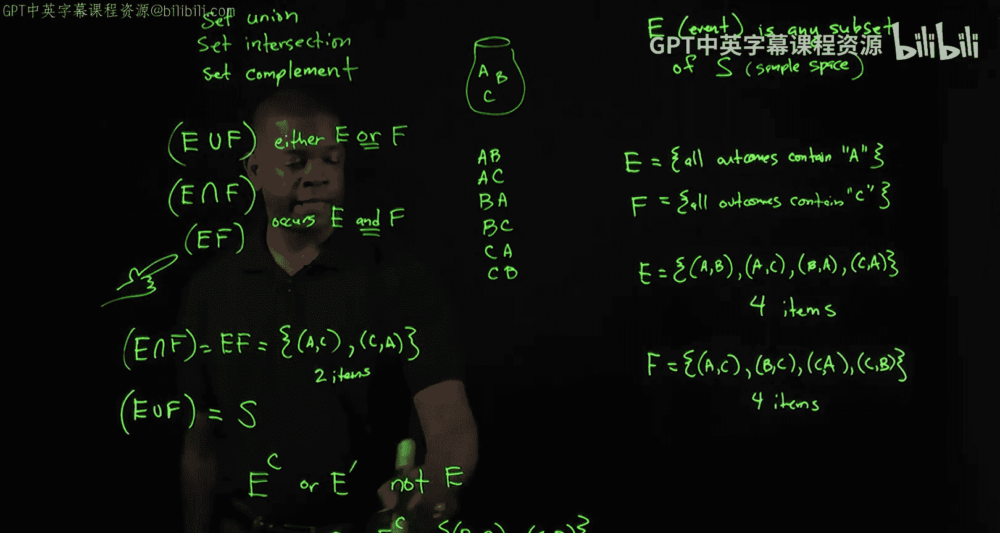

# 计算机科学的统计方法：1：事件论 📊


在本节课中，我们将要学习概率论中的一个核心概念：**事件**。我们将了解事件的定义、如何表示事件，以及如何通过集合运算（如并集、交集和补集）来组合和分析多个事件。

---

## 什么是事件？

上一节我们介绍了**样本空间**的概念，它是一个实验所有可能结果的集合。本节中我们来看看**事件**。

在概率论中，样本空间的任意一个**子集**被称为一个**事件**。我们通常用大写字母（如 `E`）来表示一个事件。

**定义**：事件 `E` 是样本空间 `S` 的任意一个子集。

例如，假设我们有一个装有字母 `A`、`B`、`C` 的袋子。我们进行一个实验：不放回地抽取两个字母，并考虑其排列顺序。那么样本空间 `S` 包含以下6种结果：
`S = {AB, AC, BA, BC, CA, CB}`

我们可以定义一个事件 `E`，它包含所有出现字母 `A` 的结果。以下是这个事件的具体构成：

```
E = {AB, AC, BA, CA}
```

我们可以数出事件 `E` 中包含4个结果。同样，我们可以定义另一个事件 `F`，它包含所有出现字母 `C` 的结果：

```
F = {AC, BC, CA, CB}
```

事件 `F` 也包含4个结果。

一个事件可以包含样本空间中的所有结果（即 `E = S`），但它**不能**包含不属于样本空间 `S` 的结果。

---

## 事件的集合运算

当我们定义了多个事件后，我们常常需要分析它们之间的关系。这涉及到集合的三种基本运算：**并集**、**交集**和**补集**。

以下是这三种运算的定义和示例。

### 并集 (Union)

事件 `E` 和 `F` 的**并集**，记作 `E ∪ F`，表示结果发生在 `E` **或** `F` 中（或同时发生）。

**公式**：`E ∪ F = {x | x ∈ E 或 x ∈ F}`

在我们的例子中，计算 `E ∪ F`：
- `AB` 在 `E` 中。
- `AC` 在 `E` 和 `F` 中。
- `BA` 在 `E` 中。
- `BC` 在 `F` 中。
- `CA` 在 `E` 和 `F` 中。
- `CB` 在 `F` 中。

因此，`E ∪ F = {AB, AC, BA, BC, CA, CB}`，这恰好等于整个样本空间 `S`。

### 交集 (Intersection)

事件 `E` 和 `F` 的**交集**，记作 `E ∩ F` 或简写为 `EF`，表示结果**同时**发生在 `E` **和** `F` 中。

**公式**：`E ∩ F = {x | x ∈ E 且 x ∈ F}`

计算 `E ∩ F`：
- `AC` 同时存在于 `E` 和 `F` 中。
- `CA` 同时存在于 `E` 和 `F` 中。

因此，`E ∩ F = {AC, CA}`，包含两个结果。

### 补集 (Complement)

事件 `E` 的**补集**，记作 `E^C` 或 `E'`，表示结果**不发生**在 `E` 中，但仍在样本空间 `S` 内。它代表“非 `E`”。

**公式**：`E^C = {x ∈ S | x ∉ E}`

计算事件 `E` 的补集 `E^C`：
- `AB` 在 `E` 中，所以不属于补集。
- `AC` 在 `E` 中。
- `BA` 在 `E` 中。
- `BC` 不在 `E` 中，所以属于补集。
- `CA` 在 `E` 中。
- `CB` 不在 `E` 中，所以属于补集。

因此，`E^C = {BC, CB}`。

需要注意的是，`E^C` 不一定等于我们之前定义的另一个事件 `F`。虽然 `E^C` 中的结果 (`BC`, `CB`) 也出现在 `F` 中，但 `F` 还包含了其他结果 (`AC`, `CA`)。

---



## 总结

本节课中我们一起学习了概率论中**事件**的核心概念。
1.  我们首先明确了事件是样本空间的子集。
2.  接着，我们学习了如何用集合运算来组合和分析事件：
    *   **并集** (`∪`) 对应逻辑“或”。
    *   **交集** (`∩`) 对应逻辑“与”。
    *   **补集** (`^C` 或 `'`) 对应逻辑“非”。
3.  我们通过具体的字母排列例子，计算了事件的并集、交集和补集，并理解了它们之间的区别与联系。


掌握这些集合运算是理解更复杂概率计算（如加法法则）的基础。