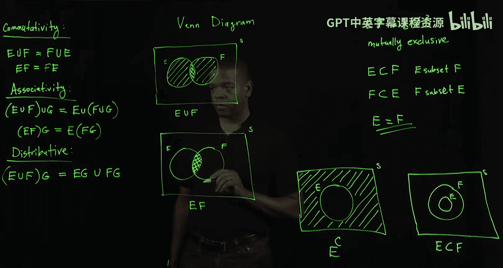

# 约翰霍普金斯大学《计算机科学的统计方法｜Statistical Methods for Computer Science》中英字幕 p12 11_维恩图解构.zh_en -BV1r483zbEzN_p12-

There are some other relations about events that are important for us to recognize。

First of all。If I have a situation where I have E。F， and again。

 we recognize that this is the intersection between E and F。

If the outcome of this particular set is null。 K， we call the null set。

 meaning that there are no events in which E and F occur， right， There are no event。

 There is no event。 Theres no outcome that is included in E and F。 If that is the case。

 Then we say that E and F are mutually。Exclusive。And this is a very important concept in that it tells us right away that E and F are independent events。

 Okay， these two events happen independent of one another。

We also want to look at some formal notation when we talk about subsets right。

 so if we have a situation where we have E and we have this U turned on its side。Of F。

What this means is that E is a subset。Okay， so E is a subset。Of F。All right。U。

If we have a situation where。F。Then is a subset of E。This notation means that F is a subset。

Subet of E。Okay， if that is the case where E is a subset of F and F is a subset of E。

 If these happen simultaneously， then we say that E。Is equal to F。That E is equal to F。

 and that's a very important concept to understand。Now。嗯。

We'd like to take a look at a graphical representation of how these relations kind of come together and one of the most useful graphical representations of this whole idea of sets come by way of what's known as a Venin diagram。

And so the first thing we'll do is I'm going to draw this box。

And this box represents the total space of all possible outcomes， so this box then is actually S。

the box itself is S。 it is the space of all possible outcomes in a given experiment。Or observation。

So we can have event E and we can have event。F， so here are two events。

 this event E is a subsetspace or a subset of the space of all possible outcomes and F。

Is a subset of the space of all possible outcomes。And so if we ask ourselves， what would be E？Union。

F in this graphical representation， the answer would be。The total amount of space covered by E。

And also， covered by。F。But because we're talking about the union。

 it's also going to include the space。Where E and F。Overlap。Okay。

And so this is the representation of E union F。All right， so what about the intersection then。

 the intersection of E union F。 Well， we could draw that again。We first draw S。

Here's our sample space， here is an event E， here is an event F。They overlap。And so in this case， E。

F。Okay this is going to be the space where E and F occur， E and F occur。

 and that is going to only happen here。This now。Is the intersection of E and F。Okay。

 let's look at another one suppose we want to look at。So here's our sample space again。

Here's our event E。And we're looking at， here's S and we say， okay。

 we want to look at E's complement， okay， so if this is E。Then E。The complement of E would be。

All the space。Outside。Of Ei。Yeah， I think you're getting it now。 You're seeing， you see it now。

 right， It's all the space outside。Of E。There's all the space that does not include E。Right。

 and so finally， let's look at some other ones， what about okay。

 so how about some of the set notation So if I had， here's our sample space。This is S again。

 and I have an event F。But then I have an event。Yi。Okay， so then this right here is going to be E。

Is a subset。Of air。E is a subset of F。And so now understanding this。

 there are a few rules that we wanted to kind of keep in mind， all right？

Few rules we want to kind of keep in mind。So rule number one is commutivity。Okay， and for comm。

 commuticivity， think about commuter， right？Communicivity basically says that E。Union。

F is equal to F。Union E。 So those two are the same。Conversely in intersection。

 it also means that so this would be。It also means that EF。Its equal to the intersection of F。E。

Those are equivalent。That's commutivity， okay， the values， these sets， these events can commute。

 they can move， right？Okay， the next one we want to look at is associivity。Associivity。Okay。

 associivity and associivity we're looking at。We say E。Union。F。And then those guys， Union G。

Is equal to， right。 So I've associated E and F together。

 but that's equal to if I had E union and I associate F。Union G。That is equivalent。

I could also say EF。Is。And G is equal to， and I can associate E。And associate FG。That is equipment。

Okay， and finally， we want to look at。Distributive。The distributive property here， Okay。

 distributive and in distributive withre saying like this。 we're saying that if I have E。Union F。

And that's intersected with G。Okay， that's intersected with G。 Well。

 that's equal to this is going to be equal to。Yijii。E intersect G。Union。F。Interssect G。E intersect G。

 union F intersect G。

All right， conversely， if I have E。De。 and then we're saying that this is union G again。

 that this is going to be equal to。一。Union G。Times。F。Yunyingji。

And so this is now kind of the complete picture both graphically。

 and then here's some algebraic rules that we follow that we can use to evaluate sets in terms of intersection。

 union with commutivity， associivity and the distributive properties。

