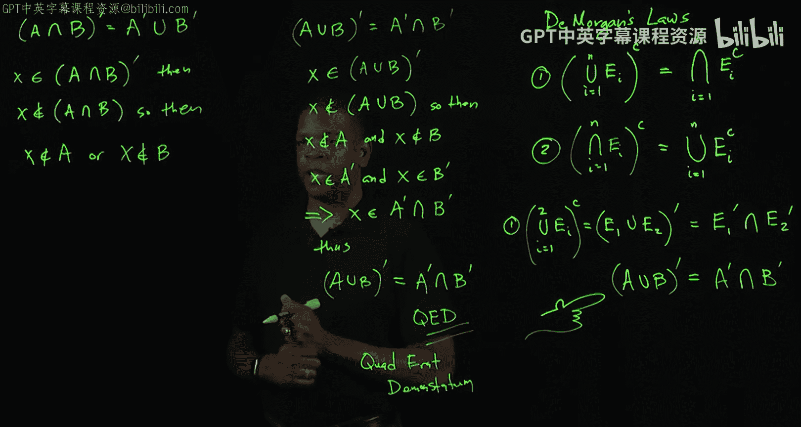

# 约翰霍普金斯大学《计算机科学的统计方法｜Statistical Methods for Computer Science》中英字幕 p13 12_德摩根定律.zh_en -BV1r483zbEzN_p13-

Yeah。

Now we end this particular module in this lecture examining what's known as De Morgan's law。

So this is a relation that is going to be very useful。Specifically， if we look at， you know。

Other possibilities of how union and intersection kind of relate。 And so to Morgan's laws。

 there are two of them。 The first one， the first one is going to say that if I take。The union。

Of all events in a particular space。 So I'm going take， I'm going say you， and I'm gonna to take。

In number of events。 So a finite number of unions of events。 So I is equal to one to n。

And I'm taking each event。As a particular I， so event one union event， two， union event， three。

 et cetera， et cetera。If I take that。Term， and I take the compliment。Okay。

 so when I have done with all the unions。In terms of all the events， the union of all the events。

And then I take the complement of that。That set， the complement will be equal to。

It would be equal to the intersection。Of all those finite events， I equals one to n。

 It would be the intersection of the events。A compliment。哼。Okay。So let's look at this second one。

 number two， okay， and this one， if I have the intersection I equals one to n。Of E。To the eye。

 And I'm gonna take the complement of that。 So you can see the difference here。 This is the union。

 This is the intersection。 and I'm taking the complement of the whole。

 right So I'm not taking the complement of each。 as I take the intersection。

 I'm taking the intersection of each event。 And then I'm getting that set。

 And then I'm taking the complement of the whole。 And so this actually is going be equal to。😊。

The union， aha， So here's the relation of the finite number I equals one to n of this finite number of events。

 And it's going to be E。Complement。Ahu。So you said， well， wait a minute， I'm not getting that。 Okay。

 so let's see if we can break this down。Let's look at a specific event。Alright。

 so let's set n equal to 2， because when we do this in smaller numbers。

 we can kind of see what's going on here。 So let's set in equal to 2。And let's work this one。

 let's do number one， so this is number one。Okay， here's number one。 We're going to work number one。

 So for number one， we're saying。U are equals one to2。

And we're saying that this is going to be E sub i。And so this right here is equal to。Ease sub one。

Union。Okay and this is going to be E sub2。RightBut we're taking the complement of these guys。

And so this will be C， so then this is。What we have。Okay。The compliment。

Remember might say we can use the C or we can use the notation。

 so in this case I want to use the notation。And I'm saying that this now is going to be equal to this guy。

 So instead of using E1 and E2， I'm going to rewrite this。 Of course， this is going to be E1。

Complement intersection E2。Complement， so what I want to do is I want to， I want to demonstrate that。

 but I want to say that this is equivalent to like this is what I'm writing below is the same thing。

 I want to say a union B。Compliment is equal to a compliment。Interscept B compliment。

So that's the same thing， I'm just saying that E1 is equal to A， E2 is equal to B。

So that's the same thing All right， so what I want to do now is I want to do a proof。Of this guy。

 I want to prove that。Okay， so let's do a proof。 So here we go。 So we're gonna do a proof of this。

 So this is going be a union B。Compliment is equal to。A complement， interet， B， complement。All right。

How are we going to do it， So let's suppose that X。Is a value is an outcome that's in the set of。A。

Union。B。Complement， so I'm saying that this x is a value in this set。Well， if that's the case。

 then a， then x cannot be in the set。 So this is in the set， this is not in the set。 So if a。

 if x is in the set。A union B complement， then it cannot be in the set a union B。Allright。

 so then so， so if that's the case， I'm going to say so then。 So what is the outcome of that。

 So if a， if x is not in the set A union B， then that means that x is not in the set A。

Right and this is the key。X is not in the set。B。So let that marinate a minute。 I mean。

 just think about that for just a second。They think through that because this is key。

 so if x is in this set。Then there is no way that x could be in the union。

 And if x is not in the union， then that means that x is not in a and simultaneously now。

 x is not in B。 So then that means that x has to be。In a compliment。And。X has to be。And B compliment。

Yeahhu。OkayX has to be in a complement and x has to be in B complement， and if that is the case。

 then that means。That X。Has to be。In。The set。A compliment。Intersect。B compliment。Right。Thus。Okay。😊。

Thus what？Thus， that x is in the set。A union， B。Compliment。And it's in the set。A。Prime， Intercept。

 B prime， or B complement。Qiu。😔，y。D。What does QE D mean。Ah look it up。

See if you can figure out what it means。 S me a。You know， put it in a discussion or something。

 But see if you can figure out what Q E D。 many of you might already know what QE D means。 All right。

Oh， you want me to tell you， okay， QE D， let's see。What。It rot。T much。Traum。I think that's right。

 you can check that on me， it has been shown or it has been demonstrated in Latin。Okay。

 so we've got that one。 Allright， let's do number two。

 So number two then is going to be a little bit different because number two is going to start with the intersection。

 So with number two， I using the same analysis here to get to break this out。😊，I'm going to have。A。

Intercept B。Complement。It's equal to a。Compliment union。B compliment。I think that's what I want。Well。

 let's see if we can walk walk it down the same way using the same type of logic here。

 So I'm gonna say， okay， so X。Is in。 we start with x is in a。Interssect B。Complement。几。

So if that is the case， we start there， then。Then what， So then x is not。In what A intersect B。

So then。So when we go to the next line same way。 So then that means what the X is not in a。

 X is not in the set a。Right。Or？Or no。I'm going to say or。X is not in the set， B。

Think that' through four minute。Okay， so if that is the case， then x is in the set a complement。

Or X is in the set B complement， yeah。And so now we can say that this is going to give me what， well。

 that means that if that's the case， then x is in the set。A compliment。Union。B， complement。

And since we started off by saying that x was in the set A， intersect B complement。

And we say that x is also in the set a intersect， union， B， intersect then。

A intersect B complement is equal to a complement union。B complement and again， QE D。

