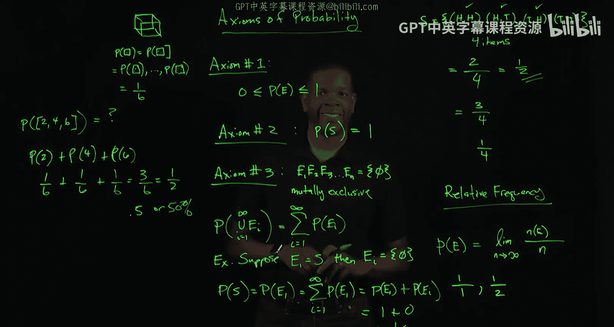

# 约翰霍普金斯大学《计算机科学的统计方法｜Statistical Methods for Computer Science》中英字幕 p14 13_概率公理体系.zh_en -BV1r483zbEzN_p14-

Hello， I'm Dr。 Tony Johnson of the Johns Hopkins University。

This is module2 of our course statistical methodsthod in computer Science。

Today we're going to be talking about axioms of probability。

Now what you've seen before in terms of sample space。

 we spent a lot of time really talking about sample space。

 talking about how to enumerate the sample space， you saw that in module1 in dealing with counting and we use that in a way to determine for instance if you had a particular outcome。

 let's say you had let's say you had a sample space of you know。

 let's say you had S is equal to the outcomes flipping a coin right so you flip a coin twice and the first time you get heads。

Heads。The next time you get。Let's say heads。Tales。Okay， the next time you get。Ts and then heads。

The next time you get。Tas， and then you flip again， and you get tails。

And you determine that there are no other possible outcomes that are available。

 You've exhausted all possible outcomes， you know。The disamp space now is going to be four。

 there are four items here。And so that be in the case。

 what you basically can say now is if you wanted to know what is the likelihood or what is the probability that you will actually get heads on your first you know you're going to get what's the probability you're gonna to get heads first that when you flip the coin you're going to get heads first okay well that probability would be equal to the number of events in which the subset of events in which heads appears first。

 so in this case it'll be two over the number of items in the sample space in this case would be four and so we know this to be one half and we definitely know this to be true。

A different type of question that will give you a different probability， however。

 is what is the probability that in both flips， the first flip and the second flip。

 what is the probability that you thought that you get at least one heads， at least one heads。

 so again， you look at your your sample space and you look at the number of events that will occur if you get at least one heads and in that case you can see one。

2，3， and so that probability would be three over4。Okay。

If you were looking at the probability that they are both heads， that would be one over four， right？

Okay， the probability that you have no heads。Well， that would be zero。Okay， that would be 0。

 The probability that you had both to。 So this is， this is what we have seen in terms of。

 of using the sample space。Another way that we can determine probability。

Is in terms of what's known as relative。Frequency。Relative frequency。 And so in this term。

 we say that the probability。Of an event。It's equal to， okay， we're going to take the limit。

As in approaches infinity。Okay and in the numerator。

 we're going to take the number of times that the event occurs。

Over the total number of times that we actually conduct the event。Okay。

 over the total number of times that we actually conduct the event。

 We call this the limiting proportion。 Okay， it is the proportion of times that the event actually occurs over the number of times that we actually conducted the event。

 and this could be easily accomplished with flipping a coin。So you flip a coin the first time。

The first time you flip the coin， you get， let's say you get one true， I mean， one heads， right？

 So if we're looking at the probability of heads。We're only looking at the probability of heads here。

Then the first time I flip a coin， if I get heads that first time。

And the number of times I've actually conducted the experiment has only been one okay in this。

One experiment。One， you would say that heads occurs 100% at the time。

But this limiting process is not designed to be done just once。

This limiting process is designed to be done multiple times。

 and as you continue to conduct the experiment multiple times in times as in gets larger and larger。

 this ratio， this proportion will converge to the probability and clearly you can see that if I flip the coin next time。

 this time I get tails， so this is the first time the next time I get tails。

 so I still have one heads。But this time I've conducted the experiment twice。And notice。

 now my probability or my proportion is one half or 50%。

And so when we're considering experiments that include sample spaces。We can look at。

If relative frequency is not something that is available to us。

 but were we're looking at experiments that include the sample spaces。

 what things can guide us where relative relative frequency has this limiting proportion to kind of guide you in finding that probability。

 What are some things that can guide in terms of probability when I do have a numerated sample space。

 Well， one of the things we're going to look at is we can assume。😊，That for sample space。

 our probability。Can be guided by。What we call axioms of probability。

So when I have a sample space and I'm trying to find P of E。

 P of E can be guided by what we call some axioms of probability。

 So we're going to talk about axioms。Of probability。Okay， so let's look at axiom number one。So。

 axiom number one。Okay， this guy basically says。That the probability。Of my event， P of E。

It's going to be between。Z and one。Zero， if it's impossible， one if it is certain。Okay， zero。

 if it is impossible， one， if it is certain， that's axiom number one。So axiom number two。

Axiium number two， and these things are pretty intuitive。 Axiom number two basically says this。

The probability。Of S， if the event in question is S。Okay。

 that means that E is equal to the sample space， then the probability of that occurring is going to be one。

The probability of that occurring is going to be one。Right。 axiom number three。Axiome number three。

All right， axiom number three is going to say that for any sequence of mutually exclusive events。

Okay。In a sequence of mutually exclusive events。 So when we're talking about is we're saying if E。1。

嗯。一。2。E3， all the way to E in if this set。Is the null set？Okay。

 we talked about mutually exclusive events， remember that？If that set is the null set。

Then the probability， if that is the case， okay， let's say this is mutually。Exclusive。

Mutually exclusive， okay， if that is the case， then the probability。Of the union。Of these events。

 I equals1 to n。Of E sub I。That probability is going to be equal to the sum。I equal1，2。Infinity。

 okay， this is actually to N。 and we're going to say that N is actually going to go to infinity。

 So it's thes it's how however many number we have。Infinite number of events。 Okay。

 then we're going to take the sum I goes to one to infinity of the individual probabilities of E sub I。

啊ha。Yeah。Okay。Oh you。Well， you don't like that。Why。Well。Okay， okay， all right。

 so I'll do an example for you。 Let me just do。 this is probably， all right。

 I'm gonna do a very simple example of axiom number 3。 Okay， because it may not seem intuitive。

 Alright， let's do this then。 Let's have an example。 No， I like when you guys interact with me。

 That's fine。 Okay， let's look at example。 Alright， suppose。😊，Okay。

 suppose that we say E1 is equal to S。 I'm saying that E the event number one is equal to S。 Okay。

 What does that mean， That means I can say then。E sub I。

I don't care how many other events there are that E sub I is going to be equal to the null set。

So let's let that sink in for a minute。Al right， so if， if E1 is S， then E2。Is not in S。

 There's no interla。 That means that E1 and E2 are mutually exclusive。 In fact。

 E1 and E I all the way to infinity are going be mutually exclusive。

 which means that they're the null set。 So if that is the case， then I can say the probability of S。

 which is E， E1 or you want me to write that Okay， so oh you don't like when I put that。 Okay。

 I'll just say this thing， the probability of S， which is the probability of E sub1。 Okay。

 that's gonna be equal to the sum。I equals 1 to infinity。Of the probability of E sub 1。

Which is going to be equal to， let's do it。 We're going to do the individual probabilities。

 It's the probability of E sub 1 plus the probability of E sub I。That's going to be equal to1 plus0。

 and that's simply equal to1 aha。That is。Our intuition。And we knew that that was the case， in fact。

 we knew that， right？Okay， so let's look at one more example。

Suppose I have a die and it is rolled and suppose all six sides are equally likely okay。

 so I've got a die。You know， in all six sides of the die。Are equally likely。You know， to come up。

 right？And so if that's the case， then I'm going to have， let's say， the probability。Of a one。

So the probability that I get。Probably of one。Is equal to the probability。That。I get a two。

Which is going to be equal to。The probability that I get a3。Ri。

Which is going to be equal to dot dot dot。The probability that I get a。6。Right， all the way。

 they're all equal。 And what did they equal to， It equals one over 6。 Where did I get that from。

 Well， because I'm rolling one die， there are six possible outcomes。

 and I'm looking at the event of one of those outcomes， right， There are six possible outcomes。

 So what if I'm looking for now the probability。Then I' row either a two， a four， or a six。Well。

Is it possible？This is good right here， so is it possible that I can row a two and a four？No。

 is it possible that I can roll two and a six？No， not not in the same row now if I pick the dice up and then roll again。

 well， that could be problems because if once I roll it and it lands on the two and I try to pick it up again and roll it again。

 like that could be a big problem。 Okay， especially in the neighborhood as I grew up in I can tell you right now that is not gonna work so no you get one row。

 you roll it it lands on the two。That means that these guys are mutually exclusive。

 and if they're mutually exclusive， then what this axiom tells me is that I can take the sum of these probabilities。

 And in that case， I can say the probability of rolling a two。Plus。

 the probability of rolling a4 plus the probability。Of rolling a 6。 A， Yeah， you're getting it now。

 So what I end up with is， I end up with 1，6 plus 1，6 plus 1，6， which is 3，6。

 And so I have a1 half or 。5 or 50% chance。Of rolling a two， four， or a six。

