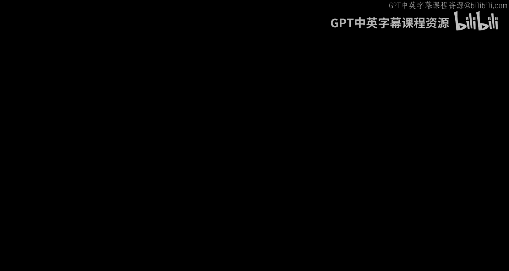
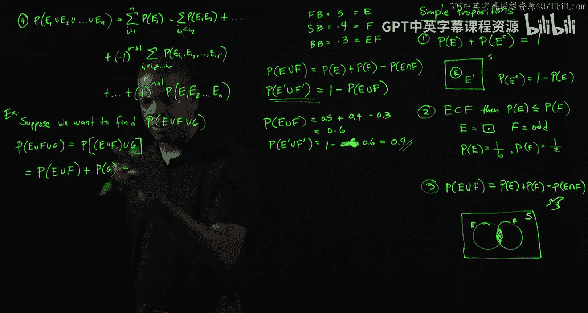

# 约翰霍普金斯大学《计算机科学的统计方法｜Statistical Methods for Computer Science》中英字幕 p15 14_简单命题分析.zh_en -BV1r483zbEzN_p15-

。

I'm Dr。 Tony Johnson from Johns Hopkins University。

This is module2 and we're still continuing our discussions for the course statistical methodsth in computer science what we're talking about now is we're going to go into looking at some simple propositions involving probability and so so we're just looking at some simple。

Propositions。Okay， looking at some simple propositions。 And so proposition number one， which is。

These can be fairly intuitive， we could say that the probability of an event。Plus。

 the probability of， so this is the probability that the event happened。

 plus the probability of the event。Not happening， okay？That that has to be equal to one。Right。

 and so clearly， if I was to draw a Venn diagram of this situation， I have an event E。

This is S and out here is E prime。Okay。And so this clearly states that the probability。Of E。

Complement。Okay， it's going to be equal to。1 minus the probability。That E actually occurs。All right。

Okay， so let's look at number two。So for number two， if E is a subset of F here。E is a subset of F。

 then that means we're saying then the probability of E occurring。

Is going to be less than or equal to the probability of F。Occurring。So for instance。

 if I was rolling a die。And I let if I was rolling a die and I let E。The equal。

 the probability that the die is one。 So let's say E。Is equal to。The event where I get a snake out。

I get one。And let's say F is the probability。F is the event that whatever I get， it's odd。

And so clearly， if I take the probability of E， the probability of rolling a1。

It's going to be equal to one over six while the probability of getting a odd。

It's going to be equal to12。And clearly， 16 is less than1 half。16 is less than1 half。Okay。

 proposition number three， let's look at this guy。 So on this one， proposition number three。

 the probability。 now this is one that is going to be very， very important。The probability。Of E。

Intercept F。You're going to see this one a lot， so this is really important。

The probability of E intersect F。It's going to be equal to。All right。We don't know。

 we don't know if E and F are mutually exclusive， we don't know that。Right。

So we need something a proposition that's going to handle if they're mutually exclusive or if they're not mutually exclusive right So in this case。

 we're going to take the probability of E。Plus， the probability of F， and we're going to subtract。

Right。The probability。Of E intercept F。 Now this right here is extremely important。

That piece is extremely important。 Well， let me explain why。 So let's say， we have。

Let's do a Venn diagram of this situation。 So I have。E， and I have。F。Okay。

 what I am looking for is I'm looking for the union of E and F。 So the union。

 So if so here's this is a sample space， this is E。And this is F。Okay。

 so the union of E and F is going to include all of E。In all of F。

But we need to subtract any overlap。Which is the P， which is the intersection of both E and F。

 And that's what this term does at the end。 If E and F are mutually exclusive， there is no overlap。

 So you're saying minus-0。 If E and F are not mutually exclusive， there is overlap。

 so you must subtract that overlap from。The calculation here。So let's like an example。

So you've got a person Jay is taking two books along on her holiday vacation。嗯。

The probability that she would like the first book is going to be so I'm going to say first book。So。

 Fb。For first book， the probability is 0。5。Okay。The probability you' like the first book is 0。5。

The probability that she will like the second book is。04， so we's say S B。

I got this right so a probability show like the first book is 0。5。

 the probability that show like the second book is 0。4。

And the probability that she would like both books， so I'll call that BB。Both books。

The probability here like both books is going to be 0。3。So let's see if we got this right。

 Probably you like the first book is 0。5 second book 。4。 The third book is 03 Okay。

 so what we want to know is what is the probability that she doesn't like any book She didn't like either one of them right All right。

 so let's see what we got So we know that the probability。So， we're going to let this be。

 let's call this event E。Let's call this event F。All right， and if that's the case。

 then we know both books right， is's going to be the event E。Yeah。Which is intersect。

Oh now it becomes pretty simple。 So let's see。 So we're going to say that the。

 So we're going to say that the probability。Of。The probability that she likes。

Either the first book or the second book is going to be the union。 So the probability。

That she likes E Union F。Is going to be equal to， right？Okay。It's going to be equal to。

The probability of E。Plus， the probability of。F。Minus the probability of E intersect F。

 I see something。 So notice that I did make a mistake here。 The mistake is that here。

The mistake is actually right here in the notation， this is not intersection， is it， this is union。

So let's go ahead and make that correction right now。 I explained it as union， but for some reason。

 I wrote intersection。 This is the intersection of E。 I mean。

 the union of E and U is equal to this right here， which is what I wrote here。All right。Now。So。

We're looking for。That she didn't like either book。So it turns out。That this tells me she likes。

She likes one of the books。What would be the expression that says that she didn't like any of the books？

Yeah， so what I'm actually looking for is I'm actually looking for P。E prime U union F prime。

That is what I'm looking for， that is shit't like either book。And that's going to be equal to。

We can go back to。Proposition number one， that's going to be equal to one minus。P of E。Union F。你 say。

Do。Alright。Well you want me to do it？Oh， okay， all right。Well， we could do it straightforward， right。

 So I'll go in and work this。 So look what we have。 So this is gonna。

 So then we we're trying to find this。 So I can say P E union F。😊，It's equal to。

 so it's going to be the probability of E， which is going to be 0。5。Plus， probability of F。

 which is going to be 0。4 minus the probability of EF， which is both， and that's going to be minus 0。

3， and that gives me a 0。6。So the probability P of E prime union F prime is going to be equal to 1 minus 0。

6， whoops， 0。6 and Russian。0 point okay， let's just scratch that out and let's put 1 minus 0。

6 is's going to be equal to 0。4。 and that's what you have。Okay。Right。

The last thing we want to look at in this section is we're to look at our final。Proposition。

 which is a generalization of this， okay a generalization of proposition number three。Right。

 so I'll write this over here。 So it's a generalization of proposition number 3。

 And so number 4 is gonna be this guy right here。 So number4。Is going to be this。 We're going to say。

The probability。Of the union of E1 union E2。Okay。Union。

And we'm going to say dot dot dot all the way to Union E sub n。Okay。

This situation is the union of all events。Okay。It's going to be equal to。

 so it's going to be a generalization of what we have here。It's going to be equal to the sum。

So this is going to be n is equal to I is equal to 1。To N。 And what is that sum going to be。

 What is going to be the individual probabilities。 So it's going to be P of E sub I。

then what we have to do is we have to subtract。Minus， okay， we have to subtract the。

Interstecting terms between the two。 So in this case， it's going to be minus。

 and we're going to take the sum。This is going to be I's equal to1 again。U。And actually。

 it's not going to be I equal to1 because it's going to keep changing。 It's going to be。

 We're going to say it's going to be where。We're going to say I sub1。Is less than I sub 2。

And now what are we looking at， we're looking at this probability。Of E sub 1， E sub 2。

 notice that this is the intersection。For the first two， is sub1， is sub2。Okay， plus。

 and we're going to continue this process， I sub 1， I sub 2， then I2， I sub 3， then I sub 3， I sub 4。

 we're going to continue this process in a monotonic way， okay。So that we go。

 this is going to be plus， and then we're going to say it's going to be plus。

And we're going to have this in front。 This is going to govern whether it's positive and negative is's going to be negative  one。

To the R plus 1。And then we're going to take the sum again。Okay， so we did all the dual terms here。

 Now we're going to do all the terms that are going to have more than two terms。

 So we're going to be doing。 we're going to be subtracting。 and this is going to be the sum。

 And this one is going to be。I sub 1， less than I sub 2， less than dot dot， dot， I sub R。

 So is going to take into account all of the indices。 And we're going to have these probabilities。

 the probability of and it's going to be E sub 1。Um。So e sub i1， comma， e sub i2， comma。

 and then this is going to continue dot dot dot。To E sub I R。Aha， right？Almost done。

 There is another term that we have to keep track of。

 and we're going to say that's going to be plus dot dot dot。

 This is going to continue all the way until the terminal point is going to be negative one。

To the n plus1。And then this is going to be the probability and what is going to be subtracting all of these terms。

 the intersection， and it's going to be subtracting the intersection E1。E2。All the way to E in。

And that's it。Now， how do we actually use that？So let's look at an example。Suppose。So。

 here's an example。Suppose。We want to find。Pi。😔，And we're going to say E Union， F Union G。Okay。

That's we're looking for。All， so what do we begin， So we're going to start with。We're going to say P。

U P， and this is gonna be E。Union F， Union G is equal to。 So we go here。 And so we're going to take。

We're going to look at this in terms of we know we can do sosociivity here。

 so we're going to say that this is equal to P。And then this is going to be。呃。E union， F。

And then this is gonna to be union G。Yeah。Okay， we can take this now， we can break it up。

And we can say that this is going to be equal to。I can use the distribution rule here。

 and I can say that this is going to be equal to。Pi。😔，And this is going to be。Yiun。Zhi。Plus。

So I want to say E， So just is going to be， no， this is P， this is union F。Let's get this right。

This is going to be union F。So I'm just taking that and then I'm saying this is going to be plus。

So this is going to be P。Of G。Right。So notice I'm using this rule。Here。

And I'm saying that all of E union F is the first， and then P of G is the second。

 and then this has to be minus right， and then it has to be the intersection between these two terms。

 So this is going to be the intersection of P。

And then this is going to be E union F。 And instead of union G， it's the intersection with G。ha yes。

 right， So convince yourself of that。 Okay， this is one term。 that's the other term。

So from there now， I can simplify even further。 So this is going to be now I'm going to use the same thing here。

 and I'm going to have that this is going to be P。Of E。Plus p of F， right？

And then that's going to be minus。P of E F。Right， over here。 And then this is plus P of G。Right。

And then this is going to be minus and what do I have here， I have P of and this is going to be EG。

Union。EGF。Qi。Okay。Now what I'm going to do well I can go even further right so at this point I can say okay。

 so I've got this， I've got this， that's good， I've got that。

 and now what I want to do oh I can do something with this piece here。So let's do this one。

So what would that be， right？ So let me just rewrite all of this。 So this is going to be P， E。Plus。

 P。And so now this is going to be。Minus。 and so now we're going to say this is minus。

 So this is going to be P。Of E G， it's minus because I'm distributing the minus。 So。

 and then it's going to be minus， and it's going to be P。Of。Was it going to be FG？

And then it's going to be instead of a minus it's going to be plus， right。

 and then it's going to be the intersection。 So that's going to be P of E G。Fg。

I just wanted to put the intersection there so they' doesn't look so confusing， right？Okay。All right。

 now we're ready to finish this up。I think， let's see。The only thing left to do is。What。Oh， yeah。

So we're done。 Look at this。 So now I can say that this is going to be equal to we've got。P of E。

Plus， P of F。Plus， I'm going to bring this guy here plus P of G， right？

Minus now we we're going to do our two you know。The ones that are two， so it' is going to be P of EF。

Minus P of E G。Minus p of Fg。And then the final term， because it was minus minus。

 but this guy was a plus， it'll be plus， and this will be P。Of and what I'm going to have。

 look at this， this is going to be distributive rule， this is going to be E。Interssect F。

 intersect G。How about that？Now， if you look at this formulation， right。

 this is equal to this guy when n is equal to2， so I encourage you to convince yourself of that。

 set n equal to two for this right here and see if you can derive。

This solution from proposition number four。

