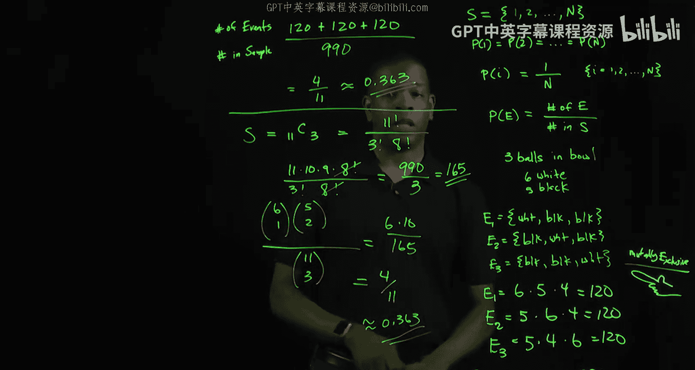
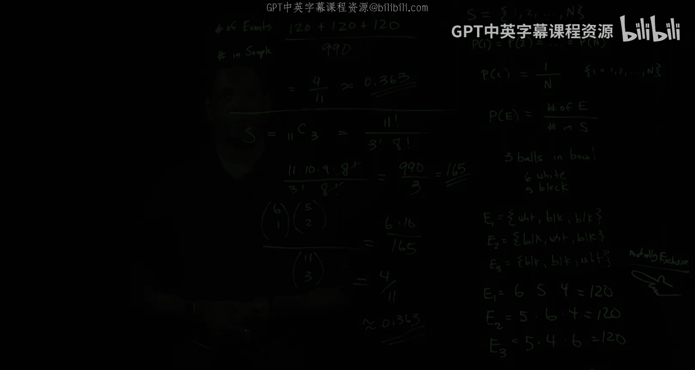

# 约翰霍普金斯大学《计算机科学的统计方法｜Statistical Methods for Computer Science》中英字幕 p16 15_等可能结果场景.zh_en -BV1r483zbEzN_p16-

Hello， I'm Dr。 Tony Johnson， Johns Hopkins University。

 this is module two of our course statistical methodsth and computer sciences and。

I am going to be talking about sample spaces when you have equally likely outcomes this is the final lecture in this module and so we're going to be in company we're going to be like a really bringing in a lot of what we talked about before into this final this final topic so what I want to talk about first of all。

 is when you have outcomes that are equally likely to occur what you're really looking at is you're looking at S as a finite set so if I was to write S so S would be a finite set。

And that finite set we could write， so it's a finite set it's going to be you know one，2。

 dot dot dot to sum in like theres there's a definite number in this finite set。

And if each one of these events are equally likely。

 then what we can say is that the probability of one is going to be equal to the probability of two。

 which is going to be equal to dot dot dot equal to the probability of in here。All right。

 so basically we could actually rewrite this in terms of saying that the probability of I。

Is going to be equal to one。Out comee over in outcome， given that I is equal to one， two。

 dot dot dot all the way to end。Okay。Or yeah。So we can basically say that the probability。

Of event E occurring is going to be equal to the number of outcomes。The number of outcomes of E。Okay。

 how often does that occur over。The number of outcomes。In S。So that's what we're going to see。

So let's at let's look at some examples here All right， let's look at a few examples。

 I think it is a best way to really kind of hone in on this what is seemingly simple topic has a lot of ramifications。

 a lot of different consequences， so an example would do。😊，So let's say you have three balls。

And they're randomly drawn out of a bow。 You know， you got them in a bow or bag or some sort。

 And in the bow， Okay， in the actual bow。 So so we see we got three balls。So in bold。And in the bowl。

 we have six。hui。We have six white， we're going to have five black。Okay， six white and five black。

Now。We want to know the probability。What is the probability。

 So we have to define the event and the event is that one of the balls。Okay。嗯。You know， we。

 we're going to pull three balls。 What's the event that one of the balls。Is white。

And the other two are black。Right。The event that one of the balls is black and the other two are white。

 And let's just for。Just talking about it， let's say that order actually matters here。 Okay。

 we're going to say that order actually matters。Right， so let's see we got。😊。

What are the ways in which this event could actually occur， So let's see event number one。Yiwen。

So we're going to say that E1 is u E1 is going to be， I get it white。A black。In a black。

Is that event？Does that event fit a scenario， Yes， Okay， so the event is。I pulled three balls。

 one of the balls is white， the other two are black， so let's look at event number two。

So in this one， I'm going to pull a black first。They know white。Thenhan a black。

That's also and then event number 3， I could pull a black first。Another black。And then a white。Okay。

So those are the three events， right？So let's see。Are these events mutually exclusive？

Are these events mutually exclusive， meaning that when I'm talking about mutually exclusive。

 I'm not saying is there only one white ball。In the bowl。I'm saying is event number one。

 mutually exclusive from event number two？Okay， that's what we're asking。Is event number one。

 mutually exclusive from event number two。 Well， I could tell you right away。

 there is no way that I could pull a white， black， black。And then event number two。

 if event number two is not white， black， black， event number two is totally different than event number one。

 and event number three is totally different than event number one and2。

So these are mutually exclusive。Yes， they are。 Okay， And that be in the case。

 I can calculate now and I can say， all right， then event number one is equal to， okay。

 event number one is equal to。 So when I reach in the bowl。

How many opportunities will there be to pick a white ball， Well， when I first reaching the bowl。

 the number of opportunities to pick a white ball is going to be six。Right。Okay， it's gonna to be 6。

What are the opportunities in order to pick a black ball？That's going to be5。

 so I'm going to multiply that times5。What are the opportunities to go in and pick another black ball that opportunity is going to be for？

And that's going to equal 120。Okay。Let's look at event number two。Event number two， event number two。

 how many opportunities on the first draw do I have to pick a black ball。

 what that's going to be five？How many need to pick a white， that's going to be 6。

 How many need to pick another black where there are only four balls left then a black。

 So that's going to be4。 that equals 1，20。Let's look at event number three。Event number three。

Blackball，5。Black ball again， four， white ball， six that also equals 120。Okay， that also equals 120。

So because these events are mutually exclusive， right？Because they're mutually exclusive。

 I know that the intersection。OkayAnd all such intersections between E1 E2 and E3 are going to all be 0。

 So we looked at how we take the union of these complicated， you know， of these multiple sets。

 the union of E1， the union of E2， the union of E3， we saw that。

 but we noticed that the first three terms。In that equation， in our proposition number4。

 if you recall， we know that the first three terms was simply the。Some of the probability of E1。

The probability of E2， the probability of E3。Yeah。You get it， right？And so that be in the case。

 then I know that in the numerator I'm going to have in the numerator， I'm going to have 120。Plus。

 120。Plus 120。That is going to be this represents the number。Of E。Events。Okay。

 that's the number of events。The number。In the sample。In the sample， okay， oh well。

 that' that's a different case。 Okay， what we have to think about in this case is。I am。

 I have 11 balls in the bowl。 I don't care what color they are I I have 11 of them in the bowl， okay。

My first choice in choosing a ball。I have 11 ways in order to do that。 Okay。

 so we're looking at S now。 I have 11 ways in order to choose the first ball。

How many ways are there to choose the next ball， Well， I've taken one out。 that means they are 10。

How many to choose the last ball Well I've taken two out， that means there are nine。

 so this is equal to 9，90。 and so the number in sample， the sample space is 990。

 and so what does this tell me？what is this going to tell me？Well。

 this tells me that this calculation is going to equal。When I do this calculation， I'm going to get。

Four over 11， which is approximately 0。363。And what does that tell me， that is the probability。

That given a bowl that contains six white balls and five black balls， if I choose three of them。

 right， and I count that as an event， what is the probability that I get one white and two black。

Okay。And notice order matters， okay， order is relevant。All right， now。

 what would I do if order is not relevant， meaning that it doesn't matter。嗯。

The order of the events or whatever， what would I do in that case， how will we handle that？Well。

 it turns out that we can do this as a combination。And so in this combination， we can write S again。

 so I'm going to just cross this here。And we're going to say let's do it this way。

 Supp S now is a simple combination。Where I'm going to have 11 balls and I'm going to choose three of them。

 right， So in this case， I'm looking at。11， C，3， okay，11， choose 3。And when I do 11， choose 3。

 let's see。 we know how to do this， right， We do this。 We're going to say that this is going to be。

This is going to be equal to 11 factorial over。3 factoral times 8 factor， right。Okay。If。

 if this is unfamiliar to you， what you want to do is you want to stop right here and you want to go back to。

Dr。 McCulllor's module1 on counting。Or you want to look at my previous videos here in module 2 where I actually gave you the definition and I actually spelled out the formula for a combination。

 but suffice to say right now， if I'm looking at solving this。

 then I know that this is going to be 11 times 10 times 9 times 8 factorial。

And that's going to be over and this is going to be three factorial8 factorial and so clearly I can cancel these two guys here and this is going to leave me with 990。

Over three。And that equals。1，65。So we want to keep that in mind that is going to be our new S saying that I'm doing it a different way。

 So we did it this way and we' do doing it a different way， right And so now we have a new S here。

 And so the question is how do we now determine these outcomes well？I have my denominator in 165。

 so what would the numerator be well？I'm asking。For what's the what is the probability that I get one white and two black。

 So what I'm going to do is I'm going to say I'm looking for the probability in the numerator of I have six white balls and I want to choose one of them。

I have five black balls， and I want to choose two of them。

And I want all of that to be over 11 balls total， and there are three that I'm choosing。

And so what do we end up with？ Well， we've already calculated denominator。

 This is going to be 6 times 10 over 1，65。 And this gives me wait for it。 Wait for it。Yeah，4 over 11。

 which is the same as what we got before，0。363。 aha。 What does this mean。What does this mean Well。

 it means that when you have equally likely outcomes。Order。

Doesn't matter either way if you have equally， if you have equally out。

 you know equally likely outcomes， you have the flexibility of using either method。

 you can do it this way， the way I did it at first， or you can do it the way I did it this way。

 you can do it with combinations。Which is really kind of streamlined。

 or you can do it where you actually just count it out。

 Either one will give you the exact same answer。

