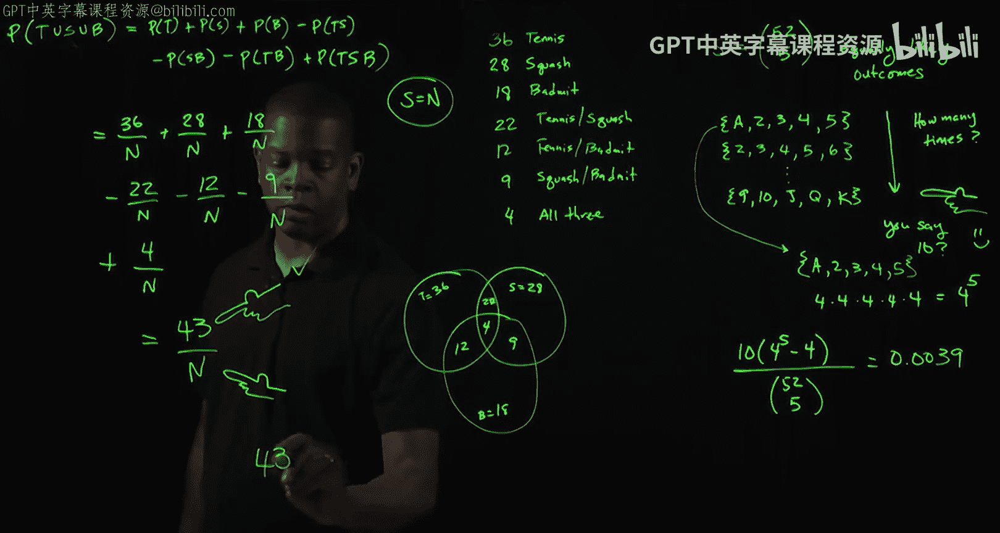

# 约翰霍普金斯大学《计算机科学的统计方法｜Statistical Methods for Computer Science》中英字幕 p17 16_ELO评分系统实例.zh_en -BV1r483zbEzN_p17-

Okay， in dealing with equally likely outcomes， let's look at another example in terms of a card game。

 okay？

Suppose we want to calculate the probability of being dealt a straight hand in a game of poker And so。

 of course， in this case， we know that order doesn't matter。

We prefer to use that because it's more streamlined and I think it's more intuitive in terms of helping you understand how these probabilities and these sample spaces are calculated。

 so in poker your det 5 cards out of a deck of 52 cards。

 so that makes the sample space pretty simple。 we can say the S then is going to be equal to out of 52 cards。

I want to choose five of them。And notice that the draw， this whole thing。

 we're going to say that these are equally。Okay， likely。Outcomes。At said better be。There's not。

 weve got big problems， right？Okay， so let's take a look at one such hand。

 What would one hand look like， Okay， a hand that would fit this category would be a hand that included。

 must see an ace。2。😔，3。😔，4 and 5。That would work。Right。U。Okay， how about another hand？

Another hand that would fit this category would be a two， a three。A4， a5， and a 6。That would work。

Okay。I could continue doing this。Until I get to a nine。A tin， a Jack， a queen。A king。

So how many times。Am I actually doing this？Okay， how many？How many times。Right。

Where'd you come up with。Did you guess 10， did you say 10？Then you are correct， okay。You say10。

 that is the answer， okay， so basically what we have then。嗯。

We have four suits that we have to deal with， right， So let's look at just the first one。

We know any combination here is going to be， I'm going to have so so if we。

 if we were to pulled this out for analysis for further analysis， right？So we got A's。2，3，4， and 5。

pullingul that off for some further analysis， there are going to be four ways to do this。Okay。

 there's going to be。Four ways to do that。Four ways to do that。4 and 4， okay， basically。

4 to the fifth power。There are four to the fifth power ways in order to get just this one hand。

Where you got an ace，2， three，4，5， because remember， there are four different suits。Right。

There are four different suits。 So we definitely keep that in mind now。

There is a particular hand that say straight。However。It is not called the straight。

And that is when you get to the。When you get to what's known as a royal flush， okay。

 a royal flush here。So we have to subtract the royal flush from this number because the royal flushes are not part of this event。

So how many royal flushes are there， Well there would be4， thered be one royal flush for each suit。

 And so that being the case， what we end up with is we end up with 10。Times4 to the fifth。

 minus the4。For each suit， right？Okay。We do that 10 times。And that's going to be divided by。52 cards。

Choose five， and that's going to give me a percentage of 0。0039。Okay。Let's look at another example。

 suppose you have a club。And in that club， you have 36 members of the club that play tennis。 So 36。

Play tennis。Okay。Now， 28 of the members of the club。They're going to play squash。In 18。Okay。

 members of the club are gonna play。Badminton。Okay。嗯。How many。😮，Of the members of this club。Play。

 at least。1。Sport。If， and here's some ifs。If 22 members。Play both tennis。And squash。Okay。

12 members play。Tennis。And Batmin。And nine members， okay， are' going to play。Squash。And Baman。Oh。

 and。We have another stat here。 We know that four members play。All three。Yeah。

 so what we want to know is we want to know。Given this situation。How many play。A。At least。1。

So this is a good this is good to do a Venn diagram。

 So I'm going to see if I can do this as a diagram。 So here we go。 So let's see I'm going to do one。

😊，And then I need overlap here。2， and then I need overlap here。3。Okay。So let's see。

 so let's let this be my tennis， so T equals 36。This will be my squash equals 28。

And then I've got badminton here， B equals， and this is going to be 18。

What else did else was I given， I was given that this is 22 because this is squash and tennis。

This is tennisni and badminton， which is going to be 12。

This is going to be nine and in between here for all four is going to be four。Okay。So。

But proposition number four。Proposition number four tells me this that the probability。

Of the union between tennis。呃。Badminton， I'll do squash in tennis， squash and badminton。

Is going to be equal to what well it's going to be equal to。The probability of tennis。Plus。

 the probability of squash。 plus the probability of。Badminton。So that's these guys。

Then I have to subtract a couple things， I have to subtract。The probability of tennis and squash。

I have to subtract the probability。Of squash and badminton。I have to subtract the probability。Of。

Tennis。And badminton， did I get this right， So the probability of tennis and squash。

 the probability of squash and badmin， the probability of tennis in badminton。 But when I do that。

I've taken this intersection a away that has to come back， and so I need to add。The intersection。

Between。Tennis。Squaash and badmin。You said， well， wait a minute， Do。 We are trying to find how many。

We're not trying to find a probability。 We're trying to find。A number， what you're calculating Dr。 J。

 you're calculating a probability。 Well， I， I understand that。So。You may be asking， well， what is S。

 I don't know， but let's just say that S is equal to n。That's just， we'll just stipulate that。

And that's fine， right， because as long as I know S is a number。The question is。

 do I need to know that number in order to do this analysis and the answer is no。

 because as it turns out。This probability gives me the probability。

That a person is in at least one of these things。 Remember， this is the or。Right。

If I wanted the probability that a person was in none of these things。

 then I would be taking a compliment。 You remember that from an example we did earlier。

 So then this down becomes pretty straightforward。 So let's see what we get。

 I know the probability of tennis。 This is going to be 36 folks out of a total of n。

 I don't know what N is。Okay。Plus。28。Over in。Plus， this is going to be 18。Over in。

Now what am I subtracting， Well， I'm going to subtract the number of people who play tennis and squash。

 so that's going to be minus 22 over n minus， and I'm going to say 12。Over in9 over in。

 And now I need to add back。The number who play all three， and that's going to be four over in。

Well when I do this calculation， I come up with a number and that's going to be 43 over in。

 and so guess what， it doesn't matter。It matters not。What this number is。I don't care。

The number that I'm concerned with that I care about is。This number。Yes。

 and so the answer then is 43 people。

