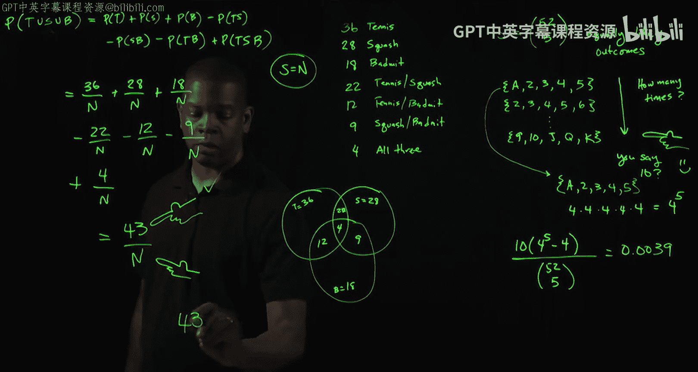

# 计算机科学的统计方法：17：等可能结果与集合运算实例

在本节课中，我们将通过两个具体实例来学习如何计算等可能结果的概率，以及如何运用集合运算解决实际问题。我们将分析扑克牌中拿到顺子的概率，并使用维恩图解决一个涉及多个集合的计数问题。

## 扑克牌顺子概率计算

上一节我们介绍了等可能结果的概念，本节中我们来看看如何将其应用于一个经典的概率问题：计算在扑克牌游戏中拿到一手顺子的概率。

在扑克游戏中，玩家从一副52张的牌中抽取5张。由于抽牌顺序无关紧要，我们使用组合数来定义样本空间。样本空间S的大小为从52张牌中任选5张的组合数，即 `C(52, 5)`。我们假设所有可能的手牌是等可能出现的。

接下来，我们需要计算事件“拿到一手顺子”包含多少种可能的手牌。顺子是指五张点数连续的牌，例如A-2-3-4-5或2-3-4-5-6。

以下是顺子可能的起始点数：
*   A, 2, 3, 4, 5
*   2, 3, 4, 5, 6
*   3, 4, 5, 6, 7
*   4, 5, 6, 7, 8
*   5, 6, 7, 8, 9
*   6, 7, 8, 9, 10
*   7, 8, 9, 10, J
*   8, 9, 10, J, Q
*   9, 10, J, Q, K
*   10, J, Q, K, A

总共有10种不同的点数组合可以构成顺子。

对于每一种点数组合（例如A-2-3-4-5），每张牌都有4种不同的花色。因此，构成该特定点数顺子的方式总数为 `4^5`。

然而，有一种特殊情况需要排除：同花顺（包括皇家同花顺）。同花顺本身是顺子，但它属于更高级别的牌型，在计算普通顺子概率时通常需要单独考虑。每种花色有1个皇家同花顺（10-J-Q-K-A），因此总共有4个皇家同花顺需要从计数中减去。

综合以上信息，拿到一手顺子的总方式数为：`10 * (4^5) - 4`。

因此，拿到顺子的概率计算公式为：
`P(顺子) = [10 * (4^5) - 4] / C(52, 5)`

计算结果约为0.0039。

## 俱乐部运动参与人数问题

看过了概率计算，现在让我们运用集合运算来解决一个实际的计数问题。这个问题涉及多个集合的交集与并集。

假设一个俱乐部有成员参与三种运动：网球(T)、壁球(S)和羽毛球(B)。已知信息如下：
*   36名成员打网球。
*   28名成员打壁球。
*   18名成员打羽毛球。
*   22名成员同时打网球和壁球。
*   12名成员同时打网球和羽毛球。
*   9名成员同时打壁球和羽毛球。
*   4名成员同时参与所有三项运动。

我们需要计算至少参与一项运动的成员人数。

解决此类问题最直观的方法是使用维恩图。三个两两相交的圆可以清晰地表示出所有可能的交集区域。

根据概率论中的容斥原理，三个集合的并集大小可以通过以下公式计算：
`|T ∪ S ∪ B| = |T| + |S| + |B| - |T ∩ S| - |S ∩ B| - |T ∩ B| + |T ∩ S ∩ B|`

这个公式的逻辑是：先将三个集合的个体数量相加，然后减去两两交集部分（因为它们被重复计算了），最后再加回三个集合的交集部分（因为在减去两两交集时，这部分被多减了一次）。

将已知数据代入公式：
`|T ∪ S ∪ B| = 36 + 28 + 18 - 22 - 12 - 9 + 4`

计算得出结果为43。

值得注意的是，在这个问题中，我们不需要知道俱乐部的总人数n。我们直接计算出了目标集合的绝对大小，而不是概率。公式中的每一项都是具体的人数，因此最终结果43就是至少参与一项运动的成员人数。

## 总结

本节课中我们一起学习了两个运用基础概率与集合知识的实例。首先，我们通过组合计数的方法，计算了扑克牌中拿到顺子这一特定手牌的概率。接着，我们利用容斥原理和维恩图，解决了一个涉及多个集合交并关系的实际计数问题，求出了至少参与一项活动的具体人数。这两个例子展示了如何将抽象的数学原理应用于具体场景的分析与计算。