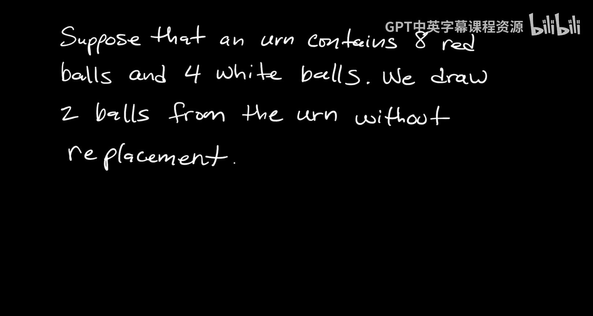
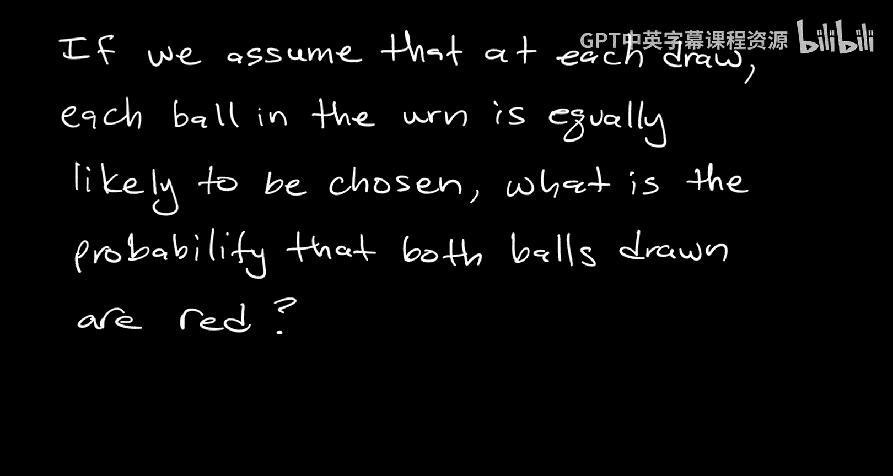
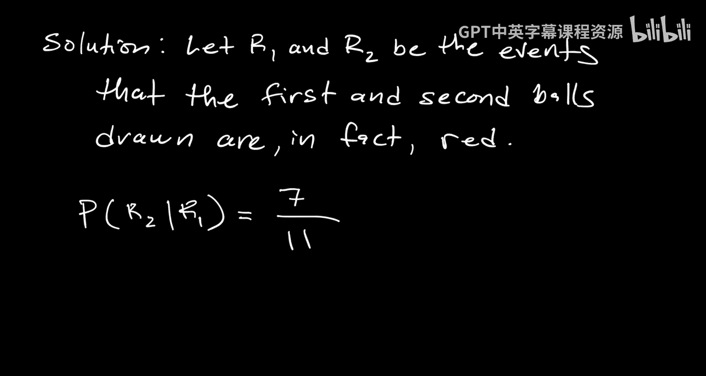
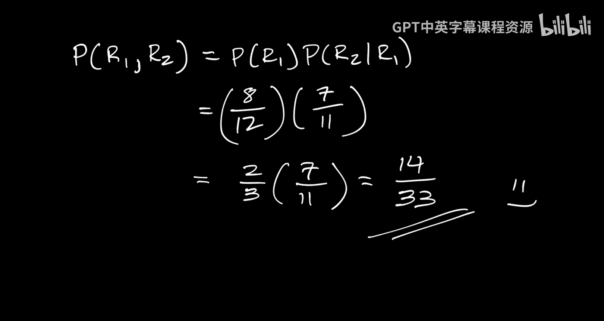

# 约翰霍普金斯大学《计算机科学的统计方法｜Statistical Methods for Computer Science》中英字幕 p21 20_瓮中红球抽取实验.zh_en -BV1r483zbEzN_p21-

Okay， let's look at a little example about。Conditional probabilities。And in this example。

 we're basically looking at。嗯。An urn that contains eight red balls。And four white balls。

Now the experiment is going to be basically we're going to draw。Two balls。From the urn。

And we're not going to replace those balls into the urn， meaning that I'm going to pull out a ball。

 and I'm going to hold that ball。 and then I'm going to pull out another ball until I have two balls。

Now， if we assume that at each draw。I haven't， you know。

 each ball in the urn is here's the key equally likely。 okay， to be chosen。

 Then what we want to know is what is the probability。

That both balls that are drawn are going to be red。

So our solution is going to begin with。um。Really quantifying the events themselves。

 And so we're going to say that R 1 and R 2。 we're going to let these be the events that the first and the second balls drawn are。

 in fact， going to be read。So with that， what we want to do now is we need to say， okay， let's draw。

 let's。Do the experiment by drawing one ball。 And so if， if， if we want to say then given。

That I draw a ball， and that ball is red。Then that means that there are going to be 7。

Red balls remaining。And。4 white balls。So we can say basically that that。The probability。Okay。

Of me drawing。A。Red ball。Second。Given that。 I drew。A red ball。Thirst。Ahu。That's what we're seeing。

 okay。What is the probability that I draw a red ball second。Given that I drew a red ball first。

 is going to be。The outcome where。Because I'm drawing the red ball second。

 given that I drew a red ball first， what that means is that I have only 7。Red balls。

Out of a possible 11 balls total。So I mean， that's the key。Recognizing that you have 7 balls。

Out of a possible。嗯。11 balls total because one ball is missing。

So that's the probability of getting a red ball second， given that you drew a red ball first。

So， now we look at。Solving the entire problem now that we've calculated our conditional probability。

 And so we can say now， we know that the probability。Of drawing a red ball first。And。

Drawing a red ball， second。Okay， iss going to be equal to the probability。

Of drawing a red ball first。Times the probability。Of drawing。A red ball。Second。

Given we drew a red ball first。And so now this is going to be equal to so drawing a red ball is going to be simply equal to eight red balls out of 12。

And。嗯。Drawing a red ball second， given you drew a red ball first was 7。Out of 11。And so this， then。

 of course， this is simplified to two third。Times 7 over 11。 And that's gonna give me 14。Over33。

And that is。The probability of drawing。A2 red balls。

A red ball first， and a red ball second。