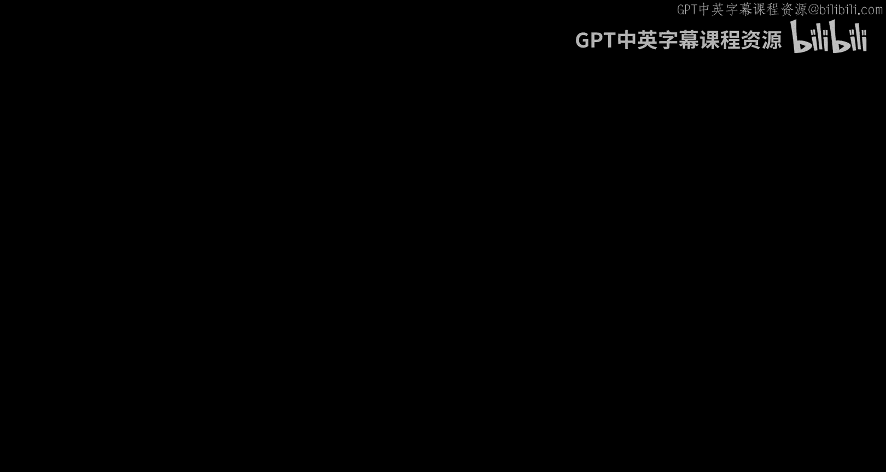
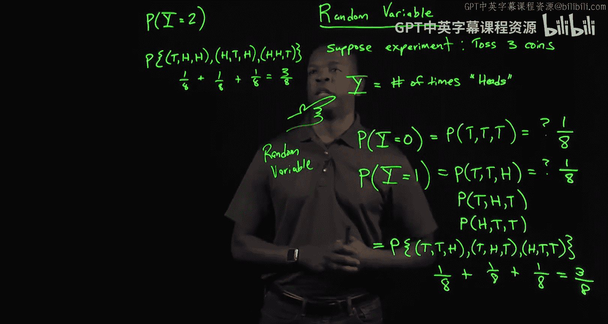

# 约翰霍普金斯大学《计算机科学的统计方法｜Statistical Methods for Computer Science》中英字幕 p27 26_随机变量基础.zh_en -BV1r483zbEzN_p27-

Hello， I'm Dr。 Tony Johnson from the Johns Hopkins University， and today in this module。

 we're going to be talking about random variables。All right。

 so in kind of understanding random variables we've seen in previous。In previous modules。

 we saw things like permutations， we saw ways in which you would do counting。

 we saw ways in which you would。Calculate different properties and different ways of actually handling a particular statistic。

 but in this module we're going to introduce this concept of a statistical random variable。And。

When we think of this， in this light， we're kind of talking about。

 instead of talking about actual outcomes， we're looking for a function that would describe these outcomes。

So in order for me to have a function that would describe these outcomes。

 I'm going to need some type of variable to。Encapsulate and basically be the the output or the。

Repository for all those outcomes and so in this in this vein。

 the function of this random variable is going to be of extreme importance and so let's just dive in here。

So suppose that an experiment consists of tossing three coins。And as I'm tossing these three coins。

 we want to。So we're going to say suppose。We have an experiment。And again。

 this experiment is tossing three coins， so we're going to toss。3 coins。All right。Now， in this。

 we're going to let why。This is going to be。嗯。We're going to let why denote the number of times。

That we see a。Head。So this is the number of times that we get heads。Alright。And so in this regard。

 now y is a random variable。 So now we so this now is。A random variable。So why is that？Well。

It's because。As we conduct this experiment， why is going to take on different values depending on。

Ding on the outcome of the experiment， so for instance， it's going to take on the values。

 well it could take on the values of zero， so I could toss the coin three times and the value of heads。

 the number of heads in those three coin tosses could be zero。

What are some other possibilities while it could be one， it could be two， or it could also be three。

 and so we got to write this in a way that we can kind of understand the full space of possibilities that Y could actually take on so let's see。

What's the probability so we're going to say the probability that this random variable y is equal to zero？

Okay。So if that is the case， then what we're saying is we're going to be taking the probability。

 okay， so then this is going to be equal to the probability。That in my three tosses。I get a true。

Truhu。I not true of tails， tails and a tails。And so what we wish to calculate now is what is the probability of that occurring？

What is the probability that I get tails three times。Well， one of the things that I know from。嗯。

Actually doing this calculation。I know that this probability is going to be one over eight。Now。

 I want you to pause the video and convince yourself that that is true。At this point。

And as you do that， once you convince yourself that is true。

 I want you to calculate the probability of the next possible value of y。

 and we're going to say that's going to be one and what would that be This means that we're going to have one heads in three tries so that's going to be the probability of tails。

Ts。And one heads。And I want you to calculate that as well。Okay， welcome back。So now。

 as you were going about and doing this， you probably convinced yourself that the probability of。

Getting no heads would be zero and there's a couple ways you can do this。

In module1 we learned how to count right so you could have counted out all the possible ways in which three coins could be tossed and if you did that you would have found that the combination of tails。

 tails， tails only occurred one time in your sample space and the sample space is going to have two raised to the third power。

😡，Possibilities until that's where the egg comes from。Okay。

 another thing you could have done if you could have said， okay。

I'm going to use another principle of counting the multiplication rule and probabilities。

 and you could have said that tails occurs one。The probability is1 half。Okay。

 and you could multiply that by the probability of another tails。

 which is one half by the probability of another tails。

 which is one half and that gives you one over8， but then I threw a curve ball at you and I said okay。

 now I want you to calculate for the random variable being equal to one and I wrote it in this way and left you hanging。

So I'm curious to know if you notice something。The thing that I wanted you to notice is that if you were to calculate this probability。

 indeed， this probability right here would be one out of eight。The reason is because in this。

Notation and how we have it， there is one combination or one permutation where I flip a tails。

 I flip another tails， and then I flip aheads， okay？

But that is not the only permutation that's actually important random in this experiment， in fact。

 there is another permutation of these three cointais because I didn't tell you whether or not order matter or not。

 so there's another permutation， that is the probability if I do a tails， then a heads then a tails。

And there is one more permutation and that is the probability that I do a heads first ats and then attails now my question is。

 is there any other permutation given that the random variables output is the random variable that equal to one and remember one。

Is the number of times that we see heads when I do the experiment。I will be very frank。

 there is no other possible permutation。 and so the way this can be written。

 you may see it written like this。 This may be written as equals。P。

 and then we'll have some curly braces here， and then we'll put the combination so itll be T T， H。

Coma， and then we'll have T， H T， comma， and then we'll have。H T T。Something like that。All right。

 well， when you see this。Okay when you see this， what you want to think in your mind is that what you're going to do is you're going to calculate the probability of each one of these and you're going to add them together so in this case I'm going to have the probability of this one and this is going to be one eighth。

😡，Okay， plus。The probability of this occurrence that's going to be one eighth plus the probability of the final occurrence being18 and now what I'm going to do is I'm going to add them together and that's going to give me a probability of three8s Now I am doing this strictly in a mathematical way of course there is a brute force method that you could do and again that method is going to involve listing all the possible combinations and permutations excuse me of of this experiment and then you just go through and you just count well how many of these have a heads in them one heads and that will you count the number and you put that number over the sample space and what that will do is that will actually give you the same thing。

But that could be time consuming， especially if you have a very large experiment。

 so suppose your experiment was tossing a coin not three times but 300 times All right， Well。

 you're not going to you're not going to you're not going to do that Okay and so you have to be so this is another technique by taking the probabilities and doing it this way。

 So what are some other values that a random variable can take。 Well。

 a random variable can take the value of。2。So we did one。 It could take the value of two。

 And this is the probability that there are two heads。 Okay。

 this is the probability that there are two heads。 And again。

 we can see that there is going to be a permutation for this。

 This is going to be something like this。So this is going to be tails。

 and then it is going to be heads， heads。Okay， what other permutation could there be。

 whether it could be a heads？Ts。Hiss。And finally， the final permutation would be heads。Heads。Tales。

And as you can see， because the likelihood of the probability of heads and tails are equally likely because this is a fair coin。

 then this is， again1 eighth。Plus1， eighth。Plus one， eighth。

 And that's going to give me three eighths。All right。

 the final value that our random variable can take is going to be three heads， right。

 and that's going to be here again， our random variable is equal to3。

 and this is going to be the probability of heads。

Heads， heads。 And if you look， there is no other situation in which that。

 So there is only one situation in this case， only one。Probably one permutation of three heads。

 and that's going to have to be equal to again， that's going to be one half。Times1 half times1 half。

 which is equal to1 over to cube， which is equal to 1/ eighth。

 which is the same thing that we got from no heads。 There's only one way in which that occurs。

And so throughout this and in all this， we come to this idea now that we can kind of put this together in a formula and the formula that you saw me use that I was using is something like this what we find is that there is going to be a condition where。

The probability。Okay， of the union。Of probabilities where I is equal to0 and it can go up to 3。

 this is for our random variable goes from 0 to 3。Of a random variable。Equals I。

This union of probabilities is equal to。The sum。I equals zero to three of the individual probabilities themselves。

And this is going to be。The random variable I。Equals I。So。This union calculated by this sum。

 has to equal。1。Has to equal one。OkayBecause if it doesn't， if this property does not hold。

 you have not you have not adequately defined your probability space and Ergo， your random variable。

 you have to really check to see if you actually en encapsulated all the information that's necessary to define your random variable。

 so let's take a look at what we have here， possibility number one， I have one eighth。😡，Okay。

Plus possibility number two， I have when y is equal to1， I have three8s， I add those together。

 I get four8s， possibility number three， y is equal to two。

 add those to the previous and I get seven eighths and then finally possibility y is equal to three。

 I add another one/ eighth and that gives me one， I have adequately defined my entire space and in doing so I have defined this random variable。

😡。