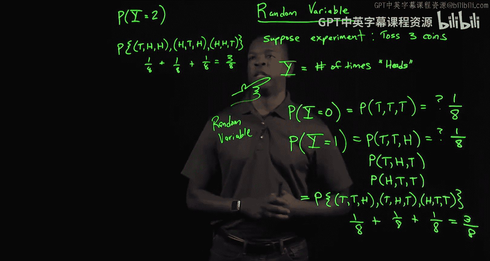

# 计算机科学的统计方法：1：随机变量基础 🎲


在本节课中，我们将学习**随机变量**的基本概念。随机变量是统计学和计算机科学中用于描述随机实验结果的数学工具。我们将通过一个简单的抛硬币实验来理解它的定义、性质以及如何计算其概率。

---

## 随机变量的定义

上一节我们介绍了计数和概率的基本概念。本节中，我们来看看如何用数学函数来描述随机实验的结果。

随机变量是一个函数，它将随机实验的每个可能结果映射到一个数值。例如，在抛硬币实验中，我们可以定义一个随机变量来表示出现正面的次数。

**公式**：设 `Y` 是一个随机变量，它表示在三次抛硬币实验中观察到正面的次数。`Y` 可以取值为 0、1、2 或 3。

---

## 计算随机变量的概率

为了理解随机变量的行为，我们需要计算它取每个可能值的概率。以下是计算这些概率的步骤。

### 计算 `P(Y = 0)`

首先，我们计算三次抛掷都没有出现正面的概率。这等价于三次都得到反面。

**公式**：`P(Y = 0) = P(反面, 反面, 反面)`

由于每次抛掷是独立的，且得到反面的概率是 `1/2`，因此：

**代码**：
```
P(Y = 0) = (1/2) * (1/2) * (1/2) = 1/8
```

### 计算 `P(Y = 1)`

接下来，我们计算恰好出现一次正面的概率。这有三种可能的情况：正面出现在第一次、第二次或第三次抛掷。

以下是所有可能的结果组合：

*   反面，反面，正面
*   反面，正面，反面
*   正面，反面，反面

每种特定序列（如“反面，反面，正面”）的概率都是 `1/8`。因此，总概率是这三种情况概率之和。

**公式**：`P(Y = 1) = P({反面, 反面, 正面} ∪ {反面, 正面, 反面} ∪ {正面, 反面, 反面})`

**代码**：
```
P(Y = 1) = (1/8) + (1/8) + (1/8) = 3/8
```

### 计算 `P(Y = 2)`

现在，我们计算恰好出现两次正面的概率。同样，这也有三种可能的序列。

以下是所有可能的结果组合：

*   反面，正面，正面
*   正面，反面，正面
*   正面，正面，反面

每种序列的概率是 `1/8`，总概率为三者之和。

**代码**：
```
P(Y = 2) = (1/8) + (1/8) + (1/8) = 3/8
```

### 计算 `P(Y = 3)`

最后，我们计算三次都出现正面的概率。只有一种序列：“正面，正面，正面”。

**代码**：
```
P(Y = 3) = (1/2) * (1/2) * (1/2) = 1/8
```

---

## 概率分布的性质



一个有效的随机变量，其所有可能取值的概率之和必须等于1。这确保了我们的概率模型覆盖了所有可能的结果。

**公式**：`∑ P(Y = i) = 1`，其中 `i` 取遍随机变量 `Y` 的所有可能值。

让我们验证我们例子中的随机变量 `Y`：

**代码**：
```
P(Y=0) + P(Y=1) + P(Y=2) + P(Y=3) = 1/8 + 3/8 + 3/8 + 1/8 = 1
```

计算结果为1，这证实了我们定义的随机变量 `Y` 及其概率是完整且正确的。

---

## 总结

本节课中我们一起学习了随机变量的基础。我们了解到随机变量是一个将实验结果数值化的函数。通过抛掷三枚硬币的例子，我们定义了随机变量 `Y` 为正面朝上的次数，并计算了它取0、1、2、3每个值的概率。最后，我们验证了所有概率之和为1，这是随机变量概率分布的一个基本性质。掌握这些概念是理解更复杂统计模型的关键第一步。